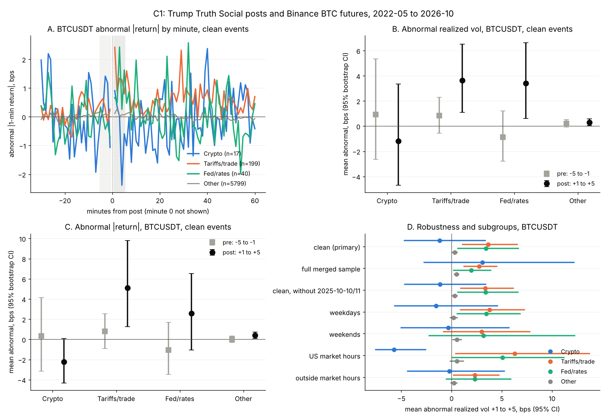

# C1: do Trump's Truth Social posts move crypto markets?

Generated by `research/politics/c1_trump_posts.py analyze`. Design fixed in
`research/politics/PREREGISTRATION.md` before any price data was opened:

- pre-registration sha256 `8a3e0a074749d54a116c4db97b80a46a3bebf771a7a819d782822a47480cbabd`
- posts file sha256 `d3ce5a47062fd0d92dff8dae92f3e616f2386f4b1d378a49eb5d4e40e374cf3c`

## Plain-language conclusion

(to be written after the first run)

## Coverage

- Posts: `posts/truth_realDonaldTrump.csv`, 38,074 posts from 2022-02-14 to 2026-11-17 (original 30,186, quote 308, repost 7,580, reply 0). Kinds come from text patterns; the archive has no reply flag, and posts deleted before 2026-08-20 are probably missing.
- Events (originals and quotes, merged within 5 minutes) inside the price data: 15,075, from 2022-02-14 to 2026-10-31; clean (no earlier event within 60 minutes): 7,331; clean and analysable on BTCUSDT (complete window and 16 controls): 6,055.
- Prices: Binance USDT-M 1-minute klines 2022-02 to 2026-10, SHA-256 checked; BTCUSDT 2,496,960 of 2,496,960 minutes; ETHUSDT 2,496,960 of 2,496,960 minutes; SOLUSDT 2,489,760 of 2,496,960 minutes.
- Placebo pool: 18,687 random minutes with no post within 60 minutes.

### Events per topic

| topic | all events | clean | clean, analysed |
|---|---|---|---|
| Crypto | 43 | 21 | 17 |
| Tariffs/trade | 429 | 223 | 199 |
| Fed/rates | 99 | 44 | 40 |
| Other | 14,504 | 7,043 | 5,799 |

## Primary result (pre-registered)

BTCUSDT, clean events, minutes +1 to +5 after the post minute. Abnormal = event value minus the mean of 16 same-minute-of-week controls on other weeks with no post within 60 minutes, in basis points. Intervals: 95% bootstrap over events. p: two-sided placebo test against random post times; Holm over the 8 tests.

**Abnormal absolute log return, bps**

| topic | events | mean | 95% CI | median | placebo p | Holm p |
|---|---|---|---|---|---|---|
| Crypto | 17 | -2.23 | [-4.33, 0.08] | -3.70 | 0.434 | 0.869 |
| Tariffs/trade | 199 | 5.10 | [1.28, 9.79] | -1.75 | 0.0002 | 0.002 |
| Fed/rates | 40 | 2.59 | [-1.07, 6.52] | -0.59 | 0.141 | 0.423 |
| Other | 5799 | 0.41 | [0.09, 0.74] | -2.32 | 0.0002 | 0.002 |

**Abnormal realized volatility, bps**

| topic | events | mean | 95% CI | median | placebo p | Holm p |
|---|---|---|---|---|---|---|
| Crypto | 17 | -1.19 | [-4.69, 3.35] | -3.12 | 0.671 | 0.869 |
| Tariffs/trade | 199 | 3.64 | [1.09, 6.53] | -0.79 | 0.0002 | 0.002 |
| Fed/rates | 40 | 3.41 | [0.62, 6.63] | 1.82 | 0.044 | 0.178 |
| Other | 5799 | 0.31 | [0.05, 0.57] | -1.71 | 0.0002 | 0.002 |

### Primary comparison: each topic minus Other

| outcome | topic | difference | 95% CI | permutation p | Holm p |
|---|---|---|---|---|---|
| absret | Crypto | -2.64 | [-4.80, -0.25] | 0.354 | 0.809 |
| absret | Tariffs/trade | 4.69 | [0.87, 9.51] | 0.0001 | 0.0006 |
| absret | Fed/rates | 2.18 | [-1.51, 6.11] | 0.270 | 0.809 |
| rv | Crypto | -1.50 | [-5.03, 3.22] | 0.527 | 0.809 |
| rv | Tariffs/trade | 3.34 | [0.83, 6.28] | 0.0001 | 0.0006 |
| rv | Fed/rates | 3.10 | [0.38, 6.42] | 0.050 | 0.202 |

## Pre-window check (pre-registered)

Same statistics over minutes -5 to -1, and the paired difference post minus pre. If the pre-window is as elevated as the post-window, the posts are reacting to moves already under way.

**absret, minutes -5 to -1**

| topic | events | mean | 95% CI | median | placebo p |
|---|---|---|---|---|---|
| Crypto | 17 | 0.34 | [-3.13, 4.13] | -2.04 | 0.755 |
| Tariffs/trade | 199 | 0.79 | [-0.89, 2.55] | -1.80 | 0.300 |
| Fed/rates | 40 | -1.04 | [-3.45, 1.69] | -2.37 | 0.645 |
| Other | 5799 | 0.02 | [-0.30, 0.35] | -2.36 | 0.437 |

| topic | post minus pre | 95% CI |
|---|---|---|
| Crypto | -2.56 | [-7.07, 2.04] |
| Tariffs/trade | 4.31 | [0.29, 9.18] |
| Fed/rates | 3.62 | [-0.35, 7.63] |
| Other | 0.39 | [-0.01, 0.78] |

**rv, minutes -5 to -1**

| topic | events | mean | 95% CI | median | placebo p |
|---|---|---|---|---|---|
| Crypto | 17 | 0.92 | [-2.64, 5.36] | -0.96 | 0.578 |
| Tariffs/trade | 199 | 0.83 | [-0.55, 2.30] | -1.61 | 0.245 |
| Fed/rates | 40 | -0.86 | [-2.80, 1.22] | -1.48 | 0.620 |
| Other | 5799 | 0.21 | [-0.08, 0.53] | -1.84 | 0.048 |

| topic | post minus pre | 95% CI |
|---|---|---|
| Crypto | -2.11 | [-8.16, 4.13] |
| Tariffs/trade | 2.81 | [0.56, 5.38] |
| Fed/rates | 4.27 | [1.56, 7.19] |
| Other | 0.10 | [-0.19, 0.37] |

## Robustness and subgroups (pre-registered, secondary)

BTCUSDT abnormal realized volatility and absolute return, +1 to +5, mean [95% CI] (placebo p). Subgroup placebos are drawn from pool minutes in the same subgroup.

| sample | outcome | Crypto | Tariffs/trade | Fed/rates | Other |
|---|---|---|---|---|---|
| full merged sample | rv | 3.05 [-2.73, 12.16] (p 0.071, n 36) | 2.75 [1.25, 4.50] (p 0.0002, n 372) | 1.95 [0.20, 3.90] (p 0.065, n 86) | 0.48 [0.27, 0.70] (p 0.0002, n 11639) |
| full merged sample | absret | 3.40 [-1.56, 10.94] (p 0.080, n 36) | 3.74 [1.43, 6.57] (p 0.0002, n 372) | 0.65 [-1.52, 3.02] (p 0.478, n 86) | 0.48 [0.24, 0.74] (p 0.0002, n 11639) |
| clean, without 2025-10-10/11 | rv | -1.16 [-4.65, 3.38] (p 0.693, n 17) | 3.34 [0.92, 6.15] (p 0.0002, n 197) | 3.40 [0.62, 6.62] (p 0.042, n 40) | 0.32 [0.06, 0.57] (p 0.0002, n 5793) |
| clean, without 2025-10-10/11 | absret | -2.22 [-4.32, 0.09] (p 0.444, n 17) | 4.43 [0.82, 9.20] (p 0.0002, n 197) | 2.60 [-1.05, 6.52] (p 0.138, n 40) | 0.42 [0.10, 0.75] (p 0.0002, n 5793) |
| weekdays | rv | -1.55 [-5.65, 4.57] (p 0.676, n 12) | 3.79 [0.87, 7.23] (p 0.0006, n 163) | 3.47 [0.58, 6.83] (p 0.075, n 32) | 0.21 [-0.10, 0.55] (p 0.011, n 4164) |
| weekdays | absret | -1.45 [-4.17, 1.51] (p 0.786, n 12) | 5.13 [0.82, 10.81] (p 0.0002, n 163) | 2.47 [-1.62, 6.90] (p 0.234, n 32) | 0.37 [-0.04, 0.79] (p 0.0010, n 4164) |
| weekends | rv | -0.35 [-5.00, 5.71] (p 0.933, n 5) | 2.99 [-0.80, 7.76] (p 0.017, n 36) | 3.16 [-2.24, 12.26] (p 0.177, n 8) | 0.54 [0.14, 0.95] (p 0.0002, n 1635) |
| weekends | absret | -4.08 [-6.77, -1.39] (p 0.157, n 5) | 4.95 [-0.56, 13.51] (p 0.001, n 36) | 3.06 [-2.44, 11.76] (p 0.218, n 8) | 0.53 [0.05, 1.02] (p 0.0002, n 1635) |
| US market hours | rv | -5.73 [-7.56, -2.56] (p 0.365, n 3) | 6.26 [0.40, 13.70] (p 0.0004, n 67) | 5.05 [0.06, 11.18] (p 0.102, n 16) | 0.51 [-0.11, 1.16] (p 0.0006, n 1441) |
| US market hours | absret | -2.09 [-7.40, 2.67] (p 0.927, n 3) | 7.78 [-0.48, 20.33] (p 0.002, n 67) | 5.70 [-0.81, 12.48] (p 0.180, n 16) | 0.46 [-0.35, 1.30] (p 0.251, n 1441) |
| outside market hours | rv | -0.22 [-4.36, 5.26] (p 0.905, n 14) | 2.31 [0.20, 4.72] (p 0.016, n 132) | 2.31 [-0.51, 5.89] (p 0.184, n 24) | 0.24 [-0.03, 0.51] (p 0.004, n 4358) |
| outside market hours | absret | -2.26 [-4.70, 0.42] (p 0.450, n 14) | 3.74 [0.52, 7.57] (p 0.0006, n 132) | 0.51 [-3.53, 5.11] (p 0.655, n 24) | 0.40 [0.07, 0.74] (p 0.0002, n 4358) |
| pre5, without 2025-10-10/11 | rv | 1.07 [-2.47, 5.47] (p 0.529, n 17) | 1.01 [-0.39, 2.51] (p 0.173, n 197) | -0.85 [-2.78, 1.21] (p 0.642, n 40) | 0.22 [-0.07, 0.53] (p 0.037, n 5793) |
| pre5, without 2025-10-10/11 | absret | 0.60 [-2.79, 4.36] (p 0.687, n 17) | 0.91 [-0.77, 2.71] (p 0.258, n 197) | -1.09 [-3.54, 1.66] (p 0.646, n 40) | 0.02 [-0.29, 0.35] (p 0.421, n 5793) |

## Secondary outcomes (pre-registered, descriptive)

Clean events, mean abnormal [95% CI] (placebo p). Units: bps for absret, rv and ret; log points for logvol; imbalance in [-1, 1].

| symbol | window | outcome | Crypto | Tariffs/trade | Fed/rates | Other |
|---|---|---|---|---|---|---|
| BTCUSDT | post15 | absret | -4.35 [-7.81, -0.75] (p 0.360) | 4.22 [-0.43, 10.20] (p 0.011) | 4.46 [-0.23, 9.75] (p 0.179) | 0.09 [-0.45, 0.64] (p 0.365) |
| BTCUSDT | post15 | rv | -2.29 [-6.67, 2.16] (p 0.585) | 3.85 [0.69, 7.39] (p 0.003) | 3.83 [0.11, 7.90] (p 0.138) | 0.16 [-0.24, 0.58] (p 0.083) |
| BTCUSDT | post60 | absret | -2.53 [-14.64, 10.06] (p 0.932) | 2.24 [-5.32, 11.19] (p 0.324) | -5.74 [-12.77, 2.48] (p 0.399) | -0.03 [-1.09, 1.04] (p 0.252) |
| BTCUSDT | post60 | rv | -2.26 [-9.21, 4.79] (p 0.889) | 7.48 [0.45, 17.11] (p 0.0006) | 2.04 [-4.03, 8.72] (p 0.504) | -0.18 [-0.93, 0.59] (p 0.286) |
| BTCUSDT | post5 | logvol | -0.147 [-0.366, 0.099] (p 0.469) | 0.205 [0.064, 0.348] (p 0.0004) | 0.229 [-0.048, 0.501] (p 0.083) | 0.029 [0.007, 0.052] (p 0.001) |
| BTCUSDT | post15 | logvol | -0.113 [-0.281, 0.066] (p 0.531) | 0.112 [-0.012, 0.239] (p 0.051) | 0.229 [-0.002, 0.462] (p 0.061) | 0.018 [-0.002, 0.039] (p 0.100) |
| BTCUSDT | post60 | logvol | -0.060 [-0.273, 0.159] (p 0.718) | 0.069 [-0.036, 0.177] (p 0.142) | 0.136 [-0.063, 0.333] (p 0.200) | 0.007 [-0.010, 0.024] (p 0.323) |
| BTCUSDT | post5 | imb | -0.017 [-0.138, 0.099] (p 0.769) | 0.007 [-0.028, 0.044] (p 0.706) | 0.020 [-0.063, 0.104] (p 0.635) | -0.000 [-0.006, 0.006] (p 0.777) |
| BTCUSDT | pre5 | logvol | 0.203 [-0.157, 0.559] (p 0.351) | 0.069 [-0.052, 0.191] (p 0.307) | 0.015 [-0.245, 0.277] (p 0.942) | 0.016 [-0.007, 0.038] (p 0.393) |
| ETHUSDT | post5 | absret | -3.89 [-7.91, 0.63] (p 0.265) | 6.34 [1.32, 12.41] (p 0.0004) | 6.32 [-0.19, 14.01] (p 0.024) | 0.46 [0.04, 0.89] (p 0.0004) |
| ETHUSDT | post5 | rv | -2.68 [-8.38, 3.75] (p 0.384) | 4.75 [1.05, 9.04] (p 0.0008) | 7.31 [2.04, 14.03] (p 0.012) | 0.41 [0.07, 0.76] (p 0.0002) |
| ETHUSDT | post5 | logvol | 0.148 [-0.079, 0.392] (p 0.455) | 0.186 [0.042, 0.334] (p 0.002) | 0.289 [0.030, 0.569] (p 0.028) | 0.045 [0.022, 0.068] (p 0.0002) |
| ETHUSDT | pre5 | rv | 0.87 [-5.41, 9.88] (p 0.622) | 1.43 [-0.91, 4.03] (p 0.107) | 1.15 [-2.09, 4.58] (p 0.444) | 0.40 [0.03, 0.79] (p 0.0002) |
| SOLUSDT | post5 | absret | -6.24 [-11.03, -1.03] (p 0.214) | 4.58 [-0.48, 10.68] (p 0.009) | 6.10 [-0.75, 14.70] (p 0.095) | 0.23 [-0.38, 0.86] (p 0.027) |
| SOLUSDT | post5 | rv | -2.18 [-7.65, 4.06] (p 0.741) | 3.47 [0.05, 7.33] (p 0.045) | 6.09 [0.49, 13.75] (p 0.087) | 0.44 [-0.08, 0.97] (p 0.005) |
| SOLUSDT | post5 | logvol | -0.228 [-0.519, 0.072] (p 0.254) | 0.137 [0.006, 0.267] (p 0.016) | 0.186 [-0.049, 0.431] (p 0.158) | 0.037 [0.015, 0.059] (p 0.0002) |
| SOLUSDT | pre5 | rv | -0.37 [-5.78, 5.26] (p 0.878) | 0.23 [-2.05, 2.72] (p 0.694) | -0.59 [-3.52, 2.61] (p 0.981) | 0.07 [-0.45, 0.63] (p 0.298) |

**Signed abnormal return after crypto posts** (no tone coding, so positive and negative posts can cancel):

| symbol | window | events | mean, bps | 95% CI | placebo p |
|---|---|---|---|---|---|
| BTCUSDT | post5 | 17 | 3.01 | [-2.14, 8.55] | 0.348 |
| BTCUSDT | post15 | 17 | 1.95 | [-8.22, 13.59] | 0.764 |
| BTCUSDT | post60 | 17 | 6.53 | [-10.53, 24.44] | 0.594 |
| ETHUSDT | post5 | 17 | 1.42 | [-5.88, 8.81] | 0.717 |
| ETHUSDT | post15 | 17 | 1.28 | [-13.96, 17.12] | 0.883 |
| ETHUSDT | post60 | 17 | 11.39 | [-15.16, 39.58] | 0.501 |
| SOLUSDT | post5 | 17 | -4.05 | [-11.88, 4.16] | 0.547 |
| SOLUSDT | post15 | 17 | -8.45 | [-24.56, 6.36] | 0.447 |
| SOLUSDT | post60 | 17 | 3.15 | [-41.21, 43.95] | 0.917 |

**Stacked check** (per-minute |r|, minutes -5..-1 and +1..+5, event and its 16 controls; window and event-by-minute fixed effects; errors clustered by event; `e5_stacked_events.stacked_did`): coefficient on real window x post minute, bps per minute.

| topic | b | 95% CI | p | clusters |
|---|---|---|---|---|
| Crypto | -0.67 | [-3.17, 1.84] | 0.580 | 17 |
| Tariffs/trade | 1.05 | [0.10, 2.00] | 0.031 | 199 |
| Fed/rates | 1.30 | [0.31, 2.29] | 0.012 | 40 |
| Other | 0.02 | [-0.08, 0.13] | 0.654 | 5799 |

## Exploratory (not in the pre-registration)

Share of clean events whose abnormal realized volatility (+1 to +5) is above the 95th percentile of the placebo pool (5% expected under no effect): Crypto 5.9%, Tariffs/trade 13.1%, Fed/rates 7.5%, Other 6.7%.

## Key named events: illustrations, not tests

Chosen because they are famous, which selects on the outcome. BTCUSDT abnormal values in bps; pctl = percentile of the +1 to +5 abnormal realized volatility within the placebo pool. Status says whether the post is a clean event in the tested sample.

| event | UTC | kind / topic | status | BTC pre rv | BTC +1..+5 rv | pctl | BTC +1..+5 ret | BTC +1..+60 ret | SOL +1..+60 ret |
|---|---|---|---|---|---|---|---|---|---|
| Open minded to crypto companies | 2024-05-25 19:13 | original / crypto | clean event | n/a | n/a | 0 | n/a | n/a | n/a |
| Thank you, Bitcoin 2024 | 2024-07-27 21:20 | original / crypto | clean event | n/a | n/a | 0 | n/a | n/a | n/a |
| World Liberty Financial promoted | 2024-09-30 15:11 | original / crypto | event, not clean | -8.4 | -9.6 | 6 | 29.9 | -26.9 | -116.2 |
| Atkins nominated to SEC | 2024-12-04 17:47 | original / crypto | event, not clean | n/a | n/a | 0 | n/a | n/a | n/a |
| Congratulations Bitcoiners $100,000 | 2024-12-05 12:55 | original / other | clean event | 5.5 | 4.1 | 81 | -15.6 | -10.0 | -67.1 |
| Sacks named crypto czar | 2024-12-06 00:50 | original / crypto | event, not clean | 4.5 | 4.7 | 83 | 36.7 | 143.9 | 317.3 |
| $TRUMP memecoin launch | 2025-01-18 02:00 | original / crypto | event, not clean | -5.0 | -4.5 | 28 | 9.7 | -4.0 | 131.3 |
| $MELANIA re-truth (repost) | 2025-01-19 21:22 | repost / crypto | not an event | 6.8 | 30.5 | 99 | -76.4 | -210.0 | -821.6 |
| Crypto reserve: XRP, SOL, ADA | 2025-03-02 15:24 | original / crypto | event, not clean | 5.9 | 141.1 | 100 | 122.9 | 416.6 | 1598.2 |
| Reserve follow-up: BTC and ETH | 2025-03-02 17:11 | repost / crypto | not an event | 39.5 | 31.1 | 99 | 46.5 | 225.2 | -118.1 |
| Great time to buy | 2025-04-09 13:37 | original / other | merged into earlier event | 33.2 | 59.6 | 100 | 78.4 | 102.0 | 191.8 |
| 90-day tariff pause | 2025-04-09 17:18 | original / tariffs | clean event | 15.9 | 170.0 | 100 | 352.5 | 618.2 | 1015.7 |
| Senate passes GENIUS Act | 2025-06-19 00:01 | original / crypto | clean event | 1.0 | -8.4 | 8 | -4.5 | -10.1 | 1.9 |
| Happy crypto week | 2025-07-15 15:29 | original / crypto | event, not clean | -7.3 | -3.4 | 37 | 5.4 | 22.1 | 39.4 |
| GENIUS Act signed | 2025-07-18 23:53 | original / crypto | clean event | -2.9 | -3.1 | 39 | 0.6 | -8.0 | -69.6 |
| China 'very strange things' | 2025-10-10 14:57 | original / tariffs | clean event | -17.4 | 0.8 | 68 | -46.8 | -169.3 | -498.1 |
| 100% tariff on China | 2025-10-10 20:50 | original / tariffs | clean event | -3.2 | 80.8 | 100 | -136.7 | -338.2 | -754.3 |
| Banks and the GENIUS Act | 2026-03-03 22:02 | original / crypto | clean event | -2.3 | 28.6 | 99 | 19.6 | 22.3 | 103.7 |
| Gensler and the Anti-Crypto Army | 2026-05-27 22:42 | original / crypto | clean event | -8.6 | 0.1 | 63 | -11.4 | -30.2 | -44.0 |
| Pass the CLARITY Act | 2026-07-13 14:26 | original / crypto | event, not clean | n/a | n/a | 0 | n/a | n/a | n/a |

## Caveats

- Topic keywords are crude: content in images, videos and links is invisible, and 'powell' or 'reciprocal' can be off-topic. Media-only posts are 'other'.
- The archive probably lacks posts deleted before 2026-08-20, and kinds are inferred from text; there is no reply flag.
- Times are when Truth Social stored the post; markets learn of it seconds to minutes later through alert accounts and wires, which is why minute 0 is skipped and +15 and +60 are reported.
- Clean events exclude posting bursts, so the sample under-represents the busiest moments; the full merged sample is shown as a check.
- Futures only (no spot cross-check), no equity-market factor, and no exclusion of scheduled macro releases (FOMC, CPI), which can coincide with Fed posts.
- Abnormal means of absolute moves are dominated by a few large events; medians are shown, and 2025-10-10 is dropped as a check.

