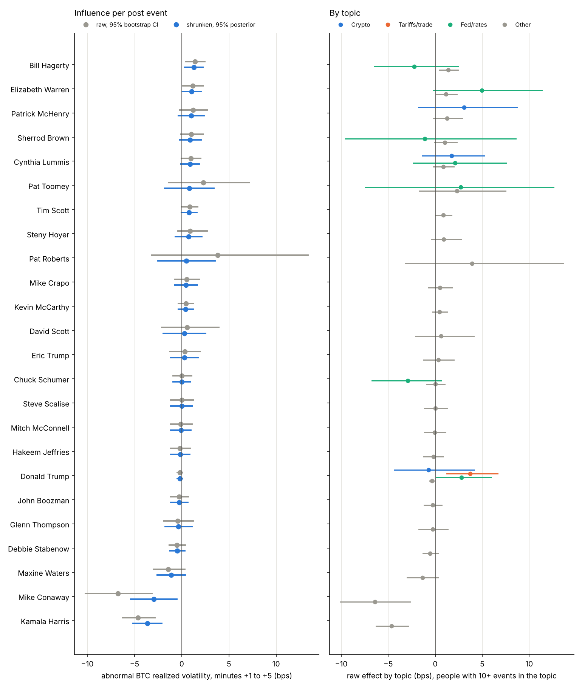

# C2: which politicians move crypto the most?

Generated by `research/politics/c2_ranking.py report` from `c2_ranking.json` (analysis run 2026-11-18T05:26:20Z). Design fixed in `research/politics/PREREGISTRATION_RANKING.md` before any X post file existed:

- pre-registration sha256 `41ef1cf1fd1af1479572d06061894a5d58d91f949ec39cf516aeb01c905a22e7`
- addendum `PREREGISTRATION_ADDENDUM_CONGRESS.md` sha256 `f8d6b1e0b03d664a4074a896a64feb847cdf30910aaf7173e2efee9c28c3210f`
- `posts/truth_realDonaldTrump.csv` (Donald Trump, trump_family) sha256 `d3ce5a47062fd0d92dff8dae92f3e616f2386f4b1d378a49eb5d4e40e374cf3c`
- `posts/x_BillHagertyTN.csv` (Bill Hagerty, republicans) sha256 `4b1190251c5dfe47e2fc10b9deea73ee02368fd24e9997033912e2d35d82bd6d`
- `posts/x_Boozman4AR.csv` (John Boozman, republicans) sha256 `a4bbfcb52d39035b28148199f18456e45a34411e11fd7cd7c1df15328ba70a8e`
- `posts/x_ConawayTX11.csv` (Mike Conaway, republicans) sha256 `09f7e365c418dd55280fa559430ee0b249ac414af82ec7876fd9f26099b90779`
- `posts/x_CongressmanGT.csv` (Glenn Thompson, republicans) sha256 `ed13655adbcddd9fa6bb23dbc42803034ba95788093418f4a1e5bd3099e7267c`
- `posts/x_CynthiaMLummis.csv` (Cynthia Lummis, republicans) sha256 `47643e523737803cd45a603b07bedf54487fc2691acbb62f664223a2cd83622c`
- `posts/x_Electdavidscott.csv` (David Scott, democrats) sha256 `5859991aad96ebb4669b20830344c84363f312f58fb3a7baa6ec8fc23c21b1da`
- `posts/x_EricTrump.csv` (Eric Trump, trump_family) sha256 `e290519d298a000a751bd4e144cdc27c1a0ecdd22a131e80473b66bdab9a13ca`
- `posts/x_GOPLeader.csv` (Kevin McCarthy, republicans) sha256 `193fe558aab131ab2b0af9a10fa27c6f4630be91bf9ed614894952326b750690`
- `posts/x_GT_TeamGT.csv` (Glenn Thompson, republicans) sha256 `9627436d586a1759582c17bc034c22021cf8d31fcafd5b648aa2daf76df56718`
- `posts/x_JohnBoozman.csv` (John Boozman, republicans) sha256 `dbea4cab65eb0c0377075983855058d8dead928e6e1715f2bd249ab72bcbdf38`
- `posts/x_KamalaHarris.csv` (Kamala Harris, democrats) sha256 `e22e7debf41f5c79b440983af157042904abfd473bc3d05cf7cc47d9e34aaae0`
- `posts/x_LeaderHoyer.csv` (Steny Hoyer, democrats) sha256 `09b1e9a2be7f23e7298620adf8c37e5128d66d4f7a80f8635d95073649e112de`
- `posts/x_LeaderMcConnell.csv` (Mitch McConnell, republicans) sha256 `540345012cfcc4338ee28585555e058b18b5fda7b8a5f73922064952756d8bbb`
- `posts/x_MaxineWaters.csv` (Maxine Waters, democrats) sha256 `4810373024697fa5b44f9432ab0473369be72b3147ac7efc42a0cd847fb8f02b`
- `posts/x_McConnellPress.csv` (Mitch McConnell, republicans) sha256 `3f309bdc8b70f43e9d27e6973fbaf6738264d6d3acea0e3b55927d4a5ee459a4`
- `posts/x_McHenryCampaign.csv` (Patrick McHenry, republicans) sha256 `7ea68163ffa951a8e04b497e3ae61d6a9c561181c39c317ef229bdc024518799`
- `posts/x_MikeCrapo.csv` (Mike Crapo, republicans) sha256 `817b750476c2cd85b521a6407a04c1c01dfe438197add5f1e96eb7103e8a6106`
- `posts/x_PatRoberts.csv` (Pat Roberts, republicans) sha256 `9b806fcf03929e097ae9afd860c3816e626263836997289c88f3567fcf01361c`
- `posts/x_PatToomey.csv` (Pat Toomey, republicans) sha256 `d7c71bbcf2785bad0d5273f880957f0dcbb44fd8567b716977c6fd92528fd852`
- `posts/x_PatrickMcHenry.csv` (Patrick McHenry, republicans) sha256 `ea9de8d9464ade604f9d8b2474f6e72d2d08324ce3d6dd4c21851a4126082106`
- `posts/x_RepJeffries.csv` (Hakeem Jeffries, democrats) sha256 `522da0622509d2d63a6b14ab7f63ae90469afffeb8636045e13f8421d4d6b3fa`
- `posts/x_RepMaxineWaters.csv` (Maxine Waters, democrats) sha256 `c6cf18deebab9dfb8d76175b26c776af47023056e5707813b6eb03189f6f9c98`
- `posts/x_SRCC.csv` (Mitch McConnell, republicans) sha256 `0372eed1c58bbcd56d992920d8a1de3c18aa89ca09c2a6b43bc99af64c8082be`
- `posts/x_SenLummis.csv` (Cynthia Lummis, republicans) sha256 `c72eaeb4d664dd787813dbdecb1a20fde9bb0f282c52cce7926147f0d641629f`
- `posts/x_SenPatRoberts.csv` (Pat Roberts, republicans) sha256 `b9220043f5ecbb689742e94a0b623ad4b06e1f52da2af183af25c362f1403701`
- `posts/x_SenSchumer.csv` (Chuck Schumer, democrats) sha256 `0067f6a2c18f5e5a6e0c1a0acddadacb51db692c974fa2040a745d8b03a6dfdd`
- `posts/x_SenSherrodBrown.csv` (Sherrod Brown, democrats) sha256 `6d39543db8268be60a0b989fe0583ef56efaa9b63500d7a257f54f5272b3c57e`
- `posts/x_SenStabenow.csv` (Debbie Stabenow, democrats) sha256 `7a090e7874862374254d639aec2cd7d5aa2190e8eb8d74eecc5daa91a58f59f9`
- `posts/x_SenToomey.csv` (Pat Toomey, republicans) sha256 `6475ee3e3adb645aa17c5218a4b8fa27102572cc6b440c266088d52dbb05072d`
- `posts/x_SenWarren.csv` (Elizabeth Warren, democrats) sha256 `bc5b05112bb1239bccf4e0237057770b82ac579eedd19e2722375e40fc7032d0`
- `posts/x_SenatorHagerty.csv` (Bill Hagerty, republicans) sha256 `21f78dd5b739be4ff3839c1cb17f58c0c1b894b93806237366c72850945a7e04`
- `posts/x_SenatorTimScott.csv` (Tim Scott, republicans) sha256 `d1a86b2a20950345e8b972024550ce13a6e76168e1f64fb5e227e3ae7d3fdaa1`
- `posts/x_SherrodBrown.csv` (Sherrod Brown, democrats) sha256 `494e838b6984687685eeebf3792e5d88ebb821b54ffebc5ab99fdc5ba67903d7`
- `posts/x_StenyHoyer.csv` (Steny Hoyer, democrats) sha256 `374d7e02c07b21db587be0fe3e6c3c5616f7006a69026c44ab74752cc55c8ee0`
- `posts/x_SteveScalise.csv` (Steve Scalise, republicans) sha256 `cf6e3ae9c7fd90dd80f0ca83f62b19cf1df06e8e37ccb7a7300de2657bd6685f`
- `posts/x_SteveScaliseGOP.csv` (Steve Scalise, republicans) sha256 `0eadad9a1ac427c7d51f51e5a9a16f92334967b276de40592405143c4ff0c75a`
- `posts/x_Team_Mitch.csv` (Mitch McConnell, republicans) sha256 `c7fdcf7eb6904851b7a9d6b8730305105e39d9472a5a974c4824583a26d83970`
- `posts/x_TimScottSC.csv` (Tim Scott, republicans) sha256 `85827ba73c00e6b35489d364eb21f4f49f3c1d3d3e76fd85b0a53f397044851a`
- `posts/x_chuckschumer.csv` (Chuck Schumer, democrats) sha256 `dda888269d0063f855fe051efd26a602c6af2cc9053a1ce39debdfe3bba2b65f`
- `posts/x_crapoforsenate.csv` (Mike Crapo, republicans) sha256 `3ad5e588db24f045d6ead8bb3f6897af7a395ff189d29e5585841d24f7a41735`
- `posts/x_ewarren.csv` (Elizabeth Warren, democrats) sha256 `e21f7d1774b0b890608c2c184177d1df30c490a38f57dcfcf82f808beab89ffb`
- `posts/x_hakeemjeffries.csv` (Hakeem Jeffries, democrats) sha256 `8907b7ae6e08da0b7b828afaf39cb4d8e25e5d7bca4a0026f45a97a7f9d92503`
- `posts/x_kevinomccarthy.csv` (Kevin McCarthy, republicans) sha256 `1b4db9497277ee3f84785baaa0cc93813335f1b127e9c2ffead61c18296dd180`
- `posts/x_realDonaldTrump.csv` (Donald Trump, trump_family) sha256 `42c3abaad0aa7e626cd31bc4a6e860a1272d654f1293bf759c8ed8a59c4819a7`
- `posts/x_repdavidscott.csv` (David Scott, democrats) sha256 `d0723fd37d132316eda60cc668061e66a0e4c1a83d81d6ba5ab951dab0082cea`
- `posts/x_stabenow.csv` (Debbie Stabenow, democrats) sha256 `4eb8d01282743bf0a6d5ccf0dc00acb24f96c6598394e59a81957fa03e785821`
- `posts/x_votetimscott.csv` (Tim Scott, republicans) sha256 `e91edc6306dc6b2ba708ebaaed3caaf0201e58361a68f0448f8ddb0184183a36`

## Answer

**Bill Hagerty moves crypto the most of the 24 ranked politicians: about +1.28 bps of extra BTC realized volatility in the 5 minutes after a post (shrunken; raw +1.40 bps, 95% CI 0.45 to 2.44, FDR q 0.005, 1,233 events), rank interval 1 to 11, although the lead is not distinguishable from the next people; the minutes before the posts are elevated too, so the posts may partly react to moves already under way.**

Negative control (Barack Obama): not in the data yet.

## Ranking (pre-registered primary)

Influence = mean abnormal BTCUSDT realized volatility over minutes +1 to +5 per clean, non-overlapping post event, in bps (event minus the mean of 16 same-minute-of-week controls with no post by that person within 60 minutes). Shrunken: empirical-Bayes posterior mean toward the mean of ranked politicians. Rank interval: 2.5th to 97.5th percentile of ranks over 10,000 bootstraps of events within person. q: Benjamini-Hochberg over ranked people on placebo p-values (random post times).

| rank | person | events | shrunken effect [95%] | raw effect [95% CI] | rank interval | placebo p | FDR q |
|---|---|---|---|---|---|---|---|
| 1 | Bill Hagerty | 1,233 | 1.28 [0.33, 2.23] | 1.40 [0.45, 2.44] | 1 to 11 | 0.0004 | 0.005 |
| 2 | Elizabeth Warren | 1,187 | 1.05 [0.04, 2.06] | 1.16 [0.14, 2.28] | 1 to 13 | 0.001 | 0.011 |
| 3 | Patrick McHenry | 646 | 1.00 [-0.36, 2.35] | 1.21 [-0.22, 2.74] | 1 to 16 | 0.017 | 0.068 |
| 4 | Sherrod Brown | 783 | 0.90 [-0.22, 2.03] | 1.03 [-0.11, 2.29] | 1 to 16 | 0.055 | 0.132 |
| 5 | Cynthia Lummis | 770 | 0.87 [-0.12, 1.86] | 0.96 [-0.05, 2.00] | 1 to 15 | 0.112 | 0.224 |
| 6 | Pat Toomey | 246 | 0.82 [-1.78, 3.42] | 2.28 [-1.39, 7.16] | 1 to 21 | 0.024 | 0.073 |
| 7 | Tim Scott | 1,402 | 0.78 [-0.03, 1.60] | 0.83 [0.00, 1.70] | 1 to 15 | 0.052 | 0.132 |
| 8 | Steny Hoyer | 1,339 | 0.73 [-0.69, 2.15] | 0.90 [-0.40, 2.70] | 1 to 18 | 0.023 | 0.073 |
| 9 | Pat Roberts | 110 | 0.50 [-2.53, 3.52] | 3.80 [-3.19, 13.37] | 1 to 22 | 0.014 | 0.068 |
| 10 | Mike Crapo | 537 | 0.45 [-0.74, 1.63] | 0.51 [-0.71, 1.83] | 2 to 20 | 0.311 | 0.534 |
| 11 | Kevin McCarthy | 1,185 | 0.42 [-0.36, 1.20] | 0.44 [-0.35, 1.27] | 3 to 18 | 0.423 | 0.591 |
| 12 | David Scott | 293 | 0.29 [-1.94, 2.53] | 0.56 [-2.11, 3.94] | 1 to 22 | 0.468 | 0.591 |
| 13 | Eric Trump | 45 | 0.27 [-1.18, 1.73] | 0.34 [-1.27, 1.98] | 2 to 21 | 0.755 | 0.824 |
| 14 | Chuck Schumer | 1,533 | 0.01 [-0.92, 0.93] | 0.01 [-0.93, 1.03] | 5 to 21 | 0.930 | 0.930 |
| 15 | Steve Scalise | 666 | 0.00 [-1.14, 1.15] | 0.00 [-1.17, 1.27] | 4 to 21 | 0.922 | 0.930 |
| 16 | Mitch McConnell | 964 | -0.09 [-1.15, 0.98] | -0.10 [-1.17, 1.07] | 5 to 21 | 0.612 | 0.734 |
| 17 | Hakeem Jeffries | 1,136 | -0.16 [-1.16, 0.85] | -0.17 [-1.20, 0.90] | 6 to 22 | 0.705 | 0.806 |
| 18 | Donald Trump | 6,352 | -0.20 [-0.46, 0.06] | -0.20 [-0.47, 0.07] | 12 to 20 | 0.079 | 0.172 |
| 19 | John Boozman | 997 | -0.26 [-1.17, 0.66] | -0.28 [-1.18, 0.70] | 8 to 22 | 0.386 | 0.579 |
| 20 | Glenn Thompson | 432 | -0.34 [-1.75, 1.07] | -0.42 [-1.91, 1.21] | 5 to 22 | 0.454 | 0.591 |
| 21 | Debbie Stabenow | 1,358 | -0.48 [-1.27, 0.31] | -0.51 [-1.30, 0.35] | 11 to 22 | 0.343 | 0.548 |
| 22 | Maxine Waters | 165 | -1.12 [-2.60, 0.36] | -1.41 [-3.00, 0.32] | 12 to 23 | 0.131 | 0.242 |
| 23 | Mike Conaway | 18 | -2.96 [-5.38, -0.53] | -6.74 [-10.18, -3.14] | 22 to 24 | 0.003 | 0.020 |
| 24 | Kamala Harris | 526 | -3.64 [-5.15, -2.13] | -4.65 [-6.28, -2.84] | 23 to 24 | 0.0002 | 0.005 |

Prior (method of moments over 24 people): mean 0.01 bps, tau^2 2.738.

### Without 2025-10-10/11

| rank | person | events | shrunken effect [95%] | raw effect [95% CI] | rank interval | placebo p | FDR q |
|---|---|---|---|---|---|---|---|
| 1 | Bill Hagerty | 1,233 | 1.28 [0.33, 2.23] | 1.40 [0.45, 2.44] | 1 to 11 | 0.0006 | 0.007 |
| 2 | Elizabeth Warren | 1,187 | 1.05 [0.04, 2.06] | 1.16 [0.14, 2.28] | 1 to 13 | 0.001 | 0.010 |
| 3 | Patrick McHenry | 646 | 1.00 [-0.36, 2.35] | 1.21 [-0.22, 2.74] | 1 to 16 | 0.018 | 0.065 |
| 4 | Sherrod Brown | 783 | 0.90 [-0.22, 2.03] | 1.03 [-0.11, 2.29] | 1 to 16 | 0.053 | 0.141 |
| 5 | Cynthia Lummis | 770 | 0.87 [-0.12, 1.86] | 0.96 [-0.05, 2.00] | 1 to 15 | 0.115 | 0.230 |
| 6 | Pat Toomey | 246 | 0.82 [-1.78, 3.42] | 2.28 [-1.39, 7.16] | 1 to 21 | 0.019 | 0.065 |
| 7 | Tim Scott | 1,402 | 0.78 [-0.03, 1.60] | 0.83 [0.00, 1.70] | 1 to 15 | 0.064 | 0.153 |
| 8 | Steny Hoyer | 1,339 | 0.73 [-0.69, 2.15] | 0.90 [-0.40, 2.70] | 1 to 18 | 0.023 | 0.068 |
| 9 | Pat Roberts | 110 | 0.50 [-2.53, 3.52] | 3.80 [-3.19, 13.37] | 1 to 22 | 0.017 | 0.065 |
| 10 | Mike Crapo | 537 | 0.45 [-0.74, 1.63] | 0.51 [-0.71, 1.83] | 2 to 20 | 0.318 | 0.544 |
| 11 | Kevin McCarthy | 1,185 | 0.42 [-0.36, 1.20] | 0.44 [-0.35, 1.27] | 3 to 18 | 0.440 | 0.591 |
| 12 | David Scott | 293 | 0.29 [-1.94, 2.53] | 0.56 [-2.11, 3.94] | 1 to 22 | 0.465 | 0.591 |
| 13 | Eric Trump | 45 | 0.27 [-1.18, 1.73] | 0.34 [-1.27, 1.98] | 2 to 21 | 0.733 | 0.800 |
| 14 | Chuck Schumer | 1,533 | 0.01 [-0.92, 0.93] | 0.01 [-0.93, 1.03] | 5 to 21 | 0.928 | 0.937 |
| 15 | Steve Scalise | 666 | 0.00 [-1.14, 1.15] | 0.00 [-1.17, 1.27] | 4 to 21 | 0.937 | 0.937 |
| 16 | Mitch McConnell | 964 | -0.09 [-1.15, 0.98] | -0.10 [-1.17, 1.07] | 5 to 21 | 0.613 | 0.736 |
| 17 | Hakeem Jeffries | 1,136 | -0.16 [-1.16, 0.85] | -0.17 [-1.20, 0.90] | 6 to 22 | 0.717 | 0.800 |
| 18 | Donald Trump | 6,344 | -0.20 [-0.46, 0.06] | -0.20 [-0.46, 0.06] | 12 to 20 | 0.086 | 0.188 |
| 19 | John Boozman | 997 | -0.26 [-1.17, 0.66] | -0.28 [-1.18, 0.70] | 8 to 22 | 0.367 | 0.550 |
| 20 | Glenn Thompson | 432 | -0.34 [-1.75, 1.07] | -0.42 [-1.91, 1.21] | 6 to 22 | 0.468 | 0.591 |
| 21 | Debbie Stabenow | 1,358 | -0.48 [-1.27, 0.31] | -0.51 [-1.30, 0.35] | 11 to 22 | 0.345 | 0.550 |
| 22 | Maxine Waters | 165 | -1.12 [-2.60, 0.36] | -1.41 [-3.00, 0.32] | 13 to 23 | 0.128 | 0.236 |
| 23 | Mike Conaway | 18 | -2.96 [-5.38, -0.53] | -6.74 [-10.18, -3.14] | 22 to 24 | 0.003 | 0.018 |
| 24 | Kamala Harris | 526 | -3.64 [-5.15, -2.13] | -4.65 [-6.28, -2.84] | 23 to 24 | 0.0002 | 0.005 |

Prior (method of moments over 24 people): mean 0.01 bps, tau^2 2.738.

## Musk (reported separately, not ranked)

No Musk post file yet.

## Per topic (pre-registered, secondary)

Same statistics within each topic; shrinkage, ranks and q among people with at least 10 analysable clean events in that topic.

| topic | person | events | raw [95% CI] | shrunken | rank interval | placebo p | q (within topic) |
|---|---|---|---|---|---|---|---|
| Crypto | Cynthia Lummis | 73 | 1.73 [-1.41, 5.25] | 1.27 | 1 to 3 | 0.229 | 0.451 |
| Crypto | Donald Trump | 16 | -0.73 [-4.36, 4.17] | 1.27 | 1 to 3 | 0.906 | 0.906 |
| Crypto | Patrick McHenry | 12 | 3.07 [-1.80, 8.69] | 1.27 | 1 to 3 | 0.301 | 0.451 |
| Crypto | Bill Hagerty | 6 | 1.20 (not ranked) | | | | |
| Crypto | Debbie Stabenow | 1 | 11.69 (not ranked) | | | | |
| Crypto | Elizabeth Warren | 7 | -2.13 (not ranked) | | | | |
| Crypto | Glenn Thompson | 3 | -15.07 (not ranked) | | | | |
| Crypto | Kevin McCarthy | 3 | -2.05 (not ranked) | | | | |
| Crypto | Pat Toomey | 7 | 6.22 (not ranked) | | | | |
| Crypto | Sherrod Brown | 2 | 6.15 (not ranked) | | | | |
| Tariffs/trade | Donald Trump | 198 | 3.73 [1.21, 6.65] | 3.73 | 1 to 1 | 0.003 | 0.003 |
| Tariffs/trade | Bill Hagerty | 8 | 6.86 (not ranked) | | | | |
| Tariffs/trade | Chuck Schumer | 1 | -3.61 (not ranked) | | | | |
| Tariffs/trade | Debbie Stabenow | 1 | -10.02 (not ranked) | | | | |
| Tariffs/trade | Elizabeth Warren | 6 | -2.91 (not ranked) | | | | |
| Tariffs/trade | Glenn Thompson | 2 | -8.83 (not ranked) | | | | |
| Tariffs/trade | Kevin McCarthy | 2 | -10.97 (not ranked) | | | | |
| Tariffs/trade | Mike Crapo | 4 | -11.34 (not ranked) | | | | |
| Tariffs/trade | Pat Roberts | 1 | -9.03 (not ranked) | | | | |
| Tariffs/trade | Pat Toomey | 3 | -8.96 (not ranked) | | | | |
| Tariffs/trade | Patrick McHenry | 6 | -4.98 (not ranked) | | | | |
| Tariffs/trade | Sherrod Brown | 5 | 2.41 (not ranked) | | | | |
| Tariffs/trade | Steny Hoyer | 1 | -7.72 (not ranked) | | | | |
| Tariffs/trade | Steve Scalise | 1 | 0.51 (not ranked) | | | | |
| Fed/rates | Bill Hagerty | 12 | -2.25 [-6.49, 2.49] | 0.85 | 1 to 7 | 0.495 | 0.578 |
| Fed/rates | Chuck Schumer | 10 | -2.92 [-6.72, 0.68] | 0.85 | 1 to 7 | 0.408 | 0.571 |
| Fed/rates | Cynthia Lummis | 14 | 2.12 [-2.36, 7.56] | 0.85 | 1 to 6 | 0.389 | 0.571 |
| Fed/rates | Donald Trump | 42 | 2.80 [0.15, 5.95] | 0.85 | 1 to 5 | 0.177 | 0.571 |
| Fed/rates | Elizabeth Warren | 17 | 4.96 [-0.24, 11.35] | 0.85 | 1 to 4 | 0.090 | 0.571 |
| Fed/rates | Pat Toomey | 10 | 2.71 [-7.46, 12.61] | 0.85 | 1 to 6 | 0.364 | 0.571 |
| Fed/rates | Sherrod Brown | 12 | -1.12 [-9.57, 8.57] | 0.85 | 1 to 7 | 0.839 | 0.839 |
| Fed/rates | David Scott | 2 | -6.12 (not ranked) | | | | |
| Fed/rates | Debbie Stabenow | 6 | 3.63 (not ranked) | | | | |
| Fed/rates | Hakeem Jeffries | 1 | 21.33 (not ranked) | | | | |
| Fed/rates | Maxine Waters | 1 | -9.76 (not ranked) | | | | |
| Fed/rates | Mike Conaway | 1 | -12.60 (not ranked) | | | | |
| Fed/rates | Mike Crapo | 5 | 9.73 (not ranked) | | | | |
| Fed/rates | Mitch McConnell | 4 | -4.85 (not ranked) | | | | |
| Fed/rates | Patrick McHenry | 4 | -6.69 (not ranked) | | | | |
| Fed/rates | Steny Hoyer | 1 | -11.68 (not ranked) | | | | |
| Fed/rates | Steve Scalise | 1 | -4.40 (not ranked) | | | | |
| Fed/rates | Tim Scott | 5 | -5.78 (not ranked) | | | | |
| Other | Bill Hagerty | 1,207 | 1.40 [0.43, 2.45] | 1.27 | 1 to 11 | 0.0004 | 0.005 |
| Other | Patrick McHenry | 624 | 1.28 [-0.18, 2.88] | 1.03 | 1 to 16 | 0.013 | 0.050 |
| Other | Elizabeth Warren | 1,157 | 1.15 [0.09, 2.30] | 1.03 | 1 to 14 | 0.0010 | 0.008 |
| Other | Sherrod Brown | 764 | 1.04 [-0.12, 2.32] | 0.90 | 1 to 16 | 0.052 | 0.124 |
| Other | Tim Scott | 1,397 | 0.86 [0.02, 1.73] | 0.80 | 1 to 14 | 0.059 | 0.129 |
| Other | Cynthia Lummis | 683 | 0.85 [-0.23, 2.01] | 0.76 | 1 to 16 | 0.169 | 0.312 |
| Other | Steny Hoyer | 1,337 | 0.91 [-0.40, 2.78] | 0.73 | 1 to 18 | 0.023 | 0.063 |
| Other | Pat Toomey | 226 | 2.29 [-1.68, 7.52] | 0.71 | 1 to 21 | 0.024 | 0.063 |
| Other | Pat Roberts | 109 | 3.92 [-3.17, 13.60] | 0.48 | 1 to 22 | 0.019 | 0.063 |
| Other | Mike Crapo | 528 | 0.52 [-0.74, 1.84] | 0.44 | 2 to 20 | 0.321 | 0.514 |
| Other | Kevin McCarthy | 1,180 | 0.47 [-0.32, 1.29] | 0.44 | 3 to 18 | 0.404 | 0.571 |
| Other | David Scott | 291 | 0.60 [-2.10, 4.10] | 0.31 | 1 to 22 | 0.436 | 0.581 |
| Other | Eric Trump | 45 | 0.34 [-1.27, 1.98] | 0.27 | 2 to 21 | 0.755 | 0.824 |
| Other | Chuck Schumer | 1,522 | 0.03 [-0.91, 1.03] | 0.03 | 5 to 21 | 0.870 | 0.900 |
| Other | Steve Scalise | 664 | 0.01 [-1.16, 1.27] | 0.01 | 4 to 22 | 0.900 | 0.900 |
| Other | Mitch McConnell | 960 | -0.08 [-1.17, 1.10] | -0.07 | 5 to 22 | 0.659 | 0.754 |
| Other | Hakeem Jeffries | 1,135 | -0.19 [-1.25, 0.88] | -0.17 | 6 to 22 | 0.656 | 0.754 |
| Other | Glenn Thompson | 427 | -0.27 [-1.77, 1.35] | -0.21 | 5 to 22 | 0.621 | 0.754 |
| Other | John Boozman | 997 | -0.28 [-1.18, 0.70] | -0.25 | 8 to 22 | 0.386 | 0.571 |
| Other | Donald Trump | 6,096 | -0.35 [-0.61, -0.09] | -0.35 | 14 to 21 | 0.004 | 0.026 |
| Other | Debbie Stabenow | 1,350 | -0.53 [-1.32, 0.33] | -0.49 | 11 to 22 | 0.320 | 0.514 |
| Other | Maxine Waters | 164 | -1.36 [-2.99, 0.36] | -1.05 | 12 to 23 | 0.142 | 0.283 |
| Other | Mike Conaway | 17 | -6.40 [-10.06, -2.69] | -2.53 | 21 to 24 | 0.007 | 0.033 |
| Other | Kamala Harris | 526 | -4.65 [-6.28, -2.84] | -3.56 | 23 to 24 | 0.0002 | 0.005 |

## Pre-window check (pre-registered)

Abnormal BTC realized volatility over minutes -5 to -1, and the paired difference post minus pre. Elevated = pre-window mean above 0 with placebo p < 0.05: the posts may react to moves already under way.

| person | events | pre5 mean [95% CI] | placebo p | post minus pre [95% CI] | elevated |
|---|---|---|---|---|---|
| Bill Hagerty | 1233 | 1.47 [0.62, 2.39] | 0.001 | -0.07 [-0.90, 0.75] | yes |
| Chuck Schumer | 1533 | 0.22 [-0.65, 1.16] | 0.453 | -0.22 [-1.01, 0.61] | no |
| Cynthia Lummis | 770 | 0.93 [-0.15, 2.04] | 0.070 | 0.03 [-0.90, 0.96] | no |
| David Scott | 293 | -0.29 [-2.43, 1.93] | 0.859 | 0.84 [-1.25, 3.36] | no |
| Debbie Stabenow | 1358 | -0.56 [-1.34, 0.29] | 0.148 | 0.05 [-0.69, 0.80] | no |
| Donald Trump | 6352 | -0.37 [-0.66, -0.06] | 0.017 | 0.17 [-0.11, 0.45] | no |
| Elizabeth Warren | 1187 | 0.21 [-0.60, 1.08] | 0.736 | 0.95 [0.09, 1.95] | no |
| Eric Trump | 45 | 0.61 [-1.48, 2.92] | 0.656 | -0.27 [-1.98, 1.48] | no |
| Glenn Thompson | 432 | -0.97 [-2.23, 0.34] | 0.087 | 0.55 [-0.89, 2.13] | no |
| Hakeem Jeffries | 1136 | -0.20 [-1.23, 0.90] | 0.720 | 0.03 [-0.96, 0.99] | no |
| John Boozman | 997 | 0.06 [-0.84, 1.03] | 0.558 | -0.34 [-1.23, 0.56] | no |
| Kamala Harris | 526 | -5.51 [-6.91, -4.06] | 0.0002 | 0.87 [-0.47, 2.34] | no |
| Kevin McCarthy | 1185 | 0.61 [-0.32, 1.65] | 0.253 | -0.17 [-1.11, 0.69] | no |
| Maxine Waters | 165 | -0.26 [-2.12, 1.80] | 0.826 | -1.16 [-3.03, 0.73] | no |
| Mike Conaway | 18 | -4.36 [-8.52, 0.21] | 0.073 | -2.38 [-6.92, 1.62] | no |
| Mike Crapo | 537 | 1.15 [-0.10, 2.54] | 0.100 | -0.64 [-1.77, 0.50] | no |
| Mitch McConnell | 964 | 0.11 [-0.94, 1.22] | 0.940 | -0.20 [-1.10, 0.71] | no |
| Pat Roberts | 110 | 1.84 [-2.71, 7.35] | 0.123 | 1.96 [-2.76, 7.85] | no |
| Pat Toomey | 246 | 1.79 [-0.88, 5.30] | 0.085 | 0.49 [-1.74, 3.01] | no |
| Patrick McHenry | 646 | 0.75 [-0.43, 1.94] | 0.176 | 0.46 [-0.82, 1.78] | no |
| Sherrod Brown | 783 | 1.06 [-0.12, 2.34] | 0.018 | -0.03 [-1.16, 1.16] | yes |
| Steny Hoyer | 1339 | 0.76 [-0.32, 2.04] | 0.074 | 0.14 [-0.98, 1.49] | no |
| Steve Scalise | 666 | -0.36 [-1.47, 0.80] | 0.599 | 0.36 [-0.72, 1.46] | no |
| Tim Scott | 1402 | 1.85 [0.81, 2.97] | 0.0002 | -1.02 [-1.96, -0.13] | yes |

## Secondary outcomes (descriptive)

| person | BTC absret +1..+5 | ETH rv +1..+5 | SOL rv +1..+5 |
|---|---|---|---|
| Bill Hagerty | 0.95 [-0.07, 2.04] (n 1233) | 1.63 [0.20, 3.44] (n 1233) | 1.40 [-0.30, 3.22] (n 1226) |
| Chuck Schumer | -0.27 [-1.22, 0.73] (n 1533) | -0.77 [-1.89, 0.46] (n 1533) | -1.95 [-3.92, 0.18] (n 1171) |
| Cynthia Lummis | 0.82 [-0.49, 2.20] (n 770) | 1.02 [-0.41, 2.50] (n 770) | -1.11 [-3.12, 0.93] (n 766) |
| David Scott | -2.04 [-4.06, 0.21] (n 293) | -0.28 [-3.01, 2.83] (n 293) | -2.55 [-6.34, 1.48] (n 208) |
| Debbie Stabenow | -0.41 [-1.36, 0.59] (n 1358) | -1.14 [-2.12, -0.10] (n 1358) | -3.83 [-5.18, -2.46] (n 1216) |
| Donald Trump | 0.02 [-0.32, 0.37] (n 6352) | 0.06 [-0.30, 0.42] (n 6352) | 0.23 [-0.27, 0.75] (n 5937) |
| Elizabeth Warren | 1.13 [-0.22, 2.76] (n 1187) | 1.82 [0.48, 3.29] (n 1187) | 1.55 [-0.32, 3.48] (n 978) |
| Eric Trump | 1.33 [-0.90, 3.69] (n 45) | 0.38 [-1.24, 2.09] (n 45) | -1.19 [-4.17, 1.78] (n 45) |
| Glenn Thompson | -0.47 [-2.19, 1.33] (n 432) | -0.50 [-2.11, 1.22] (n 432) | -0.69 [-3.79, 2.71] (n 296) |
| Hakeem Jeffries | -0.28 [-1.49, 1.00] (n 1136) | -0.22 [-1.65, 1.21] (n 1136) | 0.53 [-1.79, 2.89] (n 867) |
| John Boozman | -1.23 [-2.20, -0.20] (n 997) | -1.12 [-2.31, 0.14] (n 997) | -1.36 [-3.93, 1.54] (n 835) |
| Kamala Harris | -3.89 [-5.29, -2.43] (n 526) | -3.88 [-6.09, -1.44] (n 526) | 1.40 [-4.14, 8.06] (n 311) |
| Kevin McCarthy | 0.84 [-0.22, 1.97] (n 1185) | -0.95 [-2.14, 0.21] (n 1185) | -1.39 [-3.19, 0.37] (n 944) |
| Maxine Waters | 0.19 [-2.07, 2.70] (n 165) | -0.18 [-2.11, 1.89] (n 165) | -1.20 [-5.64, 3.76] (n 134) |
| Mike Conaway | -4.70 [-9.74, 0.32] (n 18) | -8.17 [-12.78, -3.62] (n 18) | -4.84 [-22.88, 13.87] (n 6) |
| Mike Crapo | -0.06 [-1.37, 1.30] (n 537) | -0.23 [-1.79, 1.48] (n 537) | 0.66 [-2.63, 4.27] (n 447) |
| Mitch McConnell | -0.05 [-1.30, 1.29] (n 964) | -0.72 [-2.01, 0.65] (n 964) | -3.12 [-5.43, -0.61] (n 760) |
| Pat Roberts | 3.56 [-3.15, 12.58] (n 110) | 1.06 [-4.94, 8.84] (n 110) | -5.92 [-14.94, 3.30] (n 31) |
| Pat Toomey | 3.69 [-0.11, 8.59] (n 246) | 0.91 [-2.64, 5.18] (n 246) | -2.38 [-5.84, 1.18] (n 191) |
| Patrick McHenry | 0.80 [-0.90, 2.64] (n 646) | 0.86 [-0.90, 2.77] (n 646) | 1.52 [-1.33, 4.43] (n 488) |
| Sherrod Brown | 0.91 [-0.40, 2.32] (n 783) | 1.12 [-0.21, 2.54] (n 783) | -0.73 [-2.71, 1.37] (n 606) |
| Steny Hoyer | 1.32 [0.00, 2.85] (n 1339) | 0.29 [-1.31, 2.49] (n 1339) | -2.66 [-4.39, -0.80] (n 1078) |
| Steve Scalise | 0.03 [-1.50, 1.66] (n 666) | -0.24 [-1.71, 1.31] (n 666) | -0.63 [-3.63, 2.47] (n 430) |
| Tim Scott | 0.89 [-0.18, 2.01] (n 1402) | 0.19 [-0.81, 1.21] (n 1402) | -0.92 [-2.66, 0.96] (n 1208) |

## Coverage

| person | group | posts | first | last | events in period | clean (v1 rule) | overlapping | clean, not overlapping | analysable on BTC | placebo pool |
|---|---|---|---|---|---|---|---|---|---|---|
| Bill Hagerty | republicans | 8,397 | 2021-01-03 | 2023-07-11 | 7,297 | 4,732 | 2,966 | 2,935 | 1,233 | 19,728 |
| Chuck Schumer | democrats | 8,695 | 2020-01-01 | 2023-07-11 | 6,343 | 3,548 | 3,288 | 1,820 | 1,533 | 19,695 |
| Cynthia Lummis | republicans | 3,581 | 2021-01-03 | 2023-07-11 | 2,070 | 1,669 | 1,115 | 793 | 770 | 19,985 |
| David Scott | democrats | 1,127 | 2020-01-02 | 2023-07-04 | 727 | 698 | 424 | 297 | 293 | 19,986 |
| Debbie Stabenow | democrats | 3,974 | 2020-01-01 | 2023-07-11 | 3,183 | 2,784 | 1,641 | 1,376 | 1,358 | 19,983 |
| Donald Trump | trump_family | 47,867 | 2020-01-01 | 2026-11-17 | 18,980 | 9,102 | 2,429 | 7,908 | 6,352 | 18,777 |
| Elizabeth Warren | democrats | 12,004 | 2020-01-01 | 2023-07-11 | 8,204 | 5,156 | 3,937 | 2,714 | 1,187 | 19,347 |
| Eric Trump | trump_family | 87 | 2023-01-17 | 2023-10-25 | 82 | 65 | 25 | 45 | 45 | 20,000 |
| Glenn Thompson | republicans | 1,450 | 2020-01-03 | 2023-07-07 | 1,154 | 956 | 645 | 432 | 432 | 19,998 |
| Hakeem Jeffries | democrats | 2,276 | 2020-01-01 | 2023-07-11 | 1,985 | 1,899 | 807 | 1,147 | 1,136 | 19,976 |
| John Boozman | republicans | 5,284 | 2020-01-01 | 2023-07-11 | 3,178 | 2,743 | 1,790 | 1,228 | 997 | 19,795 |
| Kamala Harris | democrats | 2,793 | 2020-01-01 | 2021-01-18 | 2,180 | 1,933 | 1,024 | 1,050 | 526 | 19,736 |
| Kevin McCarthy | republicans | 11,051 | 2020-01-01 | 2023-07-11 | 3,430 | 2,794 | 1,787 | 1,397 | 1,185 | 19,714 |
| Maxine Waters | democrats | 654 | 2020-01-03 | 2023-07-04 | 365 | 305 | 170 | 165 | 165 | 20,000 |
| Mike Conaway | republicans | 118 | 2020-01-15 | 2020-12-09 | 53 | 46 | 32 | 18 | 18 | 20,000 |
| Mike Crapo | republicans | 2,993 | 2020-01-01 | 2023-07-11 | 1,501 | 1,338 | 889 | 542 | 537 | 19,956 |
| Mitch McConnell | republicans | 10,610 | 2020-01-01 | 2023-07-11 | 5,148 | 2,634 | 3,003 | 1,179 | 964 | 19,849 |
| Pat Roberts | republicans | 593 | 2020-01-01 | 2021-01-02 | 329 | 297 | 205 | 110 | 110 | 19,996 |
| Pat Toomey | republicans | 1,138 | 2020-01-01 | 2023-01-02 | 626 | 593 | 360 | 246 | 246 | 20,000 |
| Patrick McHenry | republicans | 1,880 | 2020-01-01 | 2023-07-11 | 1,658 | 1,481 | 930 | 654 | 646 | 19,978 |
| Sherrod Brown | democrats | 3,280 | 2020-01-01 | 2023-07-11 | 2,067 | 1,854 | 1,185 | 807 | 783 | 19,946 |
| Steny Hoyer | democrats | 7,088 | 2020-01-01 | 2023-07-10 | 4,816 | 3,006 | 2,588 | 1,481 | 1,339 | 19,870 |
| Steve Scalise | republicans | 4,784 | 2020-01-01 | 2023-07-11 | 1,788 | 1,592 | 989 | 732 | 666 | 19,898 |
| Tim Scott | republicans | 6,754 | 2020-01-01 | 2023-07-11 | 5,132 | 3,733 | 2,608 | 1,902 | 1,402 | 19,706 |

Prices: Binance USDT-M 1-minute klines 2020-01 to 2026-10; months Binance does not publish: SOLUSDT 2020-01, SOLUSDT 2020-02, SOLUSDT 2020-03, SOLUSDT 2020-04, SOLUSDT 2020-05, SOLUSDT 2020-06, SOLUSDT 2020-07, SOLUSDT 2020-08.

## Caveats (fixed in the pre-registration)

- Topic keywords are the frozen v1 list: 'bitcoiner(s)' and 'ETH' are missed, images, videos and links are invisible, 'powell' and 'reciprocal' can be off-topic, non-English posts are not matched.
- Trump's Truth Social file is the frozen v1 file: 1,116 'RT: url + own text' posts are really quotes but stay reposts, so they are not events.
- Controls exclude only the same person's posts; other people's posts inside control windows bias effects toward zero. Events within 5 minutes of another person's post are dropped for both people, which removes the busiest news moments.
- Shrinkage pulls toward the mean of ranked politicians (accounts.csv groups are too small for a prior each); with fewer than 3 ranked people no shrinkage is applied.
- Times are platform timestamps; markets learn of posts seconds to minutes later.

