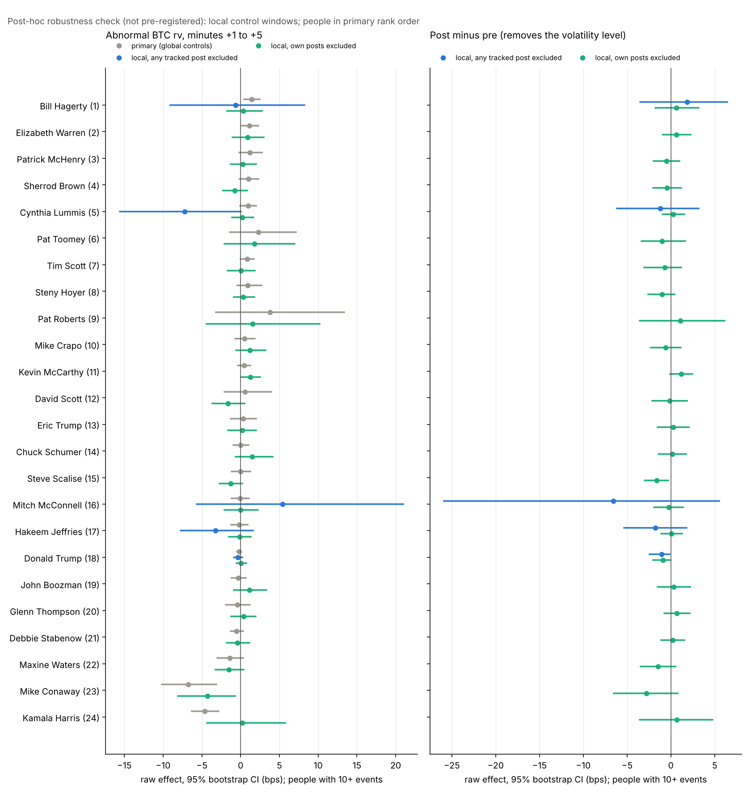

# C2 robustness check: local control windows (post-hoc, not pre-registered)

**This is a post-hoc deviation from the pre-registration**, designed after the primary C2 run had been seen; it checks the primary ranking (`c2_ranking.md`, unchanged) and does not replace it. Design: `research/politics/DEVIATION_LOCAL_CONTROLS.md`. Generated by `research/politics/c2_ranking.py report --controls local` from `c2_ranking_local.json` (analysis run 2026-11-18T05:34:33Z).

- deviation sha256 `7fc16189f475bd7f3a0d7912c7a8dadc7f8e30f086b77fe2593cfe663b969cda`
- pre-registration sha256 `41ef1cf1fd1af1479572d06061894a5d58d91f949ec39cf516aeb01c905a22e7`
- addendum `PREREGISTRATION_ADDENDUM_CONGRESS.md` sha256 `f8d6b1e0b03d664a4074a896a64feb847cdf30910aaf7173e2efee9c28c3210f`
- primary results: `c2_ranking.json` analysis run 2026-11-18T05:26:20Z
- 48 post files, the same as the primary run (identical hashes)

## What changed

Controls: the same minute of the week within plus or minus 4 weeks (8 candidates), excluding any candidate within 60 minutes of a post of any kind by any tracked person, all eligible used, at least 6 required (else the event or placebo minute is dropped). Primary: the first 16 eligible within plus or minus 26 weeks, excluding only the same person's posts. Post minus pre: abnormal rv over +1..+5 minus abnormal rv over -5..-1, both against the same local controls. Everything else (events, overlap rule, minimum 10 events, placebo, BH FDR, shrinkage, rank intervals) as pre-registered.

## Answer under local controls (computed in code)

**No politician's posts are distinguishable from random times: none of the 5 ranked politicians has an FDR q below 0.05 with a positive effect on BTC realized volatility in the 5 minutes after a post.**

Post minus pre: No politician's posts are distinguishable from random times: none of the 5 ranked politicians has an FDR q below 0.05 with a positive effect (extra BTC realized volatility in the 5 minutes after a post over the 5 minutes before it).

Primary answer, for comparison: Bill Hagerty moves crypto the most of the 24 ranked politicians: about +1.28 bps of extra BTC realized volatility in the 5 minutes after a post (shrunken; raw +1.40 bps, 95% CI 0.45 to 2.44, FDR q 0.005, 1,233 events), rank interval 1 to 11, although the lead is not distinguishable from the next people; the minutes before the posts are elevated too, so the posts may partly react to moves already under way.

## Side by side

In primary rank order. Primary: rank (rank interval), shrunken effect in bps, BH q. Local views: analysable events, raw effect in bps with 95% bootstrap CI, BH q (raw, because the local shrinkage fits tau^2 = 0 and pulls everyone to the prior, which ties all ranks). local = any tracked person's post excluded from controls (the deviation's rule); pmp = post minus pre with those controls; own-only = the pre-specified sensitivity excluding only the person's own posts. Dropped = clean events with a complete window but fewer than 6 local controls.

| person | primary rank (interval) | primary shrunken | primary q | local events | local raw [95% CI] | local q | pmp events | pmp raw [95% CI] | pmp q | local, own-only events | local, own-only raw [95% CI] | local, own-only q | pmp, own-only events | pmp, own-only raw [95% CI] | pmp, own-only q | dropped (local) |
|---|---|---|---|---|---|---|---|---|---|---|---|---|---|---|---|---|
| Bill Hagerty | 1 (1 to 11) | 1.28 | 0.005 | 12 | -0.62 [-9.05, 8.26] | 0.906 | 12 | 1.85 [-3.51, 6.46] | 0.608 | 217 | 0.30 [-1.76, 2.77] | 0.901 | 217 | 0.65 [-1.76, 3.16] | 0.734 | 2,923 |
| Elizabeth Warren | 2 (1 to 13) | 1.05 | 0.011 | 1 | -9.41 (not ranked) |  | 1 | -6.49 (not ranked) |  | 209 | 0.88 [-1.07, 2.96] | 0.502 | 209 | 0.64 [-0.91, 2.25] | 0.734 | 2,713 |
| Patrick McHenry | 3 (1 to 16) | 1.00 | 0.068 | 0 | n/a (not ranked) |  | 0 | n/a (not ranked) |  | 367 | 0.30 [-1.29, 2.02] | 0.901 | 367 | -0.50 [-1.96, 0.98] | 0.734 | 654 |
| Sherrod Brown | 4 (1 to 16) | 0.90 | 0.132 | 0 | n/a (not ranked) |  | 0 | n/a (not ranked) |  | 374 | -0.74 [-2.25, 0.86] | 0.498 | 374 | -0.43 [-2.05, 1.18] | 0.734 | 807 |
| Cynthia Lummis | 5 (1 to 15) | 0.87 | 0.224 | 12 | -7.25 [-15.57, 0.05] | 0.024 | 12 | -1.19 [-6.18, 3.19] | 0.629 | 344 | 0.23 [-1.13, 1.64] | 0.901 | 344 | 0.27 [-0.97, 1.54] | 0.807 | 781 |
| Pat Toomey | 6 (1 to 21) | 0.82 | 0.073 | 1 | 16.31 (not ranked) |  | 1 | 2.16 (not ranked) |  | 224 | 1.75 [-2.09, 6.98] | 0.331 | 224 | -0.98 [-3.35, 1.65] | 0.734 | 245 |
| Tim Scott | 7 (1 to 15) | 0.78 | 0.132 | 9 | -1.90 (not ranked) |  | 9 | 2.56 (not ranked) |  | 417 | 0.03 [-1.72, 1.85] | 0.953 | 417 | -0.71 [-3.03, 1.20] | 0.722 | 1,893 |
| Steny Hoyer | 8 (1 to 18) | 0.73 | 0.073 | 6 | 3.76 (not ranked) |  | 6 | 2.00 (not ranked) |  | 588 | 0.34 [-0.90, 1.75] | 0.901 | 588 | -1.03 [-2.58, 0.40] | 0.266 | 1,475 |
| Pat Roberts | 9 (1 to 22) | 0.50 | 0.068 | 0 | n/a (not ranked) |  | 0 | n/a (not ranked) |  | 82 | 1.54 [-4.37, 10.19] | 0.498 | 82 | 1.09 [-3.54, 6.13] | 0.734 | 110 |
| Mike Crapo | 10 (2 to 20) | 0.45 | 0.534 | 3 | -6.10 (not ranked) |  | 3 | -5.03 (not ranked) |  | 278 | 1.22 [-0.62, 3.22] | 0.368 | 278 | -0.60 [-2.30, 1.14] | 0.734 | 539 |
| Kevin McCarthy | 11 (3 to 18) | 0.42 | 0.591 | 9 | 5.80 (not ranked) |  | 9 | 4.32 (not ranked) |  | 367 | 1.23 [0.02, 2.51] | 0.331 | 367 | 1.19 [-0.08, 2.46] | 0.264 | 1,388 |
| David Scott | 12 (1 to 22) | 0.29 | 0.591 | 2 | -3.69 (not ranked) |  | 2 | 1.57 (not ranked) |  | 226 | -1.65 [-3.64, 0.47] | 0.295 | 226 | -0.16 [-2.13, 1.87] | 0.807 | 295 |
| Eric Trump | 13 (2 to 21) | 0.27 | 0.824 | 3 | -1.40 (not ranked) |  | 3 | 5.68 (not ranked) |  | 45 | 0.20 [-1.62, 2.01] | 0.901 | 45 | 0.27 [-1.53, 2.07] | 0.836 | 42 |
| Chuck Schumer | 14 (5 to 21) | 0.01 | 0.930 | 7 | -1.91 (not ranked) |  | 7 | 0.57 (not ranked) |  | 469 | 1.47 [-0.66, 4.11] | 0.295 | 469 | 0.14 [-1.39, 1.76] | 0.836 | 1,813 |
| Steve Scalise | 15 (4 to 21) | 0.00 | 0.930 | 1 | -12.02 (not ranked) |  | 1 | 3.34 (not ranked) |  | 292 | -1.29 [-2.73, 0.22] | 0.331 | 292 | -1.63 [-3.00, -0.29] | 0.240 | 731 |
| Mitch McConnell | 16 (5 to 21) | -0.09 | 0.734 | 10 | 5.40 [-5.66, 20.98] | 0.201 | 10 | -6.58 [-25.89, 5.51] | 0.122 | 343 | 0.00 [-2.09, 2.21] | 0.901 | 343 | -0.25 [-1.94, 1.40] | 0.807 | 1,169 |
| Hakeem Jeffries | 17 (6 to 22) | -0.16 | 0.806 | 21 | -3.27 [-7.77, 1.60] | 0.201 | 21 | -1.75 [-5.37, 1.82] | 0.595 | 629 | -0.14 [-1.52, 1.32] | 0.901 | 629 | 0.09 [-1.13, 1.27] | 0.836 | 1,126 |
| Donald Trump | 18 (12 to 20) | -0.20 | 0.172 | 775 | -0.34 [-0.86, 0.21] | 0.220 | 775 | -1.07 [-2.44, -0.12] | 0.019 | 1,061 | 0.05 [-0.56, 0.71] | 0.901 | 1,061 | -0.92 [-2.04, -0.06] | 0.264 | 7,133 |
| John Boozman | 19 (8 to 22) | -0.26 | 0.579 | 2 | -4.30 (not ranked) |  | 2 | -6.47 (not ranked) |  | 336 | 1.12 [-0.89, 3.30] | 0.460 | 336 | 0.32 [-1.53, 2.22] | 0.836 | 1,226 |
| Glenn Thompson | 20 (5 to 22) | -0.34 | 0.591 | 3 | 4.28 (not ranked) |  | 3 | 5.13 (not ranked) |  | 323 | 0.36 [-1.21, 1.96] | 0.901 | 323 | 0.66 [-0.78, 2.14] | 0.734 | 429 |
| Debbie Stabenow | 21 (11 to 22) | -0.48 | 0.548 | 2 | -3.89 (not ranked) |  | 2 | 5.10 (not ranked) |  | 558 | -0.41 [-1.80, 1.13] | 0.901 | 558 | 0.23 [-1.11, 1.53] | 0.734 | 1,374 |
| Maxine Waters | 22 (12 to 23) | -1.12 | 0.242 | 5 | -0.59 (not ranked) |  | 5 | 1.86 (not ranked) |  | 161 | -1.51 [-3.26, 0.38] | 0.368 | 161 | -1.44 [-3.46, 0.53] | 0.722 | 160 |
| Mike Conaway | 23 (22 to 24) | -2.96 | 0.020 | 0 | n/a (not ranked) |  | 0 | n/a (not ranked) |  | 18 | -4.30 [-8.09, -0.70] | 0.362 | 18 | -2.79 [-6.51, 0.76] | 0.734 | 18 |
| Kamala Harris | 24 (23 to 24) | -3.64 | 0.005 | 0 | n/a (not ranked) |  | 0 | n/a (not ranked) |  | 60 | 0.20 [-4.33, 5.74] | 0.901 | 60 | 0.65 [-3.56, 4.78] | 0.807 | 1,050 |
- Primary (global controls): q < 0.05 and positive: Bill Hagerty, Elizabeth Warren; q < 0.05 and negative: Kamala Harris, Mike Conaway.
- Local controls: q < 0.05 and positive: nobody; q < 0.05 and negative: Cynthia Lummis.
- Post minus pre (local): q < 0.05 and positive: nobody; q < 0.05 and negative: Donald Trump.
- Sensitivity: local band, own posts only excluded: q < 0.05 and positive: nobody; q < 0.05 and negative: nobody.
- Sensitivity: post minus pre, own posts only excluded: q < 0.05 and positive: nobody; q < 0.05 and negative: nobody.

## Ranking with local controls (abnormal rv +1..+5)

| rank | person | events | shrunken effect [95%] | raw effect [95% CI] | rank interval | placebo p | FDR q |
|---|---|---|---|---|---|---|---|
| 1 | Donald Trump | 775 | -0.37 [-0.89, 0.14] | -0.34 [-0.86, 0.21] | 1 to 4 | 0.176 | 0.220 |
| 2 | Mitch McConnell | 10 | -0.86 [-3.00, 1.28] | 5.40 [-5.66, 20.98] | 1 to 4 | 0.121 | 0.201 |
| 3 | Bill Hagerty | 12 | -0.98 [-3.08, 1.13] | -0.62 [-9.05, 8.26] | 1 to 5 | 0.906 | 0.906 |
| 4 | Hakeem Jeffries | 21 | -1.37 [-3.35, 0.60] | -3.27 [-7.77, 1.60] | 1 to 5 | 0.095 | 0.201 |
| 5 | Cynthia Lummis | 12 | -1.40 [-3.49, 0.69] | -7.25 [-15.57, 0.05] | 1 to 5 | 0.005 | 0.024 |

Prior (method of moments over 5 people): mean -1.00 bps, tau^2 1.218.

Listed, not ranked (fewer than 10 analysable clean events): Chuck Schumer (7 events, raw -1.91); David Scott (2 events, raw -3.69); Debbie Stabenow (2 events, raw -3.89); Elizabeth Warren (1 events, raw -9.41); Eric Trump (3 events, raw -1.40); Glenn Thompson (3 events, raw 4.28); John Boozman (2 events, raw -4.30); Kamala Harris (0 events, raw n/a); Kevin McCarthy (9 events, raw 5.80); Maxine Waters (5 events, raw -0.59); Mike Conaway (0 events, raw n/a); Mike Crapo (3 events, raw -6.10); Pat Roberts (0 events, raw n/a); Pat Toomey (1 events, raw 16.31); Patrick McHenry (0 events, raw n/a); Sherrod Brown (0 events, raw n/a); Steny Hoyer (6 events, raw 3.76); Steve Scalise (1 events, raw -12.02); Tim Scott (9 events, raw -1.90).

### Without 2025-10-10/11

| rank | person | events | shrunken effect [95%] | raw effect [95% CI] | rank interval | placebo p | FDR q |
|---|---|---|---|---|---|---|---|
| 1 | Donald Trump | 768 | -0.32 [-0.84, 0.20] | -0.28 [-0.81, 0.26] | 1 to 4 | 0.234 | 0.293 |
| 2 | Mitch McConnell | 10 | -0.82 [-2.98, 1.34] | 5.40 [-5.66, 20.98] | 1 to 4 | 0.115 | 0.192 |
| 3 | Bill Hagerty | 12 | -0.94 [-3.07, 1.18] | -0.62 [-9.05, 8.26] | 1 to 5 | 0.903 | 0.903 |
| 4 | Hakeem Jeffries | 21 | -1.35 [-3.34, 0.64] | -3.27 [-7.77, 1.60] | 1 to 5 | 0.099 | 0.192 |
| 5 | Cynthia Lummis | 12 | -1.38 [-3.49, 0.74] | -7.25 [-15.57, 0.05] | 1 to 5 | 0.005 | 0.026 |

Prior (method of moments over 5 people): mean -0.96 bps, tau^2 1.243.

Listed, not ranked (fewer than 10 analysable clean events): Chuck Schumer (7 events, raw -1.91); David Scott (2 events, raw -3.69); Debbie Stabenow (2 events, raw -3.89); Elizabeth Warren (1 events, raw -9.41); Eric Trump (3 events, raw -1.40); Glenn Thompson (3 events, raw 4.28); John Boozman (2 events, raw -4.30); Kamala Harris (0 events, raw n/a); Kevin McCarthy (9 events, raw 5.80); Maxine Waters (5 events, raw -0.59); Mike Conaway (0 events, raw n/a); Mike Crapo (3 events, raw -6.10); Pat Roberts (0 events, raw n/a); Pat Toomey (1 events, raw 16.31); Patrick McHenry (0 events, raw n/a); Sherrod Brown (0 events, raw n/a); Steny Hoyer (6 events, raw 3.76); Steve Scalise (1 events, raw -12.02); Tim Scott (9 events, raw -1.90).

## Ranking on post minus pre (local controls)

| rank | person | events | shrunken effect [95%] | raw effect [95% CI] | rank interval | placebo p | FDR q |
|---|---|---|---|---|---|---|---|
| 1 | Bill Hagerty | 12 | -1.03 [-1.03, -1.03] | 1.85 [-3.51, 6.46] | 1 to 4 | 0.487 | 0.608 |
| 1 | Cynthia Lummis | 12 | -1.03 [-1.03, -1.03] | -1.19 [-6.18, 3.19] | 1 to 5 | 0.629 | 0.629 |
| 1 | Donald Trump | 775 | -1.03 [-1.03, -1.03] | -1.07 [-2.44, -0.12] | 1 to 5 | 0.004 | 0.019 |
| 1 | Hakeem Jeffries | 21 | -1.03 [-1.03, -1.03] | -1.75 [-5.37, 1.82] | 1 to 5 | 0.357 | 0.595 |
| 1 | Mitch McConnell | 10 | -1.03 [-1.03, -1.03] | -6.58 [-25.89, 5.51] | 1 to 5 | 0.049 | 0.122 |

Prior (method of moments over 5 people): mean -1.03 bps, tau^2 0.000.

Listed, not ranked (fewer than 10 analysable clean events): Chuck Schumer (7 events, raw 0.57); David Scott (2 events, raw 1.57); Debbie Stabenow (2 events, raw 5.10); Elizabeth Warren (1 events, raw -6.49); Eric Trump (3 events, raw 5.68); Glenn Thompson (3 events, raw 5.13); John Boozman (2 events, raw -6.47); Kamala Harris (0 events, raw n/a); Kevin McCarthy (9 events, raw 4.32); Maxine Waters (5 events, raw 1.86); Mike Conaway (0 events, raw n/a); Mike Crapo (3 events, raw -5.03); Pat Roberts (0 events, raw n/a); Pat Toomey (1 events, raw 2.16); Patrick McHenry (0 events, raw n/a); Sherrod Brown (0 events, raw n/a); Steny Hoyer (6 events, raw 2.00); Steve Scalise (1 events, raw 3.34); Tim Scott (9 events, raw 2.56).

### Without 2025-10-10/11

| rank | person | events | shrunken effect [95%] | raw effect [95% CI] | rank interval | placebo p | FDR q |
|---|---|---|---|---|---|---|---|
| 1 | Bill Hagerty | 12 | -1.03 [-1.03, -1.03] | 1.85 [-3.51, 6.46] | 1 to 4 | 0.475 | 0.593 |
| 1 | Cynthia Lummis | 12 | -1.03 [-1.03, -1.03] | -1.19 [-6.18, 3.19] | 1 to 5 | 0.640 | 0.640 |
| 1 | Donald Trump | 768 | -1.03 [-1.03, -1.03] | -1.08 [-2.43, -0.12] | 1 to 5 | 0.005 | 0.024 |
| 1 | Hakeem Jeffries | 21 | -1.03 [-1.03, -1.03] | -1.75 [-5.37, 1.82] | 1 to 5 | 0.362 | 0.593 |
| 1 | Mitch McConnell | 10 | -1.03 [-1.03, -1.03] | -6.58 [-25.89, 5.51] | 1 to 5 | 0.054 | 0.136 |

Prior (method of moments over 5 people): mean -1.03 bps, tau^2 0.000.

Listed, not ranked (fewer than 10 analysable clean events): Chuck Schumer (7 events, raw 0.57); David Scott (2 events, raw 1.57); Debbie Stabenow (2 events, raw 5.10); Elizabeth Warren (1 events, raw -6.49); Eric Trump (3 events, raw 5.68); Glenn Thompson (3 events, raw 5.13); John Boozman (2 events, raw -6.47); Kamala Harris (0 events, raw n/a); Kevin McCarthy (9 events, raw 4.32); Maxine Waters (5 events, raw 1.86); Mike Conaway (0 events, raw n/a); Mike Crapo (3 events, raw -5.03); Pat Roberts (0 events, raw n/a); Pat Toomey (1 events, raw 2.16); Patrick McHenry (0 events, raw n/a); Sherrod Brown (0 events, raw n/a); Steny Hoyer (6 events, raw 2.00); Steve Scalise (1 events, raw 3.34); Tim Scott (9 events, raw 2.56).

## Sensitivity: plus or minus 4 weeks, only the same person's posts excluded

Abnormal rv +1..+5:

| rank | person | events | shrunken effect [95%] | raw effect [95% CI] | rank interval | placebo p | FDR q |
|---|---|---|---|---|---|---|---|
| 1 | Bill Hagerty | 217 | 0.05 [0.05, 0.05] | 0.30 [-1.76, 2.77] | 1 to 23 | 0.581 | 0.901 |
| 1 | Chuck Schumer | 469 | 0.05 [0.05, 0.05] | 1.47 [-0.66, 4.11] | 1 to 17 | 0.017 | 0.295 |
| 1 | Cynthia Lummis | 344 | 0.05 [0.05, 0.05] | 0.23 [-1.13, 1.64] | 1 to 21 | 0.694 | 0.901 |
| 1 | David Scott | 226 | 0.05 [0.05, 0.05] | -1.65 [-3.64, 0.47] | 1 to 24 | 0.025 | 0.295 |
| 1 | Debbie Stabenow | 558 | 0.05 [0.05, 0.05] | -0.41 [-1.80, 1.13] | 1 to 23 | 0.646 | 0.901 |
| 1 | Donald Trump | 1,061 | 0.05 [0.05, 0.05] | 0.05 [-0.56, 0.71] | 1 to 20 | 0.771 | 0.901 |
| 1 | Elizabeth Warren | 209 | 0.05 [0.05, 0.05] | 0.88 [-1.07, 2.96] | 1 to 20 | 0.251 | 0.502 |
| 1 | Eric Trump | 45 | 0.05 [0.05, 0.05] | 0.20 [-1.62, 2.01] | 1 to 22 | 0.847 | 0.901 |
| 1 | Glenn Thompson | 323 | 0.05 [0.05, 0.05] | 0.36 [-1.21, 1.96] | 1 to 21 | 0.756 | 0.901 |
| 1 | Hakeem Jeffries | 629 | 0.05 [0.05, 0.05] | -0.14 [-1.52, 1.32] | 1 to 23 | 0.781 | 0.901 |
| 1 | John Boozman | 336 | 0.05 [0.05, 0.05] | 1.12 [-0.89, 3.30] | 1 to 19 | 0.173 | 0.460 |
| 1 | Kamala Harris | 60 | 0.05 [0.05, 0.05] | 0.20 [-4.33, 5.74] | 1 to 23 | 0.825 | 0.901 |
| 1 | Kevin McCarthy | 367 | 0.05 [0.05, 0.05] | 1.23 [0.02, 2.51] | 1 to 13 | 0.059 | 0.331 |
| 1 | Maxine Waters | 161 | 0.05 [0.05, 0.05] | -1.51 [-3.26, 0.38] | 1 to 24 | 0.107 | 0.368 |
| 1 | Mike Conaway | 18 | 0.05 [0.05, 0.05] | -4.30 [-8.09, -0.70] | 1 to 24 | 0.090 | 0.362 |
| 1 | Mike Crapo | 278 | 0.05 [0.05, 0.05] | 1.22 [-0.62, 3.22] | 1 to 17 | 0.123 | 0.368 |
| 1 | Mitch McConnell | 343 | 0.05 [0.05, 0.05] | 0.00 [-2.09, 2.21] | 1 to 23 | 0.864 | 0.901 |
| 1 | Pat Roberts | 82 | 0.05 [0.05, 0.05] | 1.54 [-4.37, 10.19] | 1 to 24 | 0.228 | 0.498 |
| 1 | Pat Toomey | 224 | 0.05 [0.05, 0.05] | 1.75 [-2.09, 6.98] | 1 to 22 | 0.069 | 0.331 |
| 1 | Patrick McHenry | 367 | 0.05 [0.05, 0.05] | 0.30 [-1.29, 2.02] | 1 to 21 | 0.616 | 0.901 |
| 1 | Sherrod Brown | 374 | 0.05 [0.05, 0.05] | -0.74 [-2.25, 0.86] | 1 to 24 | 0.224 | 0.498 |
| 1 | Steny Hoyer | 588 | 0.05 [0.05, 0.05] | 0.34 [-0.90, 1.75] | 1 to 20 | 0.500 | 0.901 |
| 1 | Steve Scalise | 292 | 0.05 [0.05, 0.05] | -1.29 [-2.73, 0.22] | 1 to 24 | 0.043 | 0.331 |
| 1 | Tim Scott | 417 | 0.05 [0.05, 0.05] | 0.03 [-1.72, 1.85] | 1 to 22 | 0.953 | 0.953 |

Prior (method of moments over 24 people): mean 0.05 bps, tau^2 0.000.

Post minus pre:

| rank | person | events | shrunken effect [95%] | raw effect [95% CI] | rank interval | placebo p | FDR q |
|---|---|---|---|---|---|---|---|
| 1 | Bill Hagerty | 217 | -0.20 [-0.20, -0.20] | 0.65 [-1.76, 3.16] | 1 to 20 | 0.327 | 0.734 |
| 1 | Chuck Schumer | 469 | -0.20 [-0.20, -0.20] | 0.14 [-1.39, 1.76] | 1 to 21 | 0.786 | 0.836 |
| 1 | Cynthia Lummis | 344 | -0.20 [-0.20, -0.20] | 0.27 [-0.97, 1.54] | 1 to 20 | 0.658 | 0.807 |
| 1 | David Scott | 226 | -0.20 [-0.20, -0.20] | -0.16 [-2.13, 1.87] | 1 to 22 | 0.672 | 0.807 |
| 1 | Debbie Stabenow | 558 | -0.20 [-0.20, -0.20] | 0.23 [-1.11, 1.53] | 1 to 20 | 0.438 | 0.734 |
| 1 | Donald Trump | 1,061 | -0.20 [-0.20, -0.20] | -0.92 [-2.04, -0.06] | 1 to 24 | 0.023 | 0.264 |
| 1 | Elizabeth Warren | 209 | -0.20 [-0.20, -0.20] | 0.64 [-0.91, 2.25] | 1 to 19 | 0.312 | 0.734 |
| 1 | Eric Trump | 45 | -0.20 [-0.20, -0.20] | 0.27 [-1.53, 2.07] | 1 to 21 | 0.836 | 0.836 |
| 1 | Glenn Thompson | 323 | -0.20 [-0.20, -0.20] | 0.66 [-0.78, 2.14] | 1 to 18 | 0.422 | 0.734 |
| 1 | Hakeem Jeffries | 629 | -0.20 [-0.20, -0.20] | 0.09 [-1.13, 1.27] | 1 to 21 | 0.828 | 0.836 |
| 1 | John Boozman | 336 | -0.20 [-0.20, -0.20] | 0.32 [-1.53, 2.22] | 1 to 21 | 0.816 | 0.836 |
| 1 | Kamala Harris | 60 | -0.20 [-0.20, -0.20] | 0.65 [-3.56, 4.78] | 1 to 20 | 0.628 | 0.807 |
| 1 | Kevin McCarthy | 367 | -0.20 [-0.20, -0.20] | 1.19 [-0.08, 2.46] | 1 to 11 | 0.033 | 0.264 |
| 1 | Maxine Waters | 161 | -0.20 [-0.20, -0.20] | -1.44 [-3.46, 0.53] | 1 to 24 | 0.160 | 0.722 |
| 1 | Mike Conaway | 18 | -0.20 [-0.20, -0.20] | -2.79 [-6.51, 0.76] | 1 to 24 | 0.263 | 0.734 |
| 1 | Mike Crapo | 278 | -0.20 [-0.20, -0.20] | -0.60 [-2.30, 1.14] | 1 to 23 | 0.465 | 0.734 |
| 1 | Mitch McConnell | 343 | -0.20 [-0.20, -0.20] | -0.25 [-1.94, 1.40] | 1 to 23 | 0.633 | 0.807 |
| 1 | Pat Roberts | 82 | -0.20 [-0.20, -0.20] | 1.09 [-3.54, 6.13] | 1 to 20 | 0.374 | 0.734 |
| 1 | Pat Toomey | 224 | -0.20 [-0.20, -0.20] | -0.98 [-3.35, 1.65] | 1 to 24 | 0.314 | 0.734 |
| 1 | Patrick McHenry | 367 | -0.20 [-0.20, -0.20] | -0.50 [-1.96, 0.98] | 1 to 23 | 0.490 | 0.734 |
| 1 | Sherrod Brown | 374 | -0.20 [-0.20, -0.20] | -0.43 [-2.05, 1.18] | 1 to 23 | 0.346 | 0.734 |
| 1 | Steny Hoyer | 588 | -0.20 [-0.20, -0.20] | -1.03 [-2.58, 0.40] | 1 to 24 | 0.044 | 0.266 |
| 1 | Steve Scalise | 292 | -0.20 [-0.20, -0.20] | -1.63 [-3.00, -0.29] | 1 to 24 | 0.010 | 0.240 |
| 1 | Tim Scott | 417 | -0.20 [-0.20, -0.20] | -0.71 [-3.03, 1.20] | 1 to 22 | 0.181 | 0.722 |

Prior (method of moments over 24 people): mean -0.20 bps, tau^2 0.000.

## Per topic (local controls)

| topic | outcome | person | events | raw [95% CI] | shrunken | rank interval | placebo p | q (within topic) |
|---|---|---|---|---|---|---|---|---|
| Tariffs/trade | rv +1..+5 | Donald Trump | 30 | 2.48 [-0.60, 6.00] | 2.48 | 1 to 1 | 0.252 | 0.252 |
| Tariffs/trade | post minus pre | Donald Trump | 30 | -0.42 [-2.98, 2.30] | -0.42 | 1 to 1 | 0.860 | 0.860 |
| Other | rv +1..+5 | Donald Trump | 732 | -0.57 [-1.08, -0.03] | -0.60 | 1 to 4 | 0.058 | 0.145 |
| Other | rv +1..+5 | Mitch McConnell | 10 | 5.40 [-5.66, 20.98] | -1.01 | 1 to 4 | 0.121 | 0.151 |
| Other | rv +1..+5 | Bill Hagerty | 12 | -0.62 [-9.05, 8.26] | -1.12 | 1 to 5 | 0.906 | 0.906 |
| Other | rv +1..+5 | Hakeem Jeffries | 21 | -3.27 [-7.77, 1.60] | -1.47 | 1 to 5 | 0.095 | 0.151 |
| Other | rv +1..+5 | Cynthia Lummis | 12 | -7.25 [-15.57, 0.05] | -1.51 | 1 to 5 | 0.005 | 0.024 |
| Other | post minus pre | Bill Hagerty | 12 | 1.85 [-3.51, 6.46] | -1.13 | 1 to 4 | 0.487 | 0.608 |
| Other | post minus pre | Cynthia Lummis | 12 | -1.19 [-6.18, 3.19] | -1.13 | 1 to 5 | 0.629 | 0.629 |
| Other | post minus pre | Donald Trump | 732 | -1.20 [-2.62, -0.21] | -1.13 | 1 to 5 | 0.002 | 0.010 |
| Other | post minus pre | Hakeem Jeffries | 21 | -1.75 [-5.37, 1.82] | -1.13 | 1 to 5 | 0.357 | 0.595 |
| Other | post minus pre | Mitch McConnell | 10 | -6.58 [-25.89, 5.51] | -1.13 | 1 to 5 | 0.049 | 0.122 |

Primary, for comparison: Donald Trump on tariffs 3.73 [1.21, 6.65], placebo p 0.003, 198 events.

## Pre-window check (local controls)

| person | events | pre5 mean [95% CI] | placebo p | elevated | primary pre5 mean |
|---|---|---|---|---|---|
| Bill Hagerty | 12 | -2.47 [-8.93, 5.79] | 0.373 | no | 1.47 |
| Chuck Schumer | 7 | -2.48 [-10.37, 5.97] | 0.532 | no | 0.22 |
| Cynthia Lummis | 12 | -6.05 [-13.15, 1.32] | 0.013 | no | 0.93 |
| David Scott | 2 | -5.26 [-5.29, -5.22] | 0.345 | no | -0.29 |
| Debbie Stabenow | 2 | -8.99 [-12.51, -5.47] | 0.089 | no | -0.56 |
| Donald Trump | 775 | 0.74 [-0.31, 2.25] | 0.182 | no | -0.37 |
| Elizabeth Warren | 1 | -2.92 [n/a, n/a] | 0.746 | no | 0.21 |
| Eric Trump | 3 | -7.08 [-13.45, -1.62] | 0.115 | no | 0.61 |
| Glenn Thompson | 3 | -0.85 [-9.40, 10.70] | 0.994 | no | -0.97 |
| Hakeem Jeffries | 21 | -1.52 [-6.05, 3.56] | 0.516 | no | -0.20 |
| John Boozman | 2 | 2.17 [0.90, 3.44] | 0.529 | no | 0.06 |
| Kamala Harris | 0 | n/a [n/a, n/a] | n/a | no | -5.51 |
| Kevin McCarthy | 9 | 1.48 [-4.44, 7.90] | 0.596 | no | 0.61 |
| Maxine Waters | 5 | -2.45 [-3.49, -1.41] | 0.579 | no | -0.26 |
| Mike Conaway | 0 | n/a [n/a, n/a] | n/a | no | -4.36 |
| Mike Crapo | 3 | -1.07 [-3.88, 1.03] | 0.961 | no | 1.15 |
| Mitch McConnell | 10 | 11.98 [-7.72, 45.27] | 0.016 | yes | 0.11 |
| Pat Roberts | 0 | n/a [n/a, n/a] | n/a | no | 1.84 |
| Pat Toomey | 1 | 14.15 [n/a, n/a] | 0.118 | no | 1.79 |
| Patrick McHenry | 0 | n/a [n/a, n/a] | n/a | no | 0.75 |
| Sherrod Brown | 0 | n/a [n/a, n/a] | n/a | no | 1.06 |
| Steny Hoyer | 6 | 1.77 [-3.33, 6.85] | 0.542 | no | 0.76 |
| Steve Scalise | 1 | -15.37 [n/a, n/a] | 0.039 | no | -0.36 |
| Tim Scott | 9 | -4.46 [-12.51, 6.81] | 0.132 | no | 1.85 |

## Where the primary controls came from (diagnostic, exploratory)

Pre-registered controls of each person's clean events: mean distance from the event in weeks, 90th percentile of the farthest control, share of controls after the event; and the local-control coverage.

| person | events | mean distance (weeks) | farthest, p90 (weeks) | share later | kept under local | dropped under local | mean local controls | kept, own-only exclusion |
|---|---|---|---|---|---|---|---|---|
| Bill Hagerty | 1,233 | 10.2 | 25.0 | 0.45 | 12 | 2,923 | 7.1 | 217 |
| Chuck Schumer | 1,533 | 8.4 | 23.0 | 0.52 | 7 | 1,813 | 6.7 | 469 |
| Cynthia Lummis | 770 | 7.5 | 20.0 | 0.49 | 12 | 781 | 7.0 | 344 |
| David Scott | 293 | 5.6 | 12.0 | 0.50 | 2 | 295 | 7.5 | 226 |
| Debbie Stabenow | 1,358 | 7.4 | 19.0 | 0.50 | 2 | 1,374 | 7.0 | 558 |
| Donald Trump | 6,352 | 9.6 | 24.0 | 0.49 | 775 | 7,133 | 6.5 | 1,061 |
| Elizabeth Warren | 1,187 | 10.0 | 25.0 | 0.57 | 1 | 2,713 | 8.0 | 209 |
| Eric Trump | 45 | 4.7 | 9.0 | 0.49 | 3 | 42 | 6.3 | 45 |
| Glenn Thompson | 432 | 5.8 | 14.0 | 0.52 | 3 | 429 | 6.3 | 323 |
| Hakeem Jeffries | 1,136 | 6.8 | 18.0 | 0.51 | 21 | 1,126 | 6.6 | 629 |
| John Boozman | 997 | 8.5 | 23.0 | 0.51 | 2 | 1,226 | 7.5 | 336 |
| Kamala Harris | 526 | 11.5 | 25.0 | 0.68 | 0 | 1,050 | n/a | 60 |
| Kevin McCarthy | 1,185 | 8.2 | 22.0 | 0.52 | 9 | 1,388 | 7.1 | 367 |
| Maxine Waters | 165 | 4.8 | 9.0 | 0.51 | 5 | 160 | 6.8 | 161 |
| Mike Conaway | 18 | 4.9 | 10.0 | 0.51 | 0 | 18 | n/a | 18 |
| Mike Crapo | 537 | 6.6 | 16.0 | 0.50 | 3 | 539 | 7.0 | 278 |
| Mitch McConnell | 964 | 8.1 | 22.0 | 0.52 | 10 | 1,169 | 7.0 | 343 |
| Pat Roberts | 110 | 5.9 | 15.1 | 0.54 | 0 | 110 | n/a | 82 |
| Pat Toomey | 246 | 5.1 | 11.0 | 0.51 | 1 | 245 | 6.0 | 224 |
| Patrick McHenry | 646 | 6.4 | 15.0 | 0.51 | 0 | 654 | n/a | 367 |
| Sherrod Brown | 783 | 6.9 | 17.0 | 0.52 | 0 | 807 | n/a | 374 |
| Steny Hoyer | 1,339 | 7.4 | 20.0 | 0.52 | 6 | 1,475 | 7.0 | 588 |
| Steve Scalise | 666 | 7.5 | 20.0 | 0.53 | 1 | 731 | 6.0 | 292 |
| Tim Scott | 1,402 | 8.9 | 23.0 | 0.51 | 9 | 1,893 | 6.8 | 417 |

## Caveats

- Post-hoc: chosen after seeing the primary ranking. It can show which primary conclusions are robust; it cannot confirm new ones.
- Excluding every tracked person's posts drops events and removes busy weekday hours from the controls in 2020 to 2023-07; the own-posts-only sensitivity shows how much this matters.
- Post minus pre is noisier (two windows) and also moves when a post follows, and is followed by, a move already under way.
- All caveats of the primary run apply (`c2_ranking.md`).

