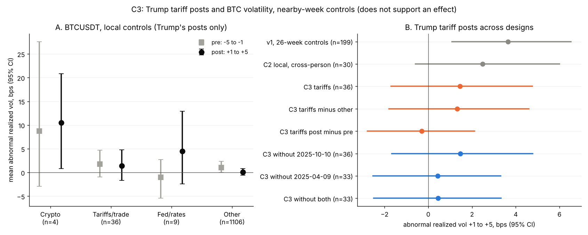

# C3: Trump's tariff posts under time-local controls (own posts only)

**Declared follow-up, decided after seeing the C2 local-controls result; not pre-registered.** Design: `research/politics/FOLLOWUP_TRUMP_TARIFF_LOCAL.md`. Generated by `research/politics/c3_trump_tariff_local.py` (run 2026-11-19T01:18:08Z).

- follow-up sha256 `5ddb736327a041b4d1e358330dd510b9313c4996509becac9e89805c1f2a3c38`
- `posts/truth_realDonaldTrump.csv` sha256 `d3ce5a47062fd0d92dff8dae92f3e616f2386f4b1d378a49eb5d4e40e374cf3c`
- `posts/x_realDonaldTrump.csv` sha256 `42c3abaad0aa7e626cd31bc4a6e860a1272d654f1293bf759c8ed8a59c4819a7`

## Verdict (decision rule stated in advance)

The follow-up **does not support an effect**: tariff minus other +1.32 bps [-1.80, 4.60], interval includes zero; tariff post minus pre -0.30 bps [-2.78, 2.12], interval includes zero.

## Events

Trump's two files pooled: 47,867 posts, 19,111 events (original and quote posts merged within 5 minutes). Clean = no earlier Trump event within 60 minutes; no cross-person rule. Kept = complete BTCUSDT window and at least 6 of the 8 same-minute-of-week controls within plus or minus 4 weeks free of any Trump post within 60 minutes. Dropped = clean with a complete window but fewer than 6 controls. Placebo pool: 12,560 random minutes.

| topic | events | clean, in period | complete window | dropped (< 6 controls) | kept | mean controls |
|---|---|---|---|---|---|---|
| Crypto | 43 | 21 | 21 | 17 | 4 | 6.2 |
| Tariffs/trade | 460 | 232 | 232 | 196 | 36 | 6.3 |
| Fed/rates | 114 | 49 | 49 | 40 | 9 | 6.2 |
| Other | 18,494 | 8,800 | 8,800 | 7,694 | 1,106 | 6.6 |

## Primary: BTCUSDT abnormal realized volatility, minutes +1 to +5

Mean abnormal rv in bps, 95% bootstrap interval, placebo p (random minutes with the same local controls). Tariff minus other: bootstrap within groups, permutation p.

| quantity | events | estimate [95% CI] | p |
|---|---|---|---|
| Tariffs/trade | 36 | 1.45 [-1.70, 4.76] | 0.508 (placebo) |
| Other | 1106 | 0.13 [-0.54, 0.83] | 0.912 (placebo) |
| **Tariffs minus other (primary test)** | | **1.32 [-1.80, 4.60]** | **0.499** (permutation) |
| Tariffs, minutes -5 to -1 | 36 | 1.75 [-0.90, 4.73] | 0.411 (placebo) |
| **Tariffs, post minus pre** | 36 | **-0.30 [-2.78, 2.12]** | 0.867 (placebo) |

## Robustness

| sample | tariff events | tariffs | tariffs minus other (perm. p) | post minus pre (placebo p) | verdict |
|---|---|---|---|---|---|
| all (primary) | 36 | 1.45 [-1.70, 4.76] | 1.32 [-1.80, 4.60] (0.499) | -0.30 [-2.78, 2.12] (0.867) | does not support an effect |
| without 2025-10-10 | 36 | 1.47 [-1.67, 4.77] | 1.30 [-1.90, 4.69] (0.513) | -0.30 [-2.79, 2.11] (0.854) | does not support an effect |
| without 2025-04-09 | 33 | 0.43 [-2.52, 3.31] | 0.30 [-2.64, 3.27] (0.884) | -0.68 [-3.21, 1.97] (0.726) | does not support an effect |
| without both | 33 | 0.45 [-2.50, 3.33] | 0.28 [-2.69, 3.20] (0.889) | -0.69 [-3.21, 1.96] (0.717) | does not support an effect |

Spans drop events and bar control and placebo minutes from 2025-10-10 00:00 to 2025-10-12 00:00 UTC and from 2025-04-09 00:00 to 2025-04-10 00:00 UTC.

## Comparison with v1 and the C2 cross-person local run

BTCUSDT abnormal rv +1..+5 for Trump's tariff/trade posts, bps.

| run | controls | events | tariffs [95% CI] | p | post minus pre [95% CI] |
|---|---|---|---|---|---|
| v1 (`c1_trump_posts.md`) | 16 within 26 weeks, own posts | 199 | 3.64 [1.09, 6.53] | 0.0002 | 2.81 [0.56, 5.38] |
| C2 local (`c2_ranking_local.md`) | 6+ within 4 weeks, any tracked person; overlap rule | 30 | 2.48 [-0.60, 6.00] | 0.252 | -0.42 [-2.98, 2.30] |
| **C3 (this run)** | 6+ within 4 weeks, Trump's posts only | 36 | 1.45 [-1.70, 4.76] | 0.508 | -0.30 [-2.78, 2.12] |

v1 tariff minus other: 3.34 [0.83, 6.28]. v1 covers 2022-02 to 2026-10 (Truth Social only); C2 and C3 add the 2020 tweets.

## Secondary outcomes (descriptive, raw p)

Mean abnormal [95% CI] (placebo p, n). Units: bps for rv and absret; log points for logvol; imbalance in [-1, 1].

| outcome | Crypto | Tariffs/trade | Fed/rates | Other |
|---|---|---|---|---|
| BTCUSDT rv +1..+5 | 10.54 [0.83, 20.83] (0.119, 4) | 1.45 [-1.70, 4.76] (0.508, 36) | 4.46 [-2.42, 12.96] (0.275, 9) | 0.13 [-0.54, 0.83] (0.912, 1106) |
| BTCUSDT rv -5..-1 | 8.76 [-2.94, 27.62] (0.153, 4) | 1.75 [-0.90, 4.73] (0.411, 36) | -1.02 [-5.43, 2.74] (0.906, 9) | 1.06 [0.04, 2.35] (0.037, 1106) |
| BTCUSDT rv post minus pre | 1.77 [-20.14, 19.33] (0.720, 4) | -0.30 [-2.78, 2.12] (0.867, 36) | 5.47 [1.44, 11.33] (0.189, 9) | -0.93 [-2.02, -0.05] (0.014, 1106) |
| BTCUSDT absret +1..+5 | 5.25 [2.24, 9.95] (0.364, 4) | 2.66 [-1.03, 6.63] (0.320, 36) | 3.10 [-5.16, 12.09] (0.450, 9) | 0.43 [-0.45, 1.39] (0.417, 1106) |
| BTCUSDT logvol +1..+5 | 0.439 [0.017, 0.799] (0.278, 4) | 0.050 [-0.254, 0.348] (0.746, 36) | 0.390 [-0.184, 0.972] (0.149, 9) | 0.006 [-0.044, 0.057] (0.920, 1105) |
| BTCUSDT imb +1..+5 | 0.082 [-0.005, 0.160] (0.484, 4) | 0.057 [-0.022, 0.133] (0.148, 36) | -0.165 [-0.389, 0.072] (0.027, 9) | -0.001 [-0.016, 0.014] (0.701, 1105) |
| ETHUSDT rv +1..+5 | 14.98 [5.56, 24.41] (0.090, 4) | 0.09 [-3.90, 4.07] (0.946, 36) | 11.60 [-4.19, 35.72] (0.064, 9) | 0.76 [-0.17, 1.78] (0.216, 1106) |
| SOLUSDT rv +1..+5 | 14.20 [-0.47, 28.88] (0.213, 4) | 1.76 [-3.33, 7.02] (0.620, 36) | 16.93 [-3.91, 49.68] (0.086, 8) | 1.45 [-0.04, 3.08] (0.059, 1032) |
| ETHUSDT rv post minus pre | 1.38 [-37.31, 28.47] (0.835, 4) | -1.58 [-5.02, 1.91] (0.504, 36) | 9.99 [-1.68, 28.07] (0.064, 9) | -0.48 [-1.58, 0.56] (0.204, 1106) |
| SOLUSDT rv post minus pre | 7.76 [-16.82, 31.42] (0.427, 4) | 0.18 [-3.80, 4.48] (0.976, 36) | 16.10 [-2.78, 43.51] (0.065, 8) | 0.01 [-1.31, 1.31] (0.986, 1032) |

## Caveats

- Decided after seeing the C2 local result and aimed at the topic v1 singled out; it checks v1's tariff finding, it cannot confirm it independently.
- Trump posts at the same hours week after week, so most clean events lack 6 post-free nearby weeks and are dropped; the kept events tilt toward hours where he posts irregularly.
- Other politicians' posts can fall inside event or control windows (they are ignored by design).
- All caveats of v1 (`c1_trump_posts.md`) apply: crude keywords, inferred kinds, 1,116 quote posts read as reposts, futures only, no macro-release exclusion.

