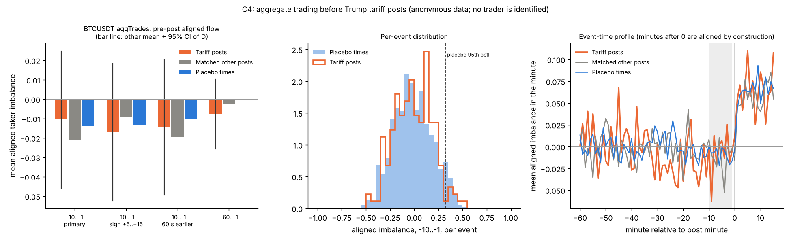

# C4: did aggregate trading move unusually before Trump's tariff posts?

**Binance public data is anonymous. This can only show whether aggregate trading before posts was unusual, never who traded; no person or entity is named or implied as having traded on information. It is a statistical test, not an accusation.**

Generated by `research/politics/c4_prepost_trading.py analyze`. Design fixed in `research/politics/PREREGISTRATION_PREPOST.md` before any aggTrades file was downloaded or any pre-post window opened:

- pre-registration sha256 `d5b47c00b8198b125d41963155d22c5dd422200be8940044ee455d9327f6ff13`
- posts file sha256 `d3ce5a47062fd0d92dff8dae92f3e616f2386f4b1d378a49eb5d4e40e374cf3c`

## Verdict under the pre-registered decision rule

**No evidence.** Primary: mean aligned taker imbalance over minutes -10 to -1 (BTCUSDT aggTrades, sign of the BTC move over +1..+15) for tariff events minus matched other events, D = +0.011 [95% CI -0.025, +0.046], one-sided permutation p 0.277. With the sign from +5..+15: D = -0.008 [-0.043, +0.027], p 0.668. The rule needs both above zero with p < 0.05.

This concerns anonymous aggregate order flow only. It identifies no one, and even a positive result would have innocent readings (posts reacting to news or to moves under way, other news, order-flow momentum).

## Coverage

- Clean v1 tariff events 2022-02 to 2026-10: 223; with all needed BTCUSDT aggTrades dates downloaded under the budget rule: 178; with complete minute data (analysed): 178. Download order was random (seed), so the analysed set is a random subset.
- Matched other events (same UTC hour, else nearest, up to 2 per tariff event, from downloaded dates): 350. Placebo times (up to 6 per tariff date, no post within [-70, +20] minutes): 710. Every anchor is more than 2 hours from every other anchor, so no control window overlaps an event window.
- Events with a zero BTC move over +1..+15 (no sign, left out of aligned outcomes): {'tariff': 0, 'other': 0, 'placebo': 2}.
- Downloaded: 3.71 GB of daily aggTrades (SHA-256 checked), reduced to per-minute bars; zips deleted.

## Primary and guard results (BTCUSDT aggTrades)

Aligned imbalance in [-1, 1]: positive means pre-post taker flow went the same way as the later BTC move. Interval: bootstrap within groups; permutation: 10,000 label shuffles; placebo p: 10,000 means of n placebo times.

| outcome | n tariff / other / placebo | tariff mean | other mean | placebo mean | D = tariff - other [95% CI] | perm p (one-sided) | perm p (two-sided) | placebo p (one-sided) | tariff events above placebo 95th pctl |
|---|---|---|---|---|---|---|---|---|---|
| aligned imbalance, -10..-1 (primary) | 178 / 350 / 708 | -0.010 | -0.021 | -0.014 | +0.011 [-0.025, +0.046] | 0.277 | 0.560 | 0.389 | 4.5% (p 0.670) |
| aligned imbalance, -10..-1, sign from +5..+15 (guard) | 178 / 349 / 710 | -0.017 | -0.009 | -0.013 | -0.008 [-0.043, +0.027] | 0.668 | 0.660 | 0.615 | 3.4% (p 0.884) |
| aligned imbalance, -10..-1, post time 60 s earlier (guard) | 178 / 350 / 708 | -0.014 | -0.019 | -0.010 | +0.005 [-0.030, +0.040] | 0.381 | 0.769 | 0.626 | 2.8% (p 0.946) |
| aligned imbalance, -60..-1 | 178 / 350 / 708 | -0.008 | -0.003 | +0.000 | -0.005 [-0.023, +0.013] | 0.708 | 0.578 | 0.892 | 6.7% (p 0.182) |
| aligned imbalance, -60..-1, sign from +5..+15 | 178 / 349 / 710 | -0.018 | -0.004 | -0.000 | -0.014 [-0.032, +0.003] | 0.947 | 0.104 | 0.997 | 4.5% (p 0.670) |
| aligned imbalance, -60..-1, post time 60 s earlier | 178 / 350 / 708 | -0.008 | -0.002 | +0.000 | -0.006 [-0.024, +0.011] | 0.766 | 0.464 | 0.907 | 5.6% (p 0.399) |
| relative volume, -10..-1 (log points) | 153 / 303 / 663 | -0.05 | -0.14 | -0.25 | +0.09 [-0.08, +0.26] | 0.152 | 0.316 | 0.0005 | 7.2% (p 0.145) |
| relative volume, -60..-1 (log points) | 153 / 303 / 663 | -0.06 | -0.15 | -0.18 | +0.09 [-0.05, +0.23] | 0.106 | 0.217 | 0.008 | 7.2% (p 0.145) |
| large-trade share, -10..-1 (%) | 178 / 350 / 710 | +0.08 | +0.08 | +0.07 | -0.00 [-0.01, +0.01] | 0.505 | 0.981 | 0.044 | 2.8% (p 0.946) |
| large-trade share, -60..-1 (%) | 178 / 350 / 710 | +0.09 | +0.09 | +0.08 | -0.00 [-0.01, +0.01] | 0.532 | 0.942 | 0.033 | 5.1% (p 0.534) |
| aligned imbalance of large trades, -10..-1 | 145 / 258 / 500 | -0.009 | -0.035 | -0.039 | +0.027 [-0.120, +0.172] | 0.360 | 0.720 | 0.280 | 0.0% (p 1.000) |
| aligned imbalance of large trades, -60..-1 | 177 / 346 / 701 | +0.011 | +0.022 | +0.010 | -0.011 [-0.089, +0.067] | 0.616 | 0.781 | 0.466 | 5.6% (p 0.392) |
| aligned pre-move, -10..-1 (bps) | 178 / 350 / 708 | +0.60 | -0.22 | -1.37 | +0.82 [-3.66, +5.19] | 0.356 | 0.728 | 0.073 | 7.3% (p 0.111) |
| aligned pre-move, -10..-1, post time 60 s earlier (bps) | 178 / 350 / 708 | -0.44 | +0.14 | -0.51 | -0.58 [-5.34, +4.06] | 0.569 | 0.831 | 0.487 | 5.6% (p 0.399) |
| aligned pre-move, -60..-1 (bps) | 178 / 350 / 708 | +4.38 | -4.42 | +2.10 | +8.80 [-1.77, +19.39] | 0.056 | 0.110 | 0.255 | 5.1% (p 0.534) |

Guard (60 s earlier): D = +0.005 [-0.030, +0.040], p 0.381.

### Without 2025-10-10 and 2025-10-11 (secondary)

| outcome | n tariff / other / placebo | tariff mean | other mean | placebo mean | D = tariff - other [95% CI] | perm p (one-sided) | perm p (two-sided) | placebo p (one-sided) | tariff events above placebo 95th pctl |
|---|---|---|---|---|---|---|---|---|---|
| aligned imbalance, -10..-1 (primary) | 176 / 348 / 703 | -0.009 | -0.022 | -0.014 | +0.013 [-0.023, +0.049] | 0.235 | 0.475 | 0.360 | 4.5% (p 0.658) |
| aligned imbalance, -10..-1, sign from +5..+15 (guard) | 176 / 347 / 705 | -0.017 | -0.010 | -0.013 | -0.007 [-0.042, +0.029] | 0.641 | 0.708 | 0.612 | 3.4% (p 0.878) |

## Full-sample replication from 1-minute klines (secondary)

All clean tariff events with complete klines; imbalance from taker-buy volume (base quantity); matched others from all clean other events (same hour and year); placebo pool drawn over the whole sample; ETH and SOL flows aligned with the BTC move.

**BTCUSDT** (tariff 223, other 446, placebo 12627)

| outcome | n tariff / other / placebo | tariff mean | other mean | placebo mean | D = tariff - other [95% CI] | perm p (one-sided) | perm p (two-sided) | placebo p (one-sided) | tariff events above placebo 95th pctl |
|---|---|---|---|---|---|---|---|---|---|
| aligned imbalance, -10..-1 (primary) | 223 / 446 / 12612 | -0.015 | -0.012 | -0.008 | -0.003 [-0.034, +0.029] | 0.580 | 0.855 | 0.708 | 4.5% (p 0.681) |
| aligned imbalance, -10..-1, sign from +5..+15 (guard) | 223 / 446 / 12611 | -0.018 | -0.016 | -0.006 | -0.002 [-0.034, +0.030] | 0.551 | 0.912 | 0.828 | 2.7% (p 0.969) |
| aligned imbalance, -10..-1, post time 60 s earlier (guard) | 223 / 446 / 12612 | -0.017 | -0.010 | -0.006 | -0.007 [-0.038, +0.025] | 0.678 | 0.656 | 0.804 | 5.4% (p 0.439) |
| aligned imbalance, -60..-1 | 223 / 446 / 12613 | -0.006 | -0.009 | -0.003 | +0.003 [-0.013, +0.020] | 0.345 | 0.686 | 0.661 | 7.6% (p 0.057) |
| relative volume, -10..-1 (log points) | 193 / 385 / 11532 | -0.06 | -0.22 | -0.24 | +0.16 [+0.00, +0.32] | 0.027 | 0.050 | 0.002 | 8.3% (p 0.034) |
| aligned pre-move, -10..-1 (bps) | 223 / 446 / 12613 | +0.38 | -0.76 | -0.62 | +1.14 [-2.36, +4.79] | 0.263 | 0.519 | 0.229 | 6.7% (p 0.152) |

**ETHUSDT** (tariff 223, other 446, placebo 12627)

| outcome | n tariff / other / placebo | tariff mean | other mean | placebo mean | D = tariff - other [95% CI] | perm p (one-sided) | perm p (two-sided) | placebo p (one-sided) | tariff events above placebo 95th pctl |
|---|---|---|---|---|---|---|---|---|---|
| aligned imbalance, -10..-1 (primary) | 223 / 446 / 12612 | +0.004 | -0.014 | -0.005 | +0.018 [-0.012, +0.048] | 0.120 | 0.241 | 0.204 | 6.7% (p 0.152) |
| aligned imbalance, -10..-1, sign from +5..+15 (guard) | 223 / 446 / 12611 | +0.015 | -0.012 | -0.003 | +0.027 [-0.003, +0.058] | 0.031 | 0.069 | 0.058 | 7.6% (p 0.057) |
| aligned imbalance, -10..-1, post time 60 s earlier (guard) | 223 / 446 / 12612 | +0.005 | -0.011 | -0.004 | +0.016 [-0.012, +0.044] | 0.139 | 0.279 | 0.230 | 4.0% (p 0.788) |
| aligned imbalance, -60..-1 | 223 / 446 / 12613 | -0.001 | -0.008 | -0.003 | +0.007 [-0.006, +0.021] | 0.163 | 0.327 | 0.368 | 5.8% (p 0.325) |
| relative volume, -10..-1 (log points) | 193 / 385 / 11532 | -0.12 | -0.21 | -0.23 | +0.09 [-0.07, +0.24] | 0.137 | 0.279 | 0.037 | 5.7% (p 0.372) |
| aligned pre-move, -10..-1 (bps) | 223 / 446 / 12613 | +1.14 | -0.80 | -0.76 | +1.94 [-3.66, +7.69] | 0.248 | 0.488 | 0.147 | 9.4% (p 0.004) |

**SOLUSDT** (tariff 223, other 446, placebo 12596)

| outcome | n tariff / other / placebo | tariff mean | other mean | placebo mean | D = tariff - other [95% CI] | perm p (one-sided) | perm p (two-sided) | placebo p (one-sided) | tariff events above placebo 95th pctl |
|---|---|---|---|---|---|---|---|---|---|
| aligned imbalance, -10..-1 (primary) | 223 / 446 / 12584 | -0.006 | -0.005 | -0.006 | -0.002 [-0.028, +0.025] | 0.555 | 0.913 | 0.497 | 5.4% (p 0.439) |
| aligned imbalance, -10..-1, sign from +5..+15 (guard) | 223 / 446 / 12579 | -0.013 | -0.002 | -0.006 | -0.011 [-0.037, +0.016] | 0.793 | 0.411 | 0.779 | 4.5% (p 0.681) |
| aligned imbalance, -10..-1, post time 60 s earlier (guard) | 223 / 446 / 12584 | -0.011 | -0.007 | -0.005 | -0.004 [-0.030, +0.022] | 0.629 | 0.761 | 0.723 | 4.9% (p 0.561) |
| aligned imbalance, -60..-1 | 223 / 446 / 12584 | -0.003 | -0.004 | -0.001 | +0.001 [-0.013, +0.015] | 0.449 | 0.892 | 0.627 | 5.8% (p 0.325) |
| relative volume, -10..-1 (log points) | 193 / 385 / 11479 | -0.19 | -0.23 | -0.23 | +0.04 [-0.11, +0.19] | 0.301 | 0.603 | 0.227 | 4.1% (p 0.753) |
| aligned pre-move, -10..-1 (bps) | 223 / 446 / 12584 | +0.03 | -0.63 | -1.75 | +0.66 [-5.44, +6.97] | 0.424 | 0.831 | 0.273 | 6.3% (p 0.228) |

## Key named events: illustrations only, not tests

Each row is one event, chosen because it is famous (which selects on the outcome). **One event cannot establish anything**, and none of these numbers says anything about who traded. pctl = percentile of the event's aligned imbalance (-10..-1) among BTC placebo times (BTC) or among 11 placebo times on the key dates (ETH, SOL).

| illustration | UTC | BTC move +1..+15, bps | symbol | aligned imb -10..-1 | pctl | aligned imb -60..-1 | large-trade share -10..-1, % | aligned pre-move -10..-1, bps |
|---|---|---|---|---|---|---|---|---|
| Illustration: $TRUMP memecoin launch post | 2025-01-18 02:00:51 | +13.4 | BTCUSDT | -0.025 | 49 | -0.130 | 0.04 | +5.9 |
| Illustration: $TRUMP memecoin launch post | 2025-01-18 02:00:51 | +13.4 | ETHUSDT | +0.367 | 100 | -0.009 | 0.04 | +9.8 |
| Illustration: $TRUMP memecoin launch post | 2025-01-18 02:00:51 | +13.4 | SOLUSDT | +0.287 | 91 | -0.074 | 0.00 | +19.7 |
| Illustration: Crypto reserve post (XRP, SOL, ADA) | 2025-03-02 15:24:20 | +318.0 | BTCUSDT | +0.111 | 73 | -0.021 | 0.03 | -7.3 |
| Illustration: Crypto reserve post (XRP, SOL, ADA) | 2025-03-02 15:24:20 | +318.0 | ETHUSDT | +0.021 | 73 | +0.037 | 0.00 | -9.7 |
| Illustration: Crypto reserve post (XRP, SOL, ADA) | 2025-03-02 15:24:20 | +318.0 | SOLUSDT | +0.109 | 73 | -0.003 | 0.11 | -27.0 |
| Illustration: 'Great time to buy' post | 2025-04-09 13:37:01 | +78.7 | BTCUSDT | +0.156 | 79 | +0.103 | 0.11 | +60.4 |
| Illustration: 'Great time to buy' post | 2025-04-09 13:37:01 | +78.7 | ETHUSDT | +0.082 | 73 | +0.072 | 0.05 | +131.0 |
| Illustration: 'Great time to buy' post | 2025-04-09 13:37:01 | +78.7 | SOLUSDT | -0.035 | 55 | +0.005 | 0.06 | +134.9 |
| Illustration: 90-day tariff pause post | 2025-04-09 17:18:40 | +448.1 | BTCUSDT | -0.120 | 31 | -0.000 | 0.03 | -14.4 |
| Illustration: 90-day tariff pause post | 2025-04-09 17:18:40 | +448.1 | ETHUSDT | -0.055 | 73 | +0.049 | 0.06 | -58.2 |
| Illustration: 90-day tariff pause post | 2025-04-09 17:18:40 | +448.1 | SOLUSDT | -0.002 | 64 | +0.103 | 0.04 | -14.8 |
| Illustration: China 'very strange things' post | 2025-10-10 14:57:52 | -33.9 | BTCUSDT | -0.084 | 38 | +0.095 | 0.03 | +0.7 |
| Illustration: China 'very strange things' post | 2025-10-10 14:57:52 | -33.9 | ETHUSDT | -0.139 | 45 | +0.046 | 0.03 | -11.1 |
| Illustration: China 'very strange things' post | 2025-10-10 14:57:52 | -33.9 | SOLUSDT | -0.134 | 9 | +0.127 | 0.00 | -15.8 |
| Illustration: 100% tariff on China post | 2025-10-10 20:50:01 | -119.0 | BTCUSDT | -0.131 | 29 | -0.058 | 0.05 | -0.9 |
| Illustration: 100% tariff on China post | 2025-10-10 20:50:01 | -119.0 | ETHUSDT | -0.037 | 73 | -0.025 | 0.00 | -2.9 |
| Illustration: 100% tariff on China post | 2025-10-10 20:50:01 | -119.0 | SOLUSDT | +0.076 | 73 | -0.076 | 0.00 | +6.3 |

## Caveats

- Anonymous, aggregate data: nothing here can attribute any trade to anyone.
- Post times are when Truth Social stored the post, in whole seconds; the 60 s shift guards against a slightly late timestamp, not against news that reached markets through other channels before the post.
- The budget (under 4 GB) did not hold every BTC tariff date, so the aggTrades analysis uses a random subset; the kline replication covers all events but has no large-trade measure.
- Placebo and matched times for the aggTrades analysis come from the same dates as tariff events (newsy days), which is conservative for day-level news but means they are not a random sample of all days.
- Clean events exclude posting bursts; topic keywords are crude (see C1).
- Relative volume is ln(window volume / mean control volume), whose mean is below zero even with no effect (Jensen's inequality); compare groups, not levels. It comes from klines and needs at least 3 post-free control weeks.
- ETH and SOL key-event percentiles rest on the few placebo times that fit on the key dates, so they are coarse.
- 'No evidence' bounds the average effect by the interval; it cannot rule out unusual trading before a single post.

