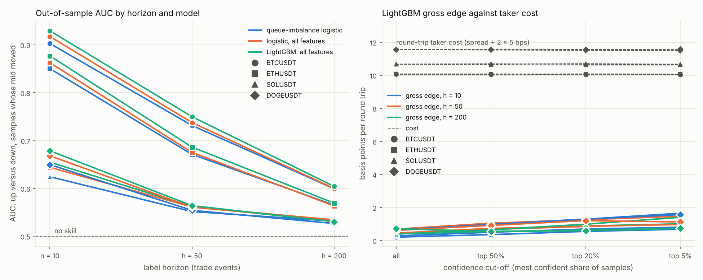

# Q11: mid-price direction from top-of-book quotes, and whether it survives costs

## Question

With top-of-book quotes added to the trade tape, can the direction of the next mid-price change be predicted out of sample, and is any of that predictability large enough to pay for acting on it as a taker? This is the price-side counterpart of Q9, which predicts trade signs from trades alone. It is limited to 2023 because Binance publishes `bookTicker` dumps for 2023 only.

## Method

- **Windows.** Train 2023-06-05 to 2023-06-18 (the last 2 days are validation days, used for early stopping and for the confidence cut-offs, after 1 discarded embargo day). Test 2023-07-03 to 2023-07-16. All splits are on whole UTC days.
- **Clock.** One sample per aggressor trade event. Sample i reads the best bid and ask strictly before trade i and the trades before i.
- **Label.** For h in {10, 50, 200} events: the sign of mid(i+h) - mid(i), raw and unsmoothed, as up, down or unchanged. Smoothed labels of the FI-2010 or DeepLOB kind are partly computable from the inputs and are not used.
- **Overlap.** Models are fitted on every g-th event (g = greatest common divisor of the horizons) with the tree leaf size scaled by h/g. Every number below is computed on every h-th event of the test window, so test labels do not overlap. A sample is used only if its label window closes inside its own block, which removes the last h events before each boundary. Events sharing a millisecond with the previous event are not fitted or scored.
- **Features (32, all causal and scale-free).** Queue imbalance, spread in ticks, a one-tick-spread indicator, microprice minus mid in ticks, quote order-flow imbalance over the last 1, 5, 20 and 100 trades in units of trailing depth, mid return over the last 10, 50 and 200 events in units of trailing volatility, and the trade-history features of `microstructure.ml.features`. The tick is the smallest price increment seen in the training window.
- **Models.** Majority class; logistic regression on queue imbalance alone (Gould and Bonart 2016); logistic regression on all features; LightGBM on all features. Each is a pair of binary models, P(mid moves) and P(up given a move), which gives both the up-versus-down scores and a three-way prediction.
- **Economics.** Direction and confidence come from P(up) - P(down). Cost is half the spread at entry, half at exit, and 2 x 5 bps of taker fee.
- **Inference.** 95% intervals resample whole UTC days (2000 resamples).

## Results

### Data and spread regime

| symbol | tick | train events | test events | time at one-tick spread | events at one-tick spread | mean spread (ticks) | trades printing at prior quote |
|---|---|---|---|---|---|---|---|
| BTCUSDT | 0.1 | 9,656,290 | 8,363,180 | 99.7% | 95.7% | 1.03 | 99.6% |
| ETHUSDT | 0.01 | 6,575,695 | 5,744,644 | 99.7% | 95.3% | 1.02 | 99.6% |
| SOLUSDT | 0.001 | 3,638,937 | 5,916,744 | 98.6% | 86.2% | 1.04 | 99.4% |
| DOGEUSDT | 1e-05 | 2,077,250 | 1,806,863 | 99.8% | 97.1% | 1.00 | 99.7% |

### Label shares in the test window (every h-th event)

| symbol | h | samples | test days | up | down | unchanged | mean abs move (bps) | share with abs move above cost at 5 bps fee |
|---|---|---|---|---|---|---|---|---|
| BTCUSDT | 10 | 828,175 | 14 | 23.4% | 23.1% | 53.5% | 0.286 | 0.01% |
| BTCUSDT | 50 | 165,553 | 14 | 39.3% | 39.3% | 21.4% | 1.028 | 0.06% |
| BTCUSDT | 200 | 41,377 | 14 | 47.6% | 47.8% | 4.6% | 2.409 | 0.98% |
| ETHUSDT | 10 | 570,591 | 14 | 28.0% | 28.1% | 43.9% | 0.447 | 0.01% |
| ETHUSDT | 50 | 114,146 | 14 | 42.7% | 42.9% | 14.4% | 1.425 | 0.11% |
| ETHUSDT | 200 | 28,536 | 14 | 48.5% | 48.9% | 2.5% | 3.125 | 3.00% |
| SOLUSDT | 10 | 584,270 | 14 | 45.9% | 46.0% | 8.2% | 2.121 | 0.26% |
| SOLUSDT | 50 | 116,834 | 14 | 48.5% | 48.7% | 2.9% | 5.105 | 9.89% |
| SOLUSDT | 200 | 29,215 | 14 | 49.0% | 49.8% | 1.2% | 10.683 | 40.59% |
| DOGEUSDT | 10 | 178,958 | 14 | 36.8% | 36.2% | 27.0% | 2.217 | 0.35% |
| DOGEUSDT | 50 | 35,814 | 14 | 45.7% | 44.2% | 10.0% | 5.447 | 10.69% |
| DOGEUSDT | 200 | 8,944 | 14 | 48.6% | 47.1% | 4.3% | 11.220 | 39.26% |

### Up versus down, on the samples whose mid moved

Log loss is in bits (1.0 is a coin flip). These scores condition on the mid having moved, which is not known in advance; the three-class table below does not condition.

| symbol | h | model | n | accuracy | AUC | MCC | log loss |
|---|---|---|---|---|---|---|---|
| BTCUSDT | 10 | majority class | 385,050 | 0.497 | 0.500 | 0.000 | 1.0001 |
| BTCUSDT | 10 | queue-imbalance logistic | 385,050 | 0.832 | 0.903 | 0.664 | 0.5770 |
| BTCUSDT | 10 | logistic, all features | 385,050 | 0.844 | 0.918 | 0.689 | 0.5294 |
| BTCUSDT | 10 | LightGBM, all features | 385,050 | 0.854 | 0.929 | 0.707 | 0.4897 |
| BTCUSDT | 50 | majority class | 130,100 | 0.500 | 0.500 | 0.000 | 1.0000 |
| BTCUSDT | 50 | queue-imbalance logistic | 130,100 | 0.681 | 0.732 | 0.362 | 0.8814 |
| BTCUSDT | 50 | logistic, all features | 130,100 | 0.684 | 0.738 | 0.368 | 0.8748 |
| BTCUSDT | 50 | LightGBM, all features | 130,100 | 0.688 | 0.750 | 0.376 | 0.8570 |
| BTCUSDT | 200 | majority class | 39,475 | 0.501 | 0.500 | 0.000 | 1.0000 |
| BTCUSDT | 200 | queue-imbalance logistic | 39,475 | 0.575 | 0.599 | 0.149 | 0.9795 |
| BTCUSDT | 200 | logistic, all features | 39,475 | 0.575 | 0.600 | 0.151 | 0.9788 |
| BTCUSDT | 200 | LightGBM, all features | 39,475 | 0.575 | 0.604 | 0.151 | 0.9761 |
| ETHUSDT | 10 | majority class | 319,927 | 0.501 | 0.500 | 0.000 | 1.0000 |
| ETHUSDT | 10 | queue-imbalance logistic | 319,927 | 0.779 | 0.850 | 0.558 | 0.6996 |
| ETHUSDT | 10 | logistic, all features | 319,927 | 0.790 | 0.863 | 0.580 | 0.6689 |
| ETHUSDT | 10 | LightGBM, all features | 319,927 | 0.800 | 0.877 | 0.600 | 0.6366 |
| ETHUSDT | 50 | majority class | 97,714 | 0.501 | 0.500 | 0.000 | 1.0000 |
| ETHUSDT | 50 | queue-imbalance logistic | 97,714 | 0.632 | 0.671 | 0.264 | 0.9351 |
| ETHUSDT | 50 | logistic, all features | 97,714 | 0.635 | 0.675 | 0.269 | 0.9316 |
| ETHUSDT | 50 | LightGBM, all features | 97,714 | 0.639 | 0.686 | 0.278 | 0.9211 |
| ETHUSDT | 200 | majority class | 27,814 | 0.502 | 0.500 | 0.000 | 1.0000 |
| ETHUSDT | 200 | queue-imbalance logistic | 27,814 | 0.547 | 0.565 | 0.095 | 0.9910 |
| ETHUSDT | 200 | logistic, all features | 27,814 | 0.547 | 0.563 | 0.094 | 0.9914 |
| ETHUSDT | 200 | LightGBM, all features | 27,814 | 0.552 | 0.569 | 0.104 | 0.9895 |
| SOLUSDT | 10 | majority class | 536,625 | 0.501 | 0.500 | 0.000 | 1.0000 |
| SOLUSDT | 10 | queue-imbalance logistic | 536,625 | 0.591 | 0.624 | 0.183 | 0.9664 |
| SOLUSDT | 10 | logistic, all features | 536,625 | 0.607 | 0.644 | 0.214 | 0.9542 |
| SOLUSDT | 10 | LightGBM, all features | 536,625 | 0.615 | 0.655 | 0.230 | 0.9466 |
| SOLUSDT | 50 | majority class | 113,503 | 0.501 | 0.500 | 0.000 | 1.0000 |
| SOLUSDT | 50 | queue-imbalance logistic | 113,503 | 0.536 | 0.552 | 0.072 | 0.9943 |
| SOLUSDT | 50 | logistic, all features | 113,503 | 0.545 | 0.561 | 0.090 | 0.9919 |
| SOLUSDT | 50 | LightGBM, all features | 113,503 | 0.546 | 0.562 | 0.093 | 0.9916 |
| SOLUSDT | 200 | majority class | 28,867 | 0.504 | 0.500 | 0.000 | 1.0000 |
| SOLUSDT | 200 | queue-imbalance logistic | 28,867 | 0.524 | 0.531 | 0.047 | 0.9981 |
| SOLUSDT | 200 | logistic, all features | 28,867 | 0.522 | 0.534 | 0.043 | 0.9975 |
| SOLUSDT | 200 | LightGBM, all features | 28,867 | 0.519 | 0.531 | 0.039 | 0.9986 |
| DOGEUSDT | 10 | majority class | 130,651 | 0.505 | 0.500 | 0.000 | 0.9999 |
| DOGEUSDT | 10 | queue-imbalance logistic | 130,651 | 0.609 | 0.650 | 0.218 | 0.9592 |
| DOGEUSDT | 10 | logistic, all features | 130,651 | 0.622 | 0.668 | 0.245 | 0.9448 |
| DOGEUSDT | 10 | LightGBM, all features | 130,651 | 0.630 | 0.679 | 0.260 | 0.9312 |
| DOGEUSDT | 50 | majority class | 32,220 | 0.509 | 0.500 | 0.000 | 0.9998 |
| DOGEUSDT | 50 | queue-imbalance logistic | 32,220 | 0.539 | 0.554 | 0.077 | 0.9958 |
| DOGEUSDT | 50 | logistic, all features | 32,220 | 0.544 | 0.561 | 0.088 | 0.9942 |
| DOGEUSDT | 50 | LightGBM, all features | 32,220 | 0.548 | 0.564 | 0.095 | 0.9908 |
| DOGEUSDT | 200 | majority class | 8,562 | 0.508 | 0.500 | 0.000 | 0.9998 |
| DOGEUSDT | 200 | queue-imbalance logistic | 8,562 | 0.515 | 0.527 | 0.028 | 0.9985 |
| DOGEUSDT | 200 | logistic, all features | 8,562 | 0.523 | 0.534 | 0.045 | 0.9975 |
| DOGEUSDT | 200 | LightGBM, all features | 8,562 | 0.531 | 0.530 | 0.059 | 0.9978 |

### LightGBM minus queue-imbalance logistic (95% day-block intervals)

| symbol | h | accuracy | AUC | MCC | log loss (bits) | three-class MCC |
|---|---|---|---|---|---|---|
| BTCUSDT | 10 | +0.0216 [+0.0196, +0.0230] | +0.0265 [+0.0222, +0.0292] | +0.0432 [+0.0393, +0.0459] | -0.0873 [-0.0895, -0.0847] | +0.1624 [+0.1478, +0.1783] |
| BTCUSDT | 50 | +0.0067 [+0.0047, +0.0082] | +0.0184 [+0.0151, +0.0209] | +0.0133 [+0.0094, +0.0164] | -0.0244 [-0.0293, -0.0212] | +0.0915 [+0.0653, +0.1160] |
| BTCUSDT | 200 | +0.0007 [-0.0036, +0.0046] | +0.0048 [+0.0020, +0.0074] | +0.0013 [-0.0073, +0.0094] | -0.0034 [-0.0050, -0.0020] | +0.0012 [-0.0065, +0.0087] |
| ETHUSDT | 10 | +0.0208 [+0.0189, +0.0225] | +0.0266 [+0.0227, +0.0296] | +0.0416 [+0.0377, +0.0450] | -0.0629 [-0.0661, -0.0597] | +0.2192 [+0.1955, +0.2407] |
| ETHUSDT | 50 | +0.0067 [+0.0052, +0.0081] | +0.0151 [+0.0128, +0.0170] | +0.0134 [+0.0104, +0.0162] | -0.0140 [-0.0164, -0.0119] | +0.0678 [+0.0502, +0.0839] |
| ETHUSDT | 200 | +0.0045 [+0.0000, +0.0088] | +0.0041 [+0.0024, +0.0060] | +0.0089 [+0.0000, +0.0176] | -0.0014 [-0.0024, -0.0007] | +0.0085 [+0.0000, +0.0168] |
| SOLUSDT | 10 | +0.0234 [+0.0202, +0.0259] | +0.0304 [+0.0257, +0.0341] | +0.0468 [+0.0405, +0.0518] | -0.0198 [-0.0209, -0.0186] | +0.0403 [+0.0343, +0.0455] |
| SOLUSDT | 50 | +0.0103 [+0.0070, +0.0129] | +0.0106 [+0.0069, +0.0136] | +0.0206 [+0.0141, +0.0257] | -0.0027 [-0.0032, -0.0021] | +0.0195 [+0.0132, +0.0245] |
| SOLUSDT | 200 | -0.0051 [-0.0121, +0.0023] | -0.0004 [-0.0059, +0.0045] | -0.0086 [-0.0230, +0.0058] | +0.0005 [+0.0000, +0.0011] | -0.0084 [-0.0225, +0.0057] |
| DOGEUSDT | 10 | +0.0209 [+0.0178, +0.0241] | +0.0289 [+0.0257, +0.0321] | +0.0419 [+0.0356, +0.0483] | -0.0280 [-0.0310, -0.0249] | +0.0830 [+0.0664, +0.1012] |
| DOGEUSDT | 50 | +0.0088 [+0.0025, +0.0152] | +0.0098 [+0.0046, +0.0152] | +0.0173 [+0.0048, +0.0301] | -0.0049 [-0.0069, -0.0026] | +0.0143 [+0.0039, +0.0254] |
| DOGEUSDT | 200 | +0.0153 [+0.0072, +0.0237] | +0.0038 [-0.0031, +0.0104] | +0.0311 [+0.0153, +0.0475] | -0.0007 [-0.0018, +0.0005] | +0.0287 [+0.0141, +0.0436] |

### Three-class prediction (up, down, unchanged) on all samples

| symbol | h | model | accuracy | MCC | predicted unchanged |
|---|---|---|---|---|---|
| BTCUSDT | 10 | majority class | 0.535 | 0.000 | 100.0% |
| BTCUSDT | 10 | queue-imbalance logistic | 0.590 | 0.384 | 37.6% |
| BTCUSDT | 10 | logistic, all features | 0.656 | 0.404 | 65.4% |
| BTCUSDT | 10 | LightGBM, all features | 0.732 | 0.547 | 59.9% |
| BTCUSDT | 50 | majority class | 0.393 | 0.000 | 0.0% |
| BTCUSDT | 50 | queue-imbalance logistic | 0.535 | 0.251 | 0.0% |
| BTCUSDT | 50 | logistic, all features | 0.538 | 0.255 | 0.0% |
| BTCUSDT | 50 | LightGBM, all features | 0.584 | 0.342 | 12.4% |
| BTCUSDT | 200 | majority class | 0.478 | 0.000 | 0.0% |
| BTCUSDT | 200 | queue-imbalance logistic | 0.548 | 0.137 | 0.0% |
| BTCUSDT | 200 | logistic, all features | 0.549 | 0.138 | 0.0% |
| BTCUSDT | 200 | LightGBM, all features | 0.549 | 0.138 | 0.0% |
| ETHUSDT | 10 | majority class | 0.439 | 0.000 | 100.0% |
| ETHUSDT | 10 | queue-imbalance logistic | 0.453 | 0.280 | 4.2% |
| ETHUSDT | 10 | logistic, all features | 0.574 | 0.352 | 39.4% |
| ETHUSDT | 10 | LightGBM, all features | 0.679 | 0.499 | 53.1% |
| ETHUSDT | 50 | majority class | 0.429 | 0.000 | 0.0% |
| ETHUSDT | 50 | queue-imbalance logistic | 0.541 | 0.204 | 0.0% |
| ETHUSDT | 50 | logistic, all features | 0.543 | 0.208 | 0.0% |
| ETHUSDT | 50 | LightGBM, all features | 0.563 | 0.272 | 9.5% |
| ETHUSDT | 200 | majority class | 0.489 | 0.000 | 0.0% |
| ETHUSDT | 200 | queue-imbalance logistic | 0.534 | 0.090 | 0.0% |
| ETHUSDT | 200 | logistic, all features | 0.533 | 0.090 | 0.0% |
| ETHUSDT | 200 | LightGBM, all features | 0.538 | 0.099 | 0.0% |
| SOLUSDT | 10 | majority class | 0.460 | 0.000 | 0.0% |
| SOLUSDT | 10 | queue-imbalance logistic | 0.543 | 0.157 | 0.0% |
| SOLUSDT | 10 | logistic, all features | 0.557 | 0.183 | 0.0% |
| SOLUSDT | 10 | LightGBM, all features | 0.565 | 0.197 | 0.0% |
| SOLUSDT | 50 | majority class | 0.487 | 0.000 | 0.0% |
| SOLUSDT | 50 | queue-imbalance logistic | 0.521 | 0.068 | 0.0% |
| SOLUSDT | 50 | logistic, all features | 0.529 | 0.085 | 0.0% |
| SOLUSDT | 50 | LightGBM, all features | 0.531 | 0.088 | 0.0% |
| SOLUSDT | 200 | majority class | 0.498 | 0.000 | 0.0% |
| SOLUSDT | 200 | queue-imbalance logistic | 0.518 | 0.046 | 0.0% |
| SOLUSDT | 200 | logistic, all features | 0.516 | 0.042 | 0.0% |
| SOLUSDT | 200 | LightGBM, all features | 0.513 | 0.038 | 0.0% |
| DOGEUSDT | 10 | majority class | 0.270 | 0.000 | 100.0% |
| DOGEUSDT | 10 | queue-imbalance logistic | 0.429 | 0.126 | 19.4% |
| DOGEUSDT | 10 | logistic, all features | 0.438 | 0.146 | 24.4% |
| DOGEUSDT | 10 | LightGBM, all features | 0.482 | 0.209 | 20.5% |
| DOGEUSDT | 50 | majority class | 0.457 | 0.000 | 0.0% |
| DOGEUSDT | 50 | queue-imbalance logistic | 0.485 | 0.064 | 0.0% |
| DOGEUSDT | 50 | logistic, all features | 0.490 | 0.073 | 0.0% |
| DOGEUSDT | 50 | LightGBM, all features | 0.493 | 0.079 | 0.0% |
| DOGEUSDT | 200 | majority class | 0.486 | 0.000 | 0.0% |
| DOGEUSDT | 200 | queue-imbalance logistic | 0.493 | 0.026 | 0.0% |
| DOGEUSDT | 200 | logistic, all features | 0.501 | 0.041 | 0.0% |
| DOGEUSDT | 200 | LightGBM, all features | 0.508 | 0.055 | 0.0% |

### Gross edge against round-trip taker cost (LightGBM, all samples)

Gross edge is the mean mid move in the predicted direction, in basis points, over the samples at or above the confidence cut-off, including samples whose mid did not move. Cost is half the spread at entry plus half at exit plus 2 x 5 bps. Intervals are 95% day-block.

| symbol | h | cut-off | n | hit rate | gross (bps) | spread cost | fees | cost | gross / cost | net (bps) |
|---|---|---|---|---|---|---|---|---|---|---|
| BTCUSDT | 10 | all | 828,175 | 39.7% | 0.204 [0.175, 0.226] | 0.047 | 10.0 | 10.047 | 0.020 | -9.843 [-9.868, -9.824] |
| BTCUSDT | 10 | top 50% | 423,045 | 62.0% | 0.355 [0.330, 0.374] | 0.050 | 10.0 | 10.050 | 0.035 | -9.695 [-9.717, -9.678] |
| BTCUSDT | 10 | top 20% | 166,693 | 86.6% | 0.550 [0.527, 0.569] | 0.044 | 10.0 | 10.044 | 0.055 | -9.494 [-9.516, -9.476] |
| BTCUSDT | 10 | top 5% | 34,048 | 97.2% | 0.680 [0.653, 0.707] | 0.038 | 10.0 | 10.038 | 0.068 | -9.359 [-9.385, -9.332] |
| BTCUSDT | 50 | all | 165,552 | 54.0% | 0.426 [0.389, 0.454] | 0.047 | 10.0 | 10.047 | 0.042 | -9.622 [-9.656, -9.596] |
| BTCUSDT | 50 | top 50% | 80,068 | 67.0% | 0.670 [0.626, 0.705] | 0.042 | 10.0 | 10.042 | 0.067 | -9.371 [-9.414, -9.338] |
| BTCUSDT | 50 | top 20% | 30,249 | 76.7% | 0.849 [0.807, 0.884] | 0.038 | 10.0 | 10.038 | 0.085 | -9.189 [-9.230, -9.155] |
| BTCUSDT | 50 | top 5% | 6,956 | 84.0% | 1.004 [0.928, 1.086] | 0.039 | 10.0 | 10.039 | 0.100 | -9.035 [-9.109, -8.955] |
| BTCUSDT | 200 | all | 41,377 | 54.9% | 0.436 [0.404, 0.460] | 0.048 | 10.0 | 10.048 | 0.043 | -9.611 [-9.642, -9.587] |
| BTCUSDT | 200 | top 50% | 20,204 | 59.4% | 0.690 [0.644, 0.731] | 0.040 | 10.0 | 10.040 | 0.069 | -9.350 [-9.396, -9.310] |
| BTCUSDT | 200 | top 20% | 7,684 | 63.4% | 0.878 [0.828, 0.922] | 0.038 | 10.0 | 10.038 | 0.087 | -9.160 [-9.210, -9.116] |
| BTCUSDT | 200 | top 5% | 1,857 | 66.4% | 1.006 [0.874, 1.142] | 0.037 | 10.0 | 10.037 | 0.100 | -9.031 [-9.164, -8.896] |
| ETHUSDT | 10 | all | 570,591 | 44.9% | 0.276 [0.246, 0.302] | 0.073 | 10.0 | 10.073 | 0.027 | -9.797 [-9.822, -9.774] |
| ETHUSDT | 10 | top 50% | 260,787 | 68.5% | 0.498 [0.474, 0.516] | 0.078 | 10.0 | 10.078 | 0.049 | -9.580 [-9.600, -9.564] |
| ETHUSDT | 10 | top 20% | 100,320 | 86.3% | 0.695 [0.669, 0.716] | 0.069 | 10.0 | 10.069 | 0.069 | -9.374 [-9.397, -9.354] |
| ETHUSDT | 10 | top 5% | 21,436 | 94.4% | 0.803 [0.769, 0.837] | 0.059 | 10.0 | 10.059 | 0.080 | -9.257 [-9.290, -9.224] |
| ETHUSDT | 50 | all | 114,146 | 54.7% | 0.448 [0.416, 0.475] | 0.073 | 10.0 | 10.073 | 0.044 | -9.625 [-9.651, -9.602] |
| ETHUSDT | 50 | top 50% | 48,243 | 65.1% | 0.732 [0.686, 0.768] | 0.067 | 10.0 | 10.067 | 0.073 | -9.335 [-9.377, -9.301] |
| ETHUSDT | 50 | top 20% | 18,368 | 71.0% | 0.861 [0.813, 0.907] | 0.060 | 10.0 | 10.060 | 0.086 | -9.199 [-9.245, -9.154] |
| ETHUSDT | 50 | top 5% | 4,779 | 77.7% | 0.966 [0.904, 1.030] | 0.056 | 10.0 | 10.056 | 0.096 | -9.090 [-9.151, -9.026] |
| ETHUSDT | 200 | all | 28,536 | 53.8% | 0.397 [0.354, 0.437] | 0.072 | 10.0 | 10.072 | 0.039 | -9.676 [-9.717, -9.635] |
| ETHUSDT | 200 | top 50% | 12,188 | 56.6% | 0.546 [0.487, 0.603] | 0.063 | 10.0 | 10.063 | 0.054 | -9.517 [-9.576, -9.460] |
| ETHUSDT | 200 | top 20% | 4,478 | 59.4% | 0.627 [0.543, 0.720] | 0.059 | 10.0 | 10.059 | 0.062 | -9.432 [-9.515, -9.341] |
| ETHUSDT | 200 | top 5% | 1,088 | 64.0% | 0.744 [0.522, 0.941] | 0.055 | 10.0 | 10.055 | 0.074 | -9.311 [-9.533, -9.116] |
| SOLUSDT | 10 | all | 584,270 | 56.5% | 0.640 [0.605, 0.670] | 0.665 | 10.0 | 10.665 | 0.060 | -10.025 [-10.119, -9.924] |
| SOLUSDT | 10 | top 50% | 270,251 | 62.9% | 1.009 [0.961, 1.052] | 0.643 | 10.0 | 10.643 | 0.095 | -9.633 [-9.692, -9.565] |
| SOLUSDT | 10 | top 20% | 100,316 | 67.4% | 1.290 [1.229, 1.344] | 0.618 | 10.0 | 10.618 | 0.121 | -9.329 [-9.370, -9.284] |
| SOLUSDT | 10 | top 5% | 24,031 | 71.4% | 1.648 [1.543, 1.747] | 0.620 | 10.0 | 10.620 | 0.155 | -8.971 [-9.064, -8.894] |
| SOLUSDT | 50 | all | 116,834 | 53.1% | 0.690 [0.641, 0.730] | 0.670 | 10.0 | 10.670 | 0.065 | -9.981 [-10.066, -9.882] |
| SOLUSDT | 50 | top 50% | 56,023 | 55.5% | 1.045 [0.949, 1.132] | 0.681 | 10.0 | 10.681 | 0.098 | -9.636 [-9.719, -9.533] |
| SOLUSDT | 50 | top 20% | 22,172 | 57.1% | 1.259 [1.123, 1.369] | 0.698 | 10.0 | 10.698 | 0.118 | -9.439 [-9.514, -9.354] |
| SOLUSDT | 50 | top 5% | 5,580 | 59.2% | 1.464 [1.212, 1.724] | 0.669 | 10.0 | 10.669 | 0.137 | -9.205 [-9.370, -9.041] |
| SOLUSDT | 200 | all | 29,215 | 51.3% | 0.391 [0.285, 0.504] | 0.669 | 10.0 | 10.669 | 0.037 | -10.278 [-10.480, -10.072] |
| SOLUSDT | 200 | top 50% | 14,986 | 52.2% | 0.645 [0.519, 0.803] | 0.694 | 10.0 | 10.694 | 0.060 | -10.049 [-10.279, -9.773] |
| SOLUSDT | 200 | top 20% | 6,403 | 53.8% | 0.986 [0.751, 1.283] | 0.669 | 10.0 | 10.669 | 0.092 | -9.683 [-9.965, -9.307] |
| SOLUSDT | 200 | top 5% | 1,552 | 55.4% | 1.403 [0.792, 2.028] | 0.657 | 10.0 | 10.657 | 0.132 | -9.254 [-9.805, -8.680] |
| DOGEUSDT | 10 | all | 178,958 | 46.0% | 0.638 [0.604, 0.670] | 1.540 | 10.0 | 11.540 | 0.055 | -10.901 [-10.956, -10.857] |
| DOGEUSDT | 10 | top 50% | 94,198 | 51.9% | 0.972 [0.922, 1.020] | 1.529 | 10.0 | 11.529 | 0.084 | -10.557 [-10.616, -10.509] |
| DOGEUSDT | 10 | top 20% | 39,077 | 57.9% | 1.290 [1.226, 1.354] | 1.505 | 10.0 | 11.505 | 0.112 | -10.215 [-10.275, -10.161] |
| DOGEUSDT | 10 | top 5% | 10,442 | 62.9% | 1.566 [1.480, 1.639] | 1.487 | 10.0 | 11.487 | 0.136 | -9.921 [-9.994, -9.857] |
| DOGEUSDT | 50 | all | 35,814 | 49.3% | 0.610 [0.528, 0.702] | 1.542 | 10.0 | 11.542 | 0.053 | -10.932 [-11.032, -10.837] |
| DOGEUSDT | 50 | top 50% | 17,570 | 51.5% | 0.912 [0.823, 1.030] | 1.543 | 10.0 | 11.543 | 0.079 | -10.631 [-10.726, -10.514] |
| DOGEUSDT | 50 | top 20% | 7,146 | 53.0% | 1.203 [1.104, 1.303] | 1.555 | 10.0 | 11.555 | 0.104 | -10.353 [-10.458, -10.248] |
| DOGEUSDT | 50 | top 5% | 1,748 | 54.3% | 1.120 [0.942, 1.313] | 1.574 | 10.0 | 11.574 | 0.097 | -10.454 [-10.635, -10.263] |
| DOGEUSDT | 200 | all | 8,944 | 50.8% | 0.711 [0.491, 0.953] | 1.548 | 10.0 | 11.548 | 0.062 | -10.838 [-11.059, -10.599] |
| DOGEUSDT | 200 | top 50% | 4,265 | 50.8% | 0.545 [0.236, 0.840] | 1.553 | 10.0 | 11.553 | 0.047 | -11.007 [-11.316, -10.717] |
| DOGEUSDT | 200 | top 20% | 1,729 | 50.8% | 0.590 [-0.380, 1.417] | 1.555 | 10.0 | 11.555 | 0.051 | -10.965 [-11.938, -10.148] |
| DOGEUSDT | 200 | top 5% | 463 | 49.5% | 0.736 [-1.122, 2.743] | 1.568 | 10.0 | 11.568 | 0.064 | -10.832 [-12.730, -8.814] |

The same table for the two logistic models is in the JSON output.

### Large-tick versus small-tick

Ordered from most to least time at a one-tick spread: DOGEUSDT spends 99.8% of the time at a one-tick spread (queue-imbalance AUC 0.650, LightGBM AUC 0.679 at h = 10); BTCUSDT spends 99.7% of the time at a one-tick spread (queue-imbalance AUC 0.903, LightGBM AUC 0.929 at h = 10); ETHUSDT spends 99.7% of the time at a one-tick spread (queue-imbalance AUC 0.850, LightGBM AUC 0.877 at h = 10); SOLUSDT spends 98.6% of the time at a one-tick spread (queue-imbalance AUC 0.624, LightGBM AUC 0.655 at h = 10).
The ordering by queue-imbalance logistic AUC does not match the ordering by one-tick share. With 4 symbols this is a description, not a fitted relationship.
The ordering by LightGBM, all features AUC does not match the ordering by one-tick share. With 4 symbols this is a description, not a fitted relationship.

## Verdict

**Is direction predictable?**

- h = 10 events: out-of-sample AUC on the samples whose mid moved is 0.624 to 0.903 for the queue-imbalance logistic and 0.655 to 0.929 for LightGBM across 4 symbol(s). The LightGBM minus queue-imbalance AUC difference has a day-block interval above zero for 4, below zero for 0 and including zero for 0 of 4.
- h = 50 events: out-of-sample AUC on the samples whose mid moved is 0.552 to 0.732 for the queue-imbalance logistic and 0.562 to 0.750 for LightGBM across 4 symbol(s). The LightGBM minus queue-imbalance AUC difference has a day-block interval above zero for 4, below zero for 0 and including zero for 0 of 4.
- h = 200 events: out-of-sample AUC on the samples whose mid moved is 0.527 to 0.599 for the queue-imbalance logistic and 0.530 to 0.604 for LightGBM across 4 symbol(s). The LightGBM minus queue-imbalance AUC difference has a day-block interval above zero for 2, below zero for 0 and including zero for 2 of 4.
- LightGBM AUC is lower at h = 200 than at h = 10 for 4 of 4 symbol(s).

**Does it survive taker costs?**

**No.** In none of the 144 cells (symbol x horizon x model x confidence cut-off) does the gross edge exceed the round-trip taker cost at a fee of 5 bps per side. The cell that comes closest is SOLUSDT, h = 200, logistic, all features, top 5% (n = 1429): gross edge 1.977 bps against a cost of 10.694 bps, a ratio of 0.185. Whatever direction these models predict is not tradeable by a taker at this fee, and I make no claim of profitability.

## Caveats

- **Fee not verified at source.** The 5 bps taker fee is the Binance USDT-M regular-tier figure as reported by third-party pages. I could not check it against Binance's own fee page, and fees changed over time. It is a command-line parameter (`--fee-bps`); the report can be rebuilt at another fee without refitting.
- **The cost accounting is optimistic.** Entry is priced at the quote that stood before trade i, with no latency, no queue of competing takers and no market impact of the order itself. A real taker acts after seeing the data and gets a later, usually worse, quote. If the gross edge does not cover the cost here, it will not cover it in practice.
- **Taker only.** A passive order would earn the spread and pay a lower fee, but top-of-book data without queue position cannot say when it would fill. No maker result is implied.
- **Conditioning.** The up-versus-down scores use only samples whose mid moved, which is known only afterwards. The three-class and economics tables use all samples.
- **Short sample.** One training window and one test window from 2023, with at most 14 test day(s). Day-block intervals from so few days are coarse and likely too narrow. One market regime; nothing here is tested on other years.
- **Many cells.** The economics table has one cell per symbol, horizon, model and cut-off, with no multiple-testing correction.
- **Mechanical component.** At a one-tick spread the thinner queue tends to empty first, so part of the predictability from queue imbalance is queue mechanics, bounded by about one tick.
- **Data.** `bookTicker` shows only the best level and may coalesce updates; trades are joined to the last quote with a strictly earlier millisecond timestamp. The table above reports how often a trade prints at or through that quote.
- **Models were not tuned.** LightGBM uses the project's default settings, and only the number of rounds is chosen on the validation days.
