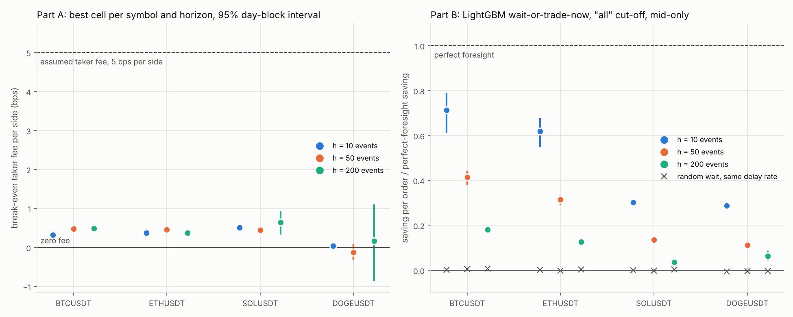

# Q13: how far the Q11 mid-direction edge is from break-even, and what it is worth for order timing

## Question

Q11 found that the direction of the next mid-price change is predictable out of sample, but that the gross edge never covers a round-trip taker cost. Q13 asks two follow-up questions of the same test-window predictions. (A) At what taker fee per side would each cell break even, and does any cell pay even at a zero fee? (B) For a trader who must buy or sell anyway, how much does waiting h events when the model expects the mid to move in the trader's favour save against trading at once? Nothing is refitted and no new data is read.

## Method

- **Predictions.** Q11's cached test-window predictions under key `3197e0626855`, which is what Q11's `config_key` gives today for its default run config (train 2023-06-05 to 2023-06-18, test 2023-07-03 to 2023-07-16) and its current fit settings. Other keys on disk, including the one written before the tick-size fix, are not read. Every number uses every h-th test event, as in Q11.
- **Cut-offs.** Q11 fixed its confidence cut-offs on the validation days (the most confident 100%, 50%, 20% and 5% of validation samples ranked by |P(up) - P(down)|) and stored the thresholds with the predictions. Q13 applies those stored thresholds unchanged. The "all" cut-off is the rule P(up) - P(down) != 0, which needs no data. No threshold is chosen on the test window.
- **Part A.** Gross edge (mean mid move in the predicted direction over the samples at or above the cut-off) and spread cost (half the spread at entry plus half at exit) are computed by Q11's own code. Break-even taker fee per side = (gross - spread cost) / 2. Required multiple = round-trip cost at 5 bps per side / gross edge.
- **Part B.** At each test sample one buyer and one seller must trade one unit, with equal weight. If the model's P(down) - P(up) is at or above the cut-off the buyer waits h events and buys then; if P(up) - P(down) is, the seller waits; otherwise both trade now. The saving of a delayed order is the mid move in its favour, in bps of the mid at i; an order traded now saves 0. Perfect foresight waits exactly when the mid moves in the trader's favour. The random wait delays the same share of orders on a coin flip (seeded).
- **Spread at the delayed time.** The cache holds only the sum of the half spreads at i and i+h, so the half spread at the delayed time cannot be separated from the one at i. The saving is therefore mid-only: it leaves out any change in the half spread between i and i+h. As a scale, the saving is divided by half the mean cached spread, the average of the entry and exit half spreads.
- **Inference.** 95% intervals resample whole UTC days (2000 resamples, seed 0 as in Q11).

## Check against Q11

The numbers below reproduce Q11's economics table (n, gross edge, spread cost and both day-block intervals; tolerance 1e-09 bps): queue-imbalance logistic 48 cells, largest difference 0 bps; logistic, all features 48 cells, largest difference 0 bps; LightGBM, all features 48 cells, largest difference 0 bps.

## Results

### Part A: best cell per symbol

The best cell is the one with the highest break-even fee per side over every horizon, model and cut-off.

| symbol | best cell | gross (bps) | spread cost | break-even fee per side (bps) | cost at 5 bps / gross | pays at zero fee |
|---|---|---|---|---|---|---|
| BTCUSDT | h = 200, queue-imbalance logistic, top 5% (n = 1,831) | 1.020 | 0.048 | +0.486 [+0.382, +0.575] | 9.9x | yes |
| ETHUSDT | h = 50, LightGBM, all features, top 5% (n = 4,779) | 0.966 | 0.056 | +0.455 [+0.425, +0.487] | 10.4x | yes |
| SOLUSDT | h = 200, logistic, all features, top 5% (n = 1,429) | 1.977 | 0.694 | +0.642 [+0.330, +0.922] | 5.4x | yes |
| DOGEUSDT | h = 200, queue-imbalance logistic, top 5% (n = 491) | 1.929 | 1.602 | +0.163 [-0.867, +1.100] | 6.0x | yes |

### Part A: every LightGBM cell

Gross edge and spread cost are Q11's. Break-even fee per side = (gross - spread cost) / 2, with its 95% day-block interval. The multiple is the round-trip cost at 5 bps per side divided by the gross edge. The logistic models' cells are in the JSON output.

| symbol | h | cut-off | n | gross (bps) | spread cost | break-even fee (bps) | pays at zero fee | cost at 5 bps / gross |
|---|---|---|---|---|---|---|---|---|
| BTCUSDT | 10 | all | 828,175 | 0.204 | 0.047 | +0.078 [+0.066, +0.088] | yes | 49.3x |
| BTCUSDT | 10 | top 50% | 423,045 | 0.355 | 0.050 | +0.153 [+0.142, +0.161] | yes | 28.3x |
| BTCUSDT | 10 | top 20% | 166,693 | 0.550 | 0.044 | +0.253 [+0.242, +0.262] | yes | 18.3x |
| BTCUSDT | 10 | top 5% | 34,048 | 0.680 | 0.038 | +0.321 [+0.308, +0.334] | yes | 14.8x |
| BTCUSDT | 50 | all | 165,552 | 0.426 | 0.047 | +0.189 [+0.172, +0.202] | yes | 23.6x |
| BTCUSDT | 50 | top 50% | 80,068 | 0.670 | 0.042 | +0.314 [+0.293, +0.331] | yes | 15.0x |
| BTCUSDT | 50 | top 20% | 30,249 | 0.849 | 0.038 | +0.406 [+0.385, +0.422] | yes | 11.8x |
| BTCUSDT | 50 | top 5% | 6,956 | 1.004 | 0.039 | +0.482 [+0.446, +0.522] | yes | 10.0x |
| BTCUSDT | 200 | all | 41,377 | 0.436 | 0.048 | +0.194 [+0.179, +0.206] | yes | 23.0x |
| BTCUSDT | 200 | top 50% | 20,204 | 0.690 | 0.040 | +0.325 [+0.302, +0.345] | yes | 14.6x |
| BTCUSDT | 200 | top 20% | 7,684 | 0.878 | 0.038 | +0.420 [+0.395, +0.442] | yes | 11.4x |
| BTCUSDT | 200 | top 5% | 1,857 | 1.006 | 0.037 | +0.485 [+0.418, +0.552] | yes | 10.0x |
| ETHUSDT | 10 | all | 570,591 | 0.276 | 0.073 | +0.102 [+0.089, +0.113] | yes | 36.5x |
| ETHUSDT | 10 | top 50% | 260,787 | 0.498 | 0.078 | +0.210 [+0.200, +0.218] | yes | 20.2x |
| ETHUSDT | 10 | top 20% | 100,320 | 0.695 | 0.069 | +0.313 [+0.301, +0.323] | yes | 14.5x |
| ETHUSDT | 10 | top 5% | 21,436 | 0.803 | 0.059 | +0.372 [+0.355, +0.388] | yes | 12.5x |
| ETHUSDT | 50 | all | 114,146 | 0.448 | 0.073 | +0.188 [+0.174, +0.199] | yes | 22.5x |
| ETHUSDT | 50 | top 50% | 48,243 | 0.732 | 0.067 | +0.333 [+0.311, +0.350] | yes | 13.8x |
| ETHUSDT | 50 | top 20% | 18,368 | 0.861 | 0.060 | +0.401 [+0.378, +0.423] | yes | 11.7x |
| ETHUSDT | 50 | top 5% | 4,779 | 0.966 | 0.056 | +0.455 [+0.425, +0.487] | yes | 10.4x |
| ETHUSDT | 200 | all | 28,536 | 0.397 | 0.072 | +0.162 [+0.142, +0.182] | yes | 25.4x |
| ETHUSDT | 200 | top 50% | 12,188 | 0.546 | 0.063 | +0.241 [+0.212, +0.270] | yes | 18.4x |
| ETHUSDT | 200 | top 20% | 4,478 | 0.627 | 0.059 | +0.284 [+0.242, +0.330] | yes | 16.0x |
| ETHUSDT | 200 | top 5% | 1,088 | 0.744 | 0.055 | +0.345 [+0.233, +0.442] | yes | 13.5x |
| SOLUSDT | 10 | all | 584,270 | 0.640 | 0.665 | -0.012 [-0.060, +0.038] | no | 16.7x |
| SOLUSDT | 10 | top 50% | 270,251 | 1.009 | 0.643 | +0.183 [+0.154, +0.217] | yes | 10.5x |
| SOLUSDT | 10 | top 20% | 100,316 | 1.290 | 0.618 | +0.336 [+0.315, +0.358] | yes | 8.2x |
| SOLUSDT | 10 | top 5% | 24,031 | 1.648 | 0.620 | +0.514 [+0.468, +0.553] | yes | 6.4x |
| SOLUSDT | 50 | all | 116,834 | 0.690 | 0.670 | +0.010 [-0.033, +0.059] | yes | 15.5x |
| SOLUSDT | 50 | top 50% | 56,023 | 1.045 | 0.681 | +0.182 [+0.141, +0.233] | yes | 10.2x |
| SOLUSDT | 50 | top 20% | 22,172 | 1.259 | 0.698 | +0.281 [+0.243, +0.323] | yes | 8.5x |
| SOLUSDT | 50 | top 5% | 5,580 | 1.464 | 0.669 | +0.398 [+0.315, +0.479] | yes | 7.3x |
| SOLUSDT | 200 | all | 29,215 | 0.391 | 0.669 | -0.139 [-0.240, -0.036] | no | 27.3x |
| SOLUSDT | 200 | top 50% | 14,986 | 0.645 | 0.694 | -0.024 [-0.140, +0.113] | no | 16.6x |
| SOLUSDT | 200 | top 20% | 6,403 | 0.986 | 0.669 | +0.158 [+0.018, +0.346] | yes | 10.8x |
| SOLUSDT | 200 | top 5% | 1,552 | 1.403 | 0.657 | +0.373 [+0.098, +0.660] | yes | 7.6x |
| DOGEUSDT | 10 | all | 178,958 | 0.638 | 1.540 | -0.451 [-0.478, -0.429] | no | 18.1x |
| DOGEUSDT | 10 | top 50% | 94,198 | 0.972 | 1.529 | -0.278 [-0.308, -0.254] | no | 11.9x |
| DOGEUSDT | 10 | top 20% | 39,077 | 1.290 | 1.505 | -0.108 [-0.138, -0.080] | no | 8.9x |
| DOGEUSDT | 10 | top 5% | 10,442 | 1.566 | 1.487 | +0.040 [+0.003, +0.072] | yes | 7.3x |
| DOGEUSDT | 50 | all | 35,814 | 0.610 | 1.542 | -0.466 [-0.516, -0.419] | no | 18.9x |
| DOGEUSDT | 50 | top 50% | 17,570 | 0.912 | 1.543 | -0.315 [-0.363, -0.257] | no | 12.7x |
| DOGEUSDT | 50 | top 20% | 7,146 | 1.203 | 1.555 | -0.176 [-0.229, -0.124] | no | 9.6x |
| DOGEUSDT | 50 | top 5% | 1,748 | 1.120 | 1.574 | -0.227 [-0.317, -0.131] | no | 10.3x |
| DOGEUSDT | 200 | all | 8,944 | 0.711 | 1.548 | -0.419 [-0.530, -0.300] | no | 16.2x |
| DOGEUSDT | 200 | top 50% | 4,265 | 0.545 | 1.553 | -0.504 [-0.658, -0.359] | no | 21.2x |
| DOGEUSDT | 200 | top 20% | 1,729 | 0.590 | 1.555 | -0.482 [-0.969, -0.074] | no | 19.6x |
| DOGEUSDT | 200 | top 5% | 463 | 0.736 | 1.568 | -0.416 [-1.365, +0.593] | no | 15.7x |

### Part B: wait or trade now, every model at the "all" cut-off

Mean saving per order against always trading now, in bps of the mid, over buyers and sellers with equal weight (orders not delayed save 0). Intervals are 95% day-block. "Half spreads" divides by the mean cached half spread (the average of the entry and exit half spreads). "Of perfect" is the share of the perfect-foresight saving. The random wait delays the same share of orders on a coin flip.

| symbol | h | policy | orders delayed | saving per order (bps) | sd per order | half spreads | of perfect | random wait (bps) |
|---|---|---|---|---|---|---|---|---|
| BTCUSDT | 10 | queue-imbalance logistic | 50.0% | +0.090 [+0.078, +0.099] | 0.402 | 3.82 | 0.63 | +0.000 [-0.000, +0.001] |
| BTCUSDT | 10 | logistic, all features | 50.0% | +0.097 [+0.083, +0.107] | 0.401 | 4.11 | 0.68 | +0.000 [-0.000, +0.001] |
| BTCUSDT | 10 | LightGBM, all features | 50.0% | +0.102 [+0.087, +0.113] | 0.400 | 4.33 | 0.71 | +0.000 [-0.000, +0.001] |
| BTCUSDT | 10 | perfect foresight | 23.2% | +0.143 [+0.118, +0.162] | 0.387 | 6.07 | 1.00 |  |
| BTCUSDT | 50 | queue-imbalance logistic | 50.0% | +0.194 [+0.179, +0.206] | 1.079 | 8.18 | 0.38 | +0.002 [-0.003, +0.008] |
| BTCUSDT | 50 | logistic, all features | 50.0% | +0.201 [+0.185, +0.214] | 1.078 | 8.47 | 0.39 | +0.002 [-0.003, +0.008] |
| BTCUSDT | 50 | LightGBM, all features | 50.0% | +0.213 [+0.194, +0.227] | 1.076 | 8.96 | 0.41 | +0.002 [-0.003, +0.008] |
| BTCUSDT | 50 | perfect foresight | 39.3% | +0.514 [+0.444, +0.566] | 0.969 | 21.65 | 1.00 |  |
| BTCUSDT | 200 | queue-imbalance logistic | 50.0% | +0.216 [+0.201, +0.231] | 2.335 | 9.05 | 0.18 | +0.008 [-0.007, +0.023] |
| BTCUSDT | 200 | logistic, all features | 50.0% | +0.220 [+0.203, +0.234] | 2.335 | 9.23 | 0.18 | +0.008 [-0.007, +0.023] |
| BTCUSDT | 200 | LightGBM, all features | 50.0% | +0.218 [+0.202, +0.230] | 2.335 | 9.14 | 0.18 | +0.008 [-0.007, +0.023] |
| BTCUSDT | 200 | perfect foresight | 47.7% | +1.204 [+1.069, +1.305] | 2.013 | 50.45 | 1.00 |  |
| ETHUSDT | 10 | queue-imbalance logistic | 50.0% | +0.122 [+0.109, +0.132] | 0.551 | 3.34 | 0.54 | +0.000 [-0.000, +0.001] |
| ETHUSDT | 10 | logistic, all features | 50.0% | +0.130 [+0.116, +0.142] | 0.549 | 3.58 | 0.58 | +0.000 [-0.000, +0.001] |
| ETHUSDT | 10 | LightGBM, all features | 50.0% | +0.138 [+0.123, +0.151] | 0.547 | 3.80 | 0.62 | +0.000 [-0.000, +0.001] |
| ETHUSDT | 10 | perfect foresight | 28.0% | +0.223 [+0.190, +0.251] | 0.518 | 6.14 | 1.00 |  |
| ETHUSDT | 50 | queue-imbalance logistic | 50.0% | +0.204 [+0.190, +0.215] | 1.440 | 5.61 | 0.29 | -0.001 [-0.006, +0.005] |
| ETHUSDT | 50 | logistic, all features | 50.0% | +0.210 [+0.194, +0.224] | 1.439 | 5.79 | 0.30 | -0.001 [-0.006, +0.005] |
| ETHUSDT | 50 | LightGBM, all features | 50.0% | +0.224 [+0.208, +0.237] | 1.437 | 6.17 | 0.31 | -0.001 [-0.006, +0.005] |
| ETHUSDT | 50 | perfect foresight | 42.8% | +0.712 [+0.633, +0.781] | 1.268 | 19.61 | 1.00 |  |
| ETHUSDT | 200 | queue-imbalance logistic | 50.0% | +0.192 [+0.171, +0.211] | 3.017 | 5.30 | 0.12 | +0.006 [-0.018, +0.031] |
| ETHUSDT | 200 | logistic, all features | 50.0% | +0.185 [+0.162, +0.204] | 3.017 | 5.13 | 0.12 | +0.006 [-0.018, +0.031] |
| ETHUSDT | 200 | LightGBM, all features | 50.0% | +0.198 [+0.177, +0.218] | 3.016 | 5.49 | 0.13 | +0.006 [-0.018, +0.031] |
| ETHUSDT | 200 | perfect foresight | 48.7% | +1.563 [+1.405, +1.700] | 2.588 | 43.26 | 1.00 |  |
| SOLUSDT | 10 | queue-imbalance logistic | 50.0% | +0.239 [+0.228, +0.253] | 2.144 | 0.72 | 0.23 | -0.001 [-0.004, +0.002] |
| SOLUSDT | 10 | logistic, all features | 50.0% | +0.297 [+0.282, +0.310] | 2.137 | 0.89 | 0.28 | -0.001 [-0.004, +0.002] |
| SOLUSDT | 10 | LightGBM, all features | 50.0% | +0.320 [+0.303, +0.335] | 2.134 | 0.96 | 0.30 | -0.001 [-0.004, +0.002] |
| SOLUSDT | 10 | perfect foresight | 45.9% | +1.060 [+0.962, +1.146] | 1.879 | 3.19 | 1.00 |  |
| SOLUSDT | 50 | queue-imbalance logistic | 50.0% | +0.252 [+0.238, +0.272] | 4.924 | 0.75 | 0.10 | -0.004 [-0.020, +0.012] |
| SOLUSDT | 50 | logistic, all features | 50.0% | +0.334 [+0.315, +0.351] | 4.920 | 1.00 | 0.13 | -0.004 [-0.020, +0.012] |
| SOLUSDT | 50 | LightGBM, all features | 50.0% | +0.345 [+0.321, +0.365] | 4.919 | 1.03 | 0.14 | -0.004 [-0.020, +0.012] |
| SOLUSDT | 50 | perfect foresight | 48.6% | +2.553 [+2.324, +2.755] | 4.219 | 7.62 | 1.00 |  |
| SOLUSDT | 200 | queue-imbalance logistic | 50.0% | +0.311 [+0.236, +0.376] | 10.063 | 0.93 | 0.06 | +0.023 [-0.049, +0.094] |
| SOLUSDT | 200 | logistic, all features | 50.0% | +0.310 [+0.254, +0.375] | 10.063 | 0.93 | 0.06 | +0.023 [-0.049, +0.094] |
| SOLUSDT | 200 | LightGBM, all features | 50.0% | +0.196 [+0.142, +0.252] | 10.066 | 0.58 | 0.04 | +0.023 [-0.049, +0.094] |
| SOLUSDT | 200 | perfect foresight | 49.4% | +5.341 [+4.804, +5.825] | 8.535 | 15.96 | 1.00 |  |
| DOGEUSDT | 10 | queue-imbalance logistic | 50.0% | +0.257 [+0.246, +0.269] | 2.236 | 0.33 | 0.23 | -0.007 [-0.011, -0.003] |
| DOGEUSDT | 10 | logistic, all features | 50.0% | +0.296 [+0.280, +0.312] | 2.232 | 0.38 | 0.27 | -0.007 [-0.011, -0.003] |
| DOGEUSDT | 10 | LightGBM, all features | 50.0% | +0.319 [+0.302, +0.335] | 2.228 | 0.41 | 0.29 | -0.007 [-0.011, -0.003] |
| DOGEUSDT | 10 | perfect foresight | 36.5% | +1.109 [+0.985, +1.193] | 1.959 | 1.44 | 1.00 |  |
| DOGEUSDT | 50 | queue-imbalance logistic | 50.0% | +0.234 [+0.205, +0.278] | 5.136 | 0.30 | 0.09 | -0.009 [-0.040, +0.024] |
| DOGEUSDT | 50 | logistic, all features | 50.0% | +0.270 [+0.238, +0.308] | 5.134 | 0.35 | 0.10 | -0.009 [-0.040, +0.024] |
| DOGEUSDT | 50 | LightGBM, all features | 50.0% | +0.305 [+0.264, +0.351] | 5.132 | 0.40 | 0.11 | -0.009 [-0.040, +0.024] |
| DOGEUSDT | 50 | perfect foresight | 45.0% | +2.724 [+2.470, +2.905] | 4.361 | 3.53 | 1.00 |  |
| DOGEUSDT | 200 | queue-imbalance logistic | 50.0% | +0.175 [+0.046, +0.297] | 10.395 | 0.23 | 0.03 | -0.017 [-0.145, +0.120] |
| DOGEUSDT | 200 | logistic, all features | 50.0% | +0.251 [+0.144, +0.360] | 10.393 | 0.32 | 0.04 | -0.017 [-0.145, +0.120] |
| DOGEUSDT | 200 | LightGBM, all features | 50.0% | +0.355 [+0.246, +0.477] | 10.390 | 0.46 | 0.06 | -0.017 [-0.145, +0.120] |
| DOGEUSDT | 200 | perfect foresight | 47.9% | +5.610 [+5.038, +5.983] | 8.752 | 7.25 | 1.00 |  |

### Part B: LightGBM across Q11's cut-offs

"Saving when delayed" is the mean favourable mid move over the delayed orders only (it equals Q11's gross edge for the cell). "Worse" is the share of delayed orders whose mid moved against the trader.

| symbol | h | cut-off | orders delayed | saving per order (bps) | sd per order | saving when delayed | sd when delayed | worse | of perfect |
|---|---|---|---|---|---|---|---|---|---|
| BTCUSDT | 10 | all | 50.0% | +0.102 [+0.087, +0.113] | 0.400 | 0.204 | 0.546 | 6.8% | 0.71 |
| BTCUSDT | 10 | top 50% | 25.5% | +0.091 [+0.077, +0.101] | 0.349 | 0.355 | 0.619 | 5.6% | 0.64 |
| BTCUSDT | 10 | top 20% | 10.1% | +0.055 [+0.048, +0.061] | 0.260 | 0.550 | 0.633 | 3.2% | 0.39 |
| BTCUSDT | 10 | top 5% | 2.1% | +0.014 [+0.013, +0.015] | 0.136 | 0.680 | 0.666 | 1.4% | 0.10 |
| BTCUSDT | 50 | all | 50.0% | +0.213 [+0.194, +0.227] | 1.076 | 0.426 | 1.491 | 24.5% | 0.41 |
| BTCUSDT | 50 | top 50% | 24.2% | +0.162 [+0.148, +0.173] | 0.791 | 0.670 | 1.498 | 20.2% | 0.32 |
| BTCUSDT | 50 | top 20% | 9.1% | +0.078 [+0.073, +0.082] | 0.501 | 0.849 | 1.448 | 16.4% | 0.15 |
| BTCUSDT | 50 | top 5% | 2.1% | +0.021 [+0.019, +0.023] | 0.259 | 1.004 | 1.490 | 11.8% | 0.04 |
| BTCUSDT | 200 | all | 50.0% | +0.218 [+0.202, +0.230] | 2.335 | 0.436 | 3.288 | 40.5% | 0.18 |
| BTCUSDT | 200 | top 50% | 24.4% | +0.168 [+0.158, +0.179] | 1.616 | 0.690 | 3.216 | 36.8% | 0.14 |
| BTCUSDT | 200 | top 20% | 9.3% | +0.082 [+0.078, +0.085] | 0.983 | 0.878 | 3.114 | 33.8% | 0.07 |
| BTCUSDT | 200 | top 5% | 2.2% | +0.023 [+0.020, +0.026] | 0.488 | 1.006 | 3.100 | 31.8% | 0.02 |
| ETHUSDT | 10 | all | 50.0% | +0.138 [+0.123, +0.151] | 0.547 | 0.276 | 0.748 | 11.2% | 0.62 |
| ETHUSDT | 10 | top 50% | 22.9% | +0.114 [+0.099, +0.126] | 0.450 | 0.498 | 0.835 | 9.7% | 0.51 |
| ETHUSDT | 10 | top 20% | 8.8% | +0.061 [+0.054, +0.067] | 0.318 | 0.695 | 0.841 | 6.6% | 0.27 |
| ETHUSDT | 10 | top 5% | 1.9% | +0.015 [+0.014, +0.016] | 0.155 | 0.803 | 0.802 | 3.5% | 0.07 |
| ETHUSDT | 50 | all | 50.0% | +0.224 [+0.208, +0.237] | 1.437 | 0.448 | 2.008 | 30.9% | 0.31 |
| ETHUSDT | 50 | top 50% | 21.1% | +0.155 [+0.144, +0.164] | 0.971 | 0.732 | 2.009 | 26.4% | 0.22 |
| ETHUSDT | 50 | top 20% | 8.0% | +0.069 [+0.064, +0.074] | 0.578 | 0.861 | 1.863 | 22.9% | 0.10 |
| ETHUSDT | 50 | top 5% | 2.1% | +0.020 [+0.018, +0.023] | 0.288 | 0.966 | 1.745 | 16.7% | 0.03 |
| ETHUSDT | 200 | all | 50.0% | +0.198 [+0.177, +0.218] | 3.016 | 0.397 | 4.256 | 43.7% | 0.13 |
| ETHUSDT | 200 | top 50% | 21.4% | +0.117 [+0.104, +0.129] | 1.874 | 0.546 | 4.026 | 41.2% | 0.07 |
| ETHUSDT | 200 | top 20% | 7.8% | +0.049 [+0.042, +0.058] | 1.057 | 0.627 | 3.724 | 38.7% | 0.03 |
| ETHUSDT | 200 | top 5% | 1.9% | +0.014 [+0.010, +0.019] | 0.452 | 0.744 | 3.192 | 34.7% | 0.01 |
| SOLUSDT | 10 | all | 50.0% | +0.320 [+0.303, +0.335] | 2.134 | 0.640 | 2.984 | 35.4% | 0.30 |
| SOLUSDT | 10 | top 50% | 23.1% | +0.233 [+0.222, +0.244] | 1.499 | 1.009 | 2.989 | 29.9% | 0.22 |
| SOLUSDT | 10 | top 20% | 8.6% | +0.111 [+0.106, +0.117] | 0.960 | 1.290 | 3.036 | 26.1% | 0.10 |
| SOLUSDT | 10 | top 5% | 2.1% | +0.034 [+0.032, +0.036] | 0.594 | 1.648 | 3.811 | 22.5% | 0.03 |
| SOLUSDT | 50 | all | 50.0% | +0.345 [+0.321, +0.365] | 4.919 | 0.690 | 6.939 | 44.1% | 0.14 |
| SOLUSDT | 50 | top 50% | 24.0% | +0.251 [+0.226, +0.273] | 3.436 | 1.045 | 6.957 | 41.7% | 0.10 |
| SOLUSDT | 50 | top 20% | 9.5% | +0.119 [+0.105, +0.132] | 2.185 | 1.259 | 6.992 | 40.2% | 0.05 |
| SOLUSDT | 50 | top 5% | 2.4% | +0.035 [+0.029, +0.041] | 1.095 | 1.464 | 6.939 | 38.7% | 0.01 |
| SOLUSDT | 200 | all | 50.0% | +0.196 [+0.142, +0.252] | 10.066 | 0.391 | 14.233 | 47.5% | 0.04 |
| SOLUSDT | 200 | top 50% | 25.6% | +0.165 [+0.134, +0.204] | 7.293 | 0.645 | 14.391 | 46.7% | 0.03 |
| SOLUSDT | 200 | top 20% | 11.0% | +0.108 [+0.083, +0.139] | 4.656 | 0.986 | 14.033 | 44.9% | 0.02 |
| SOLUSDT | 200 | top 5% | 2.7% | +0.037 [+0.021, +0.054] | 2.371 | 1.403 | 14.481 | 43.4% | 0.01 |
| DOGEUSDT | 10 | all | 50.0% | +0.319 [+0.302, +0.335] | 2.228 | 0.638 | 3.119 | 27.0% | 0.29 |
| DOGEUSDT | 10 | top 50% | 26.3% | +0.256 [+0.243, +0.269] | 1.640 | 0.972 | 3.085 | 23.1% | 0.23 |
| DOGEUSDT | 10 | top 20% | 10.9% | +0.141 [+0.133, +0.148] | 1.085 | 1.290 | 3.049 | 19.7% | 0.13 |
| DOGEUSDT | 10 | top 5% | 2.9% | +0.046 [+0.043, +0.049] | 0.592 | 1.566 | 3.105 | 16.9% | 0.04 |
| DOGEUSDT | 50 | all | 50.0% | +0.305 [+0.264, +0.351] | 5.132 | 0.610 | 7.245 | 40.7% | 0.11 |
| DOGEUSDT | 50 | top 50% | 24.5% | +0.224 [+0.201, +0.254] | 3.502 | 0.912 | 7.026 | 38.3% | 0.08 |
| DOGEUSDT | 50 | top 20% | 10.0% | +0.120 [+0.112, +0.130] | 2.244 | 1.203 | 7.011 | 36.5% | 0.04 |
| DOGEUSDT | 50 | top 5% | 2.4% | +0.027 [+0.023, +0.033] | 1.052 | 1.120 | 6.645 | 34.1% | 0.01 |
| DOGEUSDT | 200 | all | 50.0% | +0.355 [+0.246, +0.477] | 10.390 | 0.711 | 14.685 | 44.9% | 0.06 |
| DOGEUSDT | 200 | top 50% | 23.8% | +0.130 [+0.056, +0.202] | 7.059 | 0.545 | 14.449 | 44.7% | 0.02 |
| DOGEUSDT | 200 | top 20% | 9.7% | +0.057 [-0.037, +0.137] | 4.323 | 0.590 | 13.893 | 44.5% | 0.01 |
| DOGEUSDT | 200 | top 5% | 2.6% | +0.019 [-0.030, +0.071] | 2.147 | 0.736 | 13.326 | 44.3% | 0.00 |

### Q7 execution costs, quoted from `q7_execution.json`

Mean shortfall per unit in basis points of the arrival mid, evaluation days 2023-06-04 to 2023-06-07, parent orders over 2000 events in 20 children. Only the symbols shared with Q13 are listed, with Q7's pooled panel figures in the last row.

| symbol | TWAP (bps) | front-loaded (bps) | flow-reactive (bps) |
|---|---|---|---|
| BTCUSDT | 0.033 (sd 4.71) | 0.282 (sd 0.18) | 0.042 (sd 4.69) |
| SOLUSDT | 0.335 (sd 20.54) | 2.023 (sd 1.21) | 0.339 (sd 20.54) |
| pooled (Q7 panel) | 0.551 (sd 29.33) | 2.115 (sd 1.75) | 0.508 (sd 29.37) |

## Verdict

**(A) How far from break-even, at an assumed 5 bps per side?**

- Across all 144 cells (symbol x horizon x model x cut-off), 0 pay at the assumed 5 bps per side and 101 have a gross edge above the spread cost, that is, would pay at a zero fee.
- **BTCUSDT: pays only below 0.486 bps per side.** The best cell is h = 200, queue-imbalance logistic, top 5% (n = 1,831): gross edge 1.020 bps against a spread cost of 0.048 bps, break-even fee +0.486 bps per side [+0.382, +0.575]. At the assumed 5 bps the round-trip cost is 9.9x the gross edge. Even the interval's upper end is 11.5% of the assumed fee.
- **ETHUSDT: pays only below 0.455 bps per side.** The best cell is h = 50, LightGBM, all features, top 5% (n = 4,779): gross edge 0.966 bps against a spread cost of 0.056 bps, break-even fee +0.455 bps per side [+0.425, +0.487]. At the assumed 5 bps the round-trip cost is 10.4x the gross edge. Even the interval's upper end is 9.7% of the assumed fee.
- **SOLUSDT: pays only below 0.642 bps per side.** The best cell is h = 200, logistic, all features, top 5% (n = 1,429): gross edge 1.977 bps against a spread cost of 0.694 bps, break-even fee +0.642 bps per side [+0.330, +0.922]. At the assumed 5 bps the round-trip cost is 5.4x the gross edge. Even the interval's upper end is 18.4% of the assumed fee.
- **DOGEUSDT: pays only below 0.163 bps per side.** The best cell is h = 200, queue-imbalance logistic, top 5% (n = 491): gross edge 1.929 bps against a spread cost of 1.602 bps, break-even fee +0.163 bps per side [-0.867, +1.100]. At the assumed 5 bps the round-trip cost is 6.0x the gross edge. Even the interval's upper end is 22.0% of the assumed fee. The interval includes zero, so a positive break-even fee is itself not established.

**(B) What is the prediction worth for timing an order that must be placed?**

- **BTCUSDT:** the largest mean saving is at h = 200, logistic, all features, all: 50.0% of orders delayed, +0.220 [+0.203, +0.234] bps per order (standard deviation 2.335 bps per order, 40.5% of delayed orders end up worse), 0.18 of the perfect-foresight bound of 1.204 bps and 9.23 times the mean half spread. At the "all" cut-off one side of every sample is delayed, hence about half of all orders. The random wait at the same rate saves +0.008 [-0.007, +0.023] bps, an interval that includes zero. Q7 put this symbol's mean shortfall at 0.033 bps (TWAP), 0.282 bps (front-loaded) and 0.042 bps (flow-reactive).
- **ETHUSDT:** the largest mean saving is at h = 50, LightGBM, all features, all: 50.0% of orders delayed, +0.224 [+0.208, +0.237] bps per order (standard deviation 1.437 bps per order, 30.9% of delayed orders end up worse), 0.31 of the perfect-foresight bound of 0.712 bps and 6.17 times the mean half spread. At the "all" cut-off one side of every sample is delayed, hence about half of all orders. The random wait at the same rate saves -0.001 [-0.006, +0.005] bps, an interval that includes zero.
- **SOLUSDT:** the largest mean saving is at h = 50, LightGBM, all features, all: 50.0% of orders delayed, +0.345 [+0.321, +0.365] bps per order (standard deviation 4.919 bps per order, 44.1% of delayed orders end up worse), 0.14 of the perfect-foresight bound of 2.553 bps and 1.03 times the mean half spread. At the "all" cut-off one side of every sample is delayed, hence about half of all orders. The random wait at the same rate saves -0.004 [-0.020, +0.012] bps, an interval that includes zero. Q7 put this symbol's mean shortfall at 0.335 bps (TWAP), 2.023 bps (front-loaded) and 0.339 bps (flow-reactive).
- **DOGEUSDT:** the largest mean saving is at h = 200, LightGBM, all features, all: 50.0% of orders delayed, +0.355 [+0.246, +0.477] bps per order (standard deviation 10.390 bps per order, 44.9% of delayed orders end up worse), 0.06 of the perfect-foresight bound of 5.610 bps and 0.46 times the mean half spread. At the "all" cut-off one side of every sample is delayed, hence about half of all orders. The random wait at the same rate saves -0.017 [-0.145, +0.120] bps, an interval that includes zero.
- Against Q7: its flow-reactive schedule beat TWAP by 0.043 bps per unit pooled over its symbols (paired SE 0.019, n = 96). The best mid-only timing saving above is larger than that in 4 of 4 symbol(s). The two are not like for like: Q7 is a model-based replay of 2000-event parent orders on 2023-06-04 to 2023-06-07, Q13 is single orders delayed h events on the Q11 test window, and the Q13 saving leaves out the spread change and the order's own impact.

## Caveats

- **Fee not verified at source.** The 5 bps taker fee per side is the Binance USDT-M regular-tier figure as reported by third-party pages, the same assumption as Q11. I could not check it against Binance's own fee page, and fees changed over time. No other fee tier is assumed here; the break-even fee lets a reader compare with whatever fee applies to them. It is a command-line parameter (`--fee-bps`).
- **Spread change not included.** The saving in Part B is a mid-price saving. A delayed order crosses the half spread at i+h, not at i, and the cache cannot separate the two. When the spread sits at one tick most of the time (see the one-tick shares in Q11) the change is usually zero, but it is not measured here.
- **Delaying has costs not modelled.** The order's own market impact, the risk that the quote moves away and the order is not filled at all, other participants trading on the same signal, and latency are all absent. The standard deviation and the share of delayed orders that end up worse show that waiting adds risk, even when the mean saving is positive.
- **Optimistic timing.** Sample i reads the quote that stood before trade i, with no latency, as in Q11. A real trader sees the data later.
- **Q7 is not like for like.** Q7 is a model-based replay (drift, half spread and linear own impact) of parent orders on different days in June 2023, and 2 of its symbols are in Q13. Its numbers are quoted for scale, not as a benchmark this analysis beats or misses.
- **Short sample.** One test window from 2023 with at most 14 test day(s); day-block intervals from so few days are coarse and likely too narrow.
- **Many cells.** Part A has one cell per symbol, horizon, model and cut-off, and the best cell per symbol is a maximum over them, which flatters it. No multiple-testing correction is applied.
