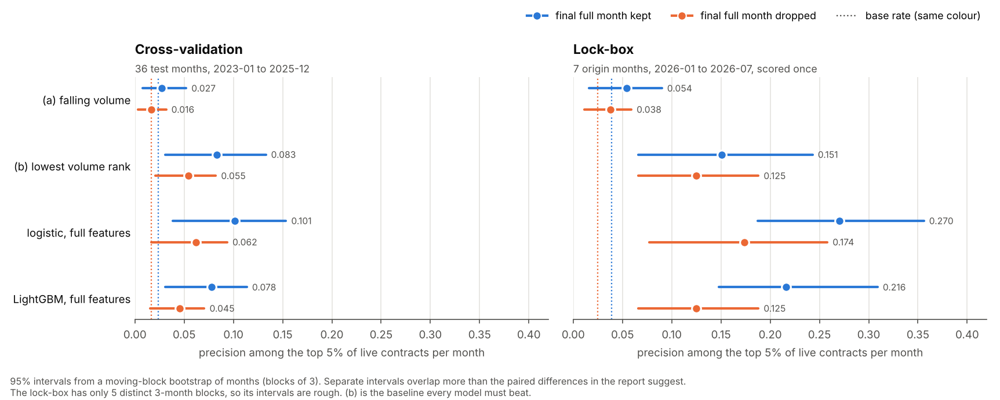

# Q16: can a coin's own trading tell that it is about to be delisted?

## Question

Does a contract's own monthly trading (volume, open interest, price, funding) rank it as likely to stop trading within 3 months, better than the rule that flags the lowest-volume contracts?

## Universe and labels

- **Lifecycle.** Every USDT-M perpetual with a daily aggTrades file in the data.binance.vision archive: 924 symbols, 935 lives (alive 758, delisted 151, reused-symbol 11, renamed 10, index 3, merged 2). Dates come from daily aggTrades only. A gap of more than 30 days starts a new life, so 11 reused tickers give two lives each.
- **Ghost months.** Klines, funding and metrics keep publishing files after a contract stops trading: 2,126 of 23,356 monthly panel rows (9.1%) are ghost months with files but no traded volume. They are never used as a death date, and the labelled panel keeps 0 of them.
- **Events and censoring.** An event is a delisting (status `delisted`, or the first life of a reused ticker). Renamed (10) and merged (2) lives are censored at their last trading month: not events, and not negatives near the end. Alive lives are censored at 2026-10.
- **Label.** At the end of month t, y = 1 if the life's last trading month L is in t+1 to t+3, using data up to month t only. Censored rows with t + 3 past the censoring month are dropped, never set to 0; the final trading month L itself is never a feature row; rows with t + 3 past 2026-10 are dropped for every life, so the last labelled month is 2026-07.
- **Exclusions.** 238 lives: 182 by the weekend-volume screen, confirmed by name, 25 stocks (Q14 name review), 16 non-crypto by name with under 14 trading days, 6 ETFs (Q14 name review), 3 Q14 timing screen, 3 index contracts, 3 commodities (Q14 name review). Crypto lives under the weekend cut that were kept by name: CFGUSDT life 1, GRVTUSDT life 1, LITUSDT life 2, MOONSHOTUSDT life 1, PREDICTUSDT life 1. No excluded life is an event.
- **Panel.** 18,329 life-months, 686 lives with at least one labelled row (alive 513, delisted 150, reused-symbol 11, renamed 10, merged 2), 2020-01 to 2026-07; 465 positive rows from 161 event lives, base rate 0.0254. Rows dropped when the panel was built: censored_label_unknown 24, final_trading_month 174, label_window_past_data_end 1,573.

### Base rate by year of the prediction month

| year | rows | lives | positive rows | event lives | base rate | role |
|---|---|---|---|---|---|---|
| 2020 | 502 | 80 | 3 | 1 | 0.0060 | training only |
| 2021 | 1,380 | 137 | 11 | 5 | 0.0080 | training only |
| 2022 | 1,689 | 159 | 44 | 17 | 0.0261 | training only |
| 2023 | 2,294 | 243 | 9 | 4 | 0.0039 | CV test |
| 2024 | 3,339 | 371 | 89 | 32 | 0.0267 | CV test |
| 2025 | 5,395 | 580 | 164 | 65 | 0.0304 | CV test |
| 2026 | 3,730 | 574 | 145 | 61 | 0.0389 | lock-box |

## Method

1. **Validation.** Expanding window with monthly origins and 6-month test blocks from 2023-01 to 2025-12 (6 folds, 36 test months). A training row needs t + 3 before the first test month, so no training label window reaches the test block. Scalers, thresholds, C and tree counts are fitted on training rows only (inner split: the last 12 training months).
2. **Alert rule and metrics.** Each month, flag the top max(1, round(0.05 x live contracts)) by score; precision and recall over all alerts, and PR-AUC. 95% intervals from a moving-block bootstrap of test months (blocks of 3, 2000 replicates, seed 0); model comparisons use paired differences on the same replicates.
3. **Candidates.** Baselines (b0): (a) falling 3-month volume, (b) lowest volume rank within the month, (c) logistic on those two plus age. Models (b1): L2 logistic and LightGBM on 35 features in 8 groups (volume level, volume trend, age, price and drawdown, volatility, open interest, funding, other activity), plus ablations and a discrete-time hazard for interpretation.
4. **Lock-box (b2).** The full logistic model, LightGBM and rules (a) and (b) were frozen at commit b3571a6, trained on every row with t + 3 before 2026-01, and scored once on origins 2026-01 to 2026-07 (first run on 2026-11-18).
5. **Announcement sensitivity.** Every result is reported twice: as labelled, and with the final full month before the last trading month (`final_full_month`) dropped from training and test rows, since that month often holds the delisting announcement.
6. **Assembly.** This report parses b2's saved tables and reads the CV numbers from b0's and b1's JSON output; nothing is refitted or rescored here.

## Results

### Baselines in cross-validation

Final full month kept: 11,028 test rows, 262 positive rows from 96 event lives, base rate 0.0238 [0.0129, 0.0322].

| baseline | precision at top 5% | recall | hits/alerts | PR-AUC |
|---|---|---|---|---|
| (a) falling volume | 0.027 [0.008, 0.052] | 0.057 [0.026, 0.112] | 15/552 | 0.028 [0.014, 0.043] |
| (b) lowest volume rank | 0.083 [0.031, 0.133] | 0.176 [0.094, 0.258] | 46/552 | 0.056 [0.023, 0.086] |
| (c) logistic, 3 features | 0.053 [0.021, 0.075] | 0.111 [0.061, 0.144] | 29/552 | 0.045 [0.019, 0.064] |

Paired differences: (b) - (a) +0.056 [+0.002, +0.103]; (c) - (b) -0.031 [-0.063, -0.006]. The volume rank (b) is the bar.

Final full month dropped: 10,948 test rows, 182 positive rows from 96 event lives, base rate 0.0166 [0.0087, 0.0227].

| baseline | precision at top 5% | recall | hits/alerts | PR-AUC |
|---|---|---|---|---|
| (a) falling volume | 0.016 [0.003, 0.032] | 0.049 [0.011, 0.090] | 9/550 | 0.019 [0.009, 0.031] |
| (b) lowest volume rank | 0.055 [0.021, 0.082] | 0.165 [0.093, 0.225] | 30/550 | 0.040 [0.014, 0.060] |
| (c) logistic, 3 features | 0.029 [0.008, 0.044] | 0.088 [0.036, 0.126] | 16/550 | 0.028 [0.013, 0.040] |

Paired differences: (b) - (a) +0.038 [+0.008, +0.060]; (c) - (b) -0.025 [-0.041, -0.011]. The volume rank (b) is the bar.

### Models in cross-validation

**Final full month kept.**

| model | precision at top 5% | hits/alerts | PR-AUC | precision - (b) | against (b) |
|---|---|---|---|---|---|
| (b) lowest volume rank | 0.083 [0.031, 0.133] | 46/552 | 0.056 [0.023, 0.086] |  | (bar) |
| logistic, full features | 0.101 [0.038, 0.153] | 56/552 | 0.076 [0.027, 0.120] | +0.018 [-0.008, +0.042] | is ahead but not decisively |
| LightGBM, full features | 0.078 [0.031, 0.114] | 43/552 | 0.053 [0.017, 0.087] | -0.005 [-0.041, +0.017] | does not beat the baseline |
| logistic, volume only | 0.062 [0.026, 0.089] | 34/552 | 0.046 [0.016, 0.074] | -0.022 [-0.056, +0.003] | does not beat the baseline |
| LightGBM, volume only | 0.047 [0.027, 0.066] | 26/552 | 0.040 [0.020, 0.056] | -0.036 [-0.080, +0.006] | does not beat the baseline |

**Final full month dropped.**

| model | precision at top 5% | hits/alerts | PR-AUC | precision - (b) | against (b) |
|---|---|---|---|---|---|
| (b) lowest volume rank | 0.055 [0.021, 0.082] | 30/550 | 0.040 [0.014, 0.060] |  | (bar) |
| logistic, full features | 0.062 [0.017, 0.094] | 34/550 | 0.060 [0.020, 0.092] | +0.007 [-0.019, +0.022] | is ahead but not decisively |
| LightGBM, full features | 0.045 [0.015, 0.070] | 25/550 | 0.033 [0.012, 0.055] | -0.009 [-0.023, +0.004] | does not beat the baseline |
| logistic, volume only | 0.047 [0.022, 0.067] | 26/550 | 0.029 [0.012, 0.046] | -0.007 [-0.022, +0.008] | does not beat the baseline |
| LightGBM, volume only | 0.031 [0.016, 0.047] | 17/550 | 0.028 [0.016, 0.042] | -0.024 [-0.050, +0.006] | does not beat the baseline |

LightGBM's early stopping kept 20 to 41 trees in every fold (20 is the floor), so it is close to a few shallow trees: what it learns from earlier years does not carry forward. Models fitted on the volume features alone are below the raw volume rank in 4 of 4 model-run pairs (precision differences -0.036 to -0.007): fitting weights to volume level and trend on earlier years adds drift, not signal.

### Lock-box (2026)

| run | train rows | train positives | C (logistic) | trees (LightGBM) | training base rate |
|---|---|---|---|---|---|
| final full month kept | 13,002 | 244 | 0.03 | 20 | 0.0188 |
| final full month dropped | 12,930 | 172 | 0.01 | 36 | 0.0133 |

**Final full month kept.** 3,730 rows (574 lives) over 7 origin months (2026-01 to 2026-07); 145 positive rows from 61 event lives; base rate 0.0389 [0.0241, 0.0533].

| candidate | precision at top 5% | recall | hits/alerts | PR-AUC |
|---|---|---|---|---|
| (a) falling volume | 0.054 [0.016, 0.090] | 0.069 [0.033, 0.087] | 10/185 | 0.052 [0.020, 0.082] |
| (b) lowest volume rank | 0.151 [0.066, 0.243] | 0.193 [0.135, 0.217] | 28/185 | 0.119 [0.046, 0.196] |
| logistic, full features | 0.270 [0.187, 0.356] | 0.345 [0.318, 0.392] | 50/185 | 0.202 [0.119, 0.312] |
| LightGBM, full features | 0.216 [0.148, 0.309] | 0.276 [0.251, 0.327] | 40/185 | 0.171 [0.123, 0.245] |

| difference | precision | PR-AUC | leave one month out (precision) | against (b) |
|---|---|---|---|---|
| logistic, full features - (b) | +0.119 [+0.097, +0.145] | +0.083 [+0.061, +0.151] | +0.101 to +0.139 | beats the baseline |
| LightGBM, full features - (b) | +0.065 [+0.038, +0.124] | +0.052 [+0.033, +0.119] | +0.044 to +0.095 | beats the baseline |
| (a) falling volume - (b) | -0.097 [-0.148, -0.044] | -0.067 [-0.113, -0.025] | -0.119 to -0.076 | does not beat the baseline |

**Final full month dropped.** 3,677 rows (567 lives) over 7 origin months (2026-01 to 2026-07); 92 positive rows from 54 event lives; base rate 0.0250 [0.0159, 0.0343].

| candidate | precision at top 5% | recall | hits/alerts | PR-AUC |
|---|---|---|---|---|
| (a) falling volume | 0.038 [0.011, 0.059] | 0.076 [0.032, 0.090] | 7/184 | 0.037 [0.014, 0.056] |
| (b) lowest volume rank | 0.125 [0.066, 0.188] | 0.250 [0.207, 0.303] | 23/184 | 0.092 [0.044, 0.142] |
| logistic, full features | 0.174 [0.077, 0.258] | 0.348 [0.237, 0.381] | 32/184 | 0.133 [0.056, 0.233] |
| LightGBM, full features | 0.125 [0.066, 0.188] | 0.250 [0.207, 0.338] | 23/184 | 0.085 [0.060, 0.141] |

| difference | precision | PR-AUC | leave one month out (precision) | against (b) |
|---|---|---|---|---|
| logistic, full features - (b) | +0.049 [-0.016, +0.081] | +0.041 [+0.002, +0.092] | +0.019 to +0.076 | is ahead but not decisively |
| LightGBM, full features - (b) | +0.000 [-0.005, +0.022] | -0.007 [-0.022, +0.040] | -0.013 to +0.006 | does not beat the baseline |
| (a) falling volume - (b) | -0.087 [-0.134, -0.044] | -0.056 [-0.089, -0.027] | -0.108 to -0.070 | does not beat the baseline |

Hits among the alerts by origin month (final month kept / dropped):

| origin month | alerts | positive rows | (a) | (b) | logistic | LightGBM |
|---|---|---|---|---|---|---|
| 2026-01 | 27 | 34 / 27 | 3 / 3 | 9 / 6 | 13 / 12 | 6 / 5 |
| 2026-02 | 27 | 31 / 22 | 3 / 2 | 8 / 7 | 8 / 7 | 10 / 6 |
| 2026-03 | 27 | 28 / 10 | 2 / 0 | 4 / 3 | 10 / 4 | 9 / 5 |
| 2026-04 | 26 | 12 / 8 | 1 / 1 | 1 / 1 | 5 / 2 | 4 / 1 |
| 2026-05 | 26 | 15 / 9 | 0 / 0 | 4 / 4 | 5 / 1 | 5 / 3 |
| 2026-06 | 26 | 10 / 8 | 1 / 1 | 0 / 0 | 5 / 3 | 3 / 1 |
| 2026-07 | 26 | 15 / 8 | 0 / 0 | 2 / 2 | 4 / 3 | 3 / 2 |

### Cross-validation against the lock-box (the figure)

| run | candidate | CV precision at top 5% | lock-box precision |
|---|---|---|---|
| final full month kept | (a) falling volume | 0.027 [0.008, 0.052] | 0.054 [0.016, 0.090] |
| final full month kept | (b) lowest volume rank | 0.083 [0.031, 0.133] | 0.151 [0.066, 0.243] |
| final full month kept | logistic, full features | 0.101 [0.038, 0.153] | 0.270 [0.187, 0.356] |
| final full month kept | LightGBM, full features | 0.078 [0.031, 0.114] | 0.216 [0.148, 0.309] |
| final full month dropped | (a) falling volume | 0.016 [0.003, 0.032] | 0.038 [0.011, 0.059] |
| final full month dropped | (b) lowest volume rank | 0.055 [0.021, 0.082] | 0.125 [0.066, 0.188] |
| final full month dropped | logistic, full features | 0.062 [0.017, 0.094] | 0.174 [0.077, 0.258] |
| final full month dropped | LightGBM, full features | 0.045 [0.015, 0.070] | 0.125 [0.066, 0.188] |

### Which features matter

**Final full month kept**, LightGBM TreeSHAP on the last CV fold (2025-07 to 2025-12): groups open interest 40%, price and drawdown 18%, funding 17%, volume level 13%, volume trend 6%, volatility 3%, age 3%, other activity 1%; top features oi_rank_pct 25% (corr with SHAP -0.90), funding_interval_min_h 9% (corr with SHAP -0.73), funding_abs_mean 7% (corr with SHAP +0.58), trades_rank_pct 5% (corr with SHAP -0.60), max_dd_life 5% (corr with SHAP -0.37).

**Final full month dropped**, LightGBM TreeSHAP on the last CV fold (2025-07 to 2025-12): groups open interest 40%, price and drawdown 25%, funding 15%, volume trend 11%, volume level 6%, age 1%, volatility 1%, other activity 1%; top features oi_rank_pct 22% (corr with SHAP -0.88), log_oi 7% (corr with SHAP -0.70), funding_abs_mean 7% (corr with SHAP +0.32), funding_interval_min_h 7% (corr with SHAP -0.56), ret_6m 6% (corr with SHAP -0.23).

Ablations in CV: volume features plus one group (change against the same model on volume features only; last column is the paired difference against rule (b)).

| run | model | added group | precision | change vs volume only | PR-AUC change | precision - (b) |
|---|---|---|---|---|---|---|
| final full month kept | logistic | age | 0.045 [0.025, 0.067] | -0.016 | -0.000 | -0.038 [-0.079, +0.003] |
| final full month kept | logistic | price and drawdown | 0.080 [0.039, 0.110] | +0.018 | +0.009 | -0.004 [-0.032, +0.016] |
| final full month kept | logistic | volatility | 0.062 [0.026, 0.089] | +0.000 | +0.005 | -0.022 [-0.058, +0.004] |
| final full month kept | logistic | open interest | 0.083 [0.036, 0.121] | +0.022 | +0.007 | +0.000 [-0.030, +0.025] |
| final full month kept | logistic | funding | 0.051 [0.025, 0.075] | -0.011 | +0.004 | -0.033 [-0.068, +0.006] |
| final full month kept | logistic | other activity | 0.063 [0.028, 0.090] | +0.002 | +0.000 | -0.020 [-0.055, +0.005] |
| final full month kept | LightGBM | age | 0.047 [0.024, 0.070] | +0.000 | +0.002 | -0.036 [-0.074, +0.002] |
| final full month kept | LightGBM | price and drawdown | 0.051 [0.023, 0.071] | +0.004 | +0.001 | -0.033 [-0.077, +0.006] |
| final full month kept | LightGBM | volatility | 0.058 [0.031, 0.081] | +0.011 | +0.005 | -0.025 [-0.067, +0.017] |
| final full month kept | LightGBM | open interest | 0.083 [0.029, 0.125] | +0.036 | +0.010 | +0.000 [-0.035, +0.023] |
| final full month kept | LightGBM | funding | 0.047 [0.024, 0.070] | +0.000 | +0.009 | -0.036 [-0.085, +0.011] |
| final full month kept | LightGBM | other activity | 0.051 [0.029, 0.074] | +0.004 | -0.001 | -0.033 [-0.066, +0.004] |
| final full month dropped | logistic | age | 0.045 [0.021, 0.063] | -0.002 | +0.000 | -0.009 [-0.023, +0.006] |
| final full month dropped | logistic | price and drawdown | 0.053 [0.024, 0.079] | +0.005 | +0.006 | -0.002 [-0.019, +0.019] |
| final full month dropped | logistic | volatility | 0.045 [0.018, 0.068] | -0.002 | +0.001 | -0.009 [-0.025, +0.008] |
| final full month dropped | logistic | open interest | 0.056 [0.020, 0.082] | +0.009 | +0.014 | +0.002 [-0.016, +0.011] |
| final full month dropped | logistic | funding | 0.042 [0.018, 0.063] | -0.005 | +0.004 | -0.013 [-0.034, +0.009] |
| final full month dropped | logistic | other activity | 0.045 [0.020, 0.067] | -0.002 | -0.001 | -0.009 [-0.020, +0.005] |
| final full month dropped | LightGBM | age | 0.022 [0.007, 0.036] | -0.009 | -0.002 | -0.033 [-0.063, +0.002] |
| final full month dropped | LightGBM | price and drawdown | 0.031 [0.014, 0.048] | +0.000 | -0.001 | -0.024 [-0.042, -0.002] |
| final full month dropped | LightGBM | volatility | 0.027 [0.013, 0.042] | -0.004 | +0.000 | -0.027 [-0.050, +0.000] |
| final full month dropped | LightGBM | open interest | 0.053 [0.020, 0.079] | +0.022 | +0.009 | -0.002 [-0.020, +0.012] |
| final full month dropped | LightGBM | funding | 0.025 [0.013, 0.039] | -0.005 | +0.001 | -0.029 [-0.055, +0.002] |
| final full month dropped | LightGBM | other activity | 0.025 [0.012, 0.039] | -0.005 | -0.003 | -0.029 [-0.056, +0.002] |

Open interest raises precision over volume features alone for 4 of 4 model-run pairs (by +0.009 to +0.036); the best other group adds +0.018 (price and drawdown, final full month kept) and +0.005 (price and drawdown, final full month dropped). 0 of the 24 ablations beat rule (b) with a paired interval clear of zero.

Discrete-time hazard (interpretation only, not scored): odds ratio per 1 SD of the monthly death hazard, all features in one model, intervals from resampling lives. Without the final month the label is shifted to t + 2.

| run | feature | SD | odds ratio | 95% interval | excludes 1 |
|---|---|---|---|---|---|
| final full month kept | qv_rank_pct | 0.288 | 0.24 | 0.16 to 0.31 | yes |
| final full month kept | dlog_qv_3m | 1 | 0.96 | 0.72 to 1.25 | no |
| final full month kept | log_qv_rel_peak | 1.26 | 1.01 | 0.73 to 1.44 | no |
| final full month kept | log_age | 1.08 | 0.99 | 0.67 to 1.60 | no |
| final full month kept | dd_life_month_end | 0.27 | 0.85 | 0.55 to 1.45 | no |
| final full month kept | ret_3m | 0.65 | 0.82 | 0.60 to 1.10 | no |
| final full month kept | realized_vol | 0.0306 | 2.06 | 1.56 to 2.76 | yes |
| final full month kept | log_oi_to_qv | 0.647 | 0.75 | 0.56 to 1.04 | no |
| final full month kept | funding_abs_mean | 0.000229 | 1.37 | 1.08 to 1.65 | yes |
| final full month dropped | qv_rank_pct | 0.288 | 0.35 | 0.25 to 0.45 | yes |
| final full month dropped | dlog_qv_3m | 1 | 0.94 | 0.72 to 1.18 | no |
| final full month dropped | log_qv_rel_peak | 1.26 | 1.10 | 0.81 to 1.51 | no |
| final full month dropped | log_age | 1.08 | 0.82 | 0.59 to 1.16 | no |
| final full month dropped | dd_life_month_end | 0.271 | 0.89 | 0.59 to 1.28 | no |
| final full month dropped | ret_3m | 0.654 | 1.04 | 0.83 to 1.37 | no |
| final full month dropped | realized_vol | 0.0305 | 1.43 | 1.13 to 1.81 | yes |
| final full month dropped | log_oi_to_qv | 0.646 | 0.83 | 0.65 to 1.03 | no |
| final full month dropped | funding_abs_mean | 0.000229 | 1.25 | 1.06 to 1.47 | yes |

Odds ratios per SD with an interval clear of 1 in both runs (kept, dropped): qv_rank_pct 0.24 and 0.35; realized_vol 2.06 and 1.43; funding_abs_mean 1.37 and 1.25. A higher volume rank cuts the hazard: small coins die. Intervals covering 1 in both runs, once the rest is in the model: dlog_qv_3m, log_qv_rel_peak, log_age, dd_life_month_end, ret_3m, log_oi_to_qv. The 3-month volume change is among them, which is why the classic falling-volume rule (a) is near chance.

### Announcement leakage

Binance announces a delisting about 5 to 10 days before settlement, so when settlement falls early in the last month the announcement lands in the final full month, which is a positive row. 153 of the 465 positive rows are final full months; 39 of those lives settled on day 10 or earlier. In the lock-box, 53 of 145 positive rows are final full months.

Dropping that month cuts the logistic model's lock-box gain over (b) from +0.119 [+0.097, +0.145] to +0.049 [-0.016, +0.081]: 59% of the main-run gain, more than half, disappears when that month is dropped. LightGBM's gain goes from +0.065 [+0.038, +0.124] to +0.000 [-0.005, +0.022]. In CV the logistic gain goes from +0.018 [-0.008, +0.042] to +0.007 [-0.019, +0.022]. The two runs differ in their rows (positives and training data), so the share is a description, not a decomposition. The announcement month is where the models' extra features earn most: price, volatility and volume move sharply on the announcement, which a live user would see too late to act on.

### Consistency checks

- b2 compares against CV numbers it copied by hand; 24 of 24 agree with b0's and b1's JSON within 0.0015.
- Lock-box positives and event lives recounted from the panel: 145 and 61 (b2: 145 and 61).

## Verdict

**On the fair test (final full month dropped), the frozen full-feature logistic model is ahead but not decisively.** The baseline is the lowest-volume-rank rule (b), and the headline metric is precision among the top 5% of live contracts each month on the 2026 lock-box (3,730 contract-months over 7 origin months, 61 delisted contracts, base rate 3.9%). With the final full month before the last trading day kept, the logistic model beats the baseline: 0.270 against 0.151, paired difference +0.119 [+0.097, +0.145]. With that month dropped, since it often holds the delisting announcement, it is ahead but not decisively: 0.174 against 0.125, paired difference +0.049 [-0.016, +0.081] (PR-AUC difference +0.041 [+0.002, +0.092]); 59% of the main-run gain, more than half, disappears when that month is dropped. In cross-validation (36 test months, 2023-01 to 2025-12) the same model is ahead but not decisively with the month kept (+0.018 [-0.008, +0.042]) and is ahead but not decisively without it (+0.007 [-0.019, +0.022]). LightGBM on the same features does not beat the baseline on the fair lock-box test (+0.000 [-0.005, +0.022]), and the falling-volume rule (a) stays near chance (0.038 against a base rate of 0.025). So a contract's own monthly trading does flag likely delistings, mostly through its volume rank (rule (b) alone reaches 5.0 times the base rate on the fair lock-box test) and its open-interest rank (open interest is 40% of the tree model's attributions); the extra features add an edge with the same sign in CV and the lock-box, but its size is not established once the announcement month is removed.

## Caveats

- **No announcement dates.** Binance announces a futures delisting about 5 to 10 days before settlement, and the announcement moves price and volume. The panel has no announcement date per contract, so the fair run drops the whole final full month instead (153 of 465 positive rows; 53 of 145 in the lock-box). That removes some genuine pre-announcement signal along with the leak, and keeps any announcement that falls earlier than the final full month. The true cut needs the announcement times.
- **Batched delistings, few independent months.** The 61 lock-box delistings stopped on 23 distinct days in 9 calendar months, and 93 of the 145 positive rows sit in origins 2026-01 to 2026-03. A life is positive at L-3, L-2 and L-1, so rows are not independent. The month block bootstrap has only 5 distinct 3-month blocks over 7 months, so the lock-box intervals are rough and probably too narrow; the leave-one-month-out ranges are a check, not a frozen metric.
- **The lock-box was not perfectly untouched.** 16 of the 61 lock-box delistings were already positives in the last CV block (origins 2025-10 to 2025-12, whose label windows reach into 2026). No lock-box training row contains them (training stops at t = 2025-09), but the choice of the logistic model as a candidate was made after seeing CV results that counted those deaths.
- **Scores rank, they are not probabilities.** No class weights; the delisting rate keeps rising, so every fitted probability under-predicts (lock-box mean predicted 0.0300 against 0.0389 observed with the final month, 0.0213 against 0.0250 without). Brier skill of the logistic model is small (0.082 [0.041, 0.102] on the lock-box, 0.021 [-0.006, 0.038] in CV), and Platt and isotonic maps fitted on the inner split did not improve it in CV. Read the scores as a ranking at a fixed alert rate.
- **Many comparisons on 36 CV months.** b1 compared 12 ablations and 4 models per run on the same test months; the largest of several noisy gains (open interest) is biased upward. Only the two frozen models and two rules were scored on the lock-box, once.
- **Size of the lock-box gain.** Lock-box precision is 1.8 to 2.8 times its CV value across the 8 candidate-run pairs, mostly because the 2026 base rate is higher (0.0389 against 0.0238 in CV) and the early-2026 batches were large. The sign of the logistic edge carries over from CV; its size does not.
- **No trade-level features.** Predictability and trade size from aggTrades are not in the monthly panel, so Q16 says nothing about whether they add to volume and open interest.
- **Universe screens.** The non-crypto screen uses each life's whole trading history; every excluded life is alive or an index contract, so it removes negatives only, and a live user would know the underlying at listing. Renames and mergers are censored by Q14's hand-made list; two 2022 events (KEEP and NU into Threshold) may be token migrations.
- **Output code added after the lock-box.** `b0_baselines.py` and `b1_models.py` gained a JSON writer (stage `json`, flag `--json-only`) after the frozen commit b3571a6; it writes numbers they already compute, changes no modelling, and was run on the pre-2026 folds only. The lock-box numbers are parsed from `b2_lockbox.md`; b2 was not rerun.
